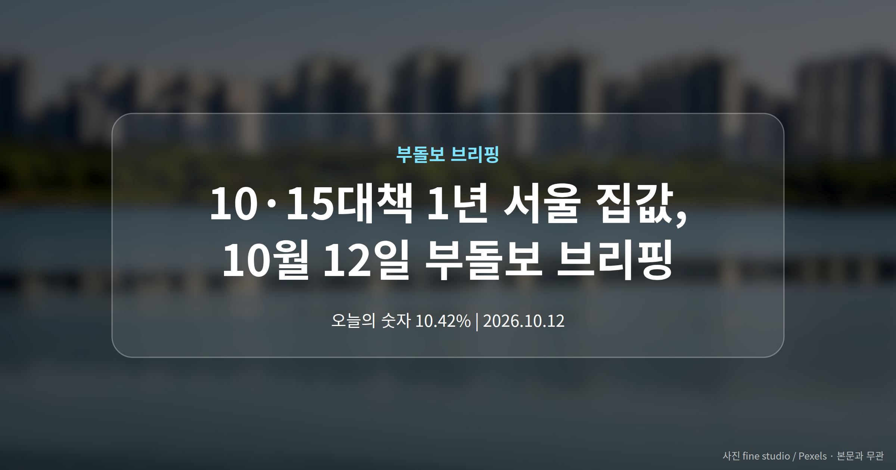
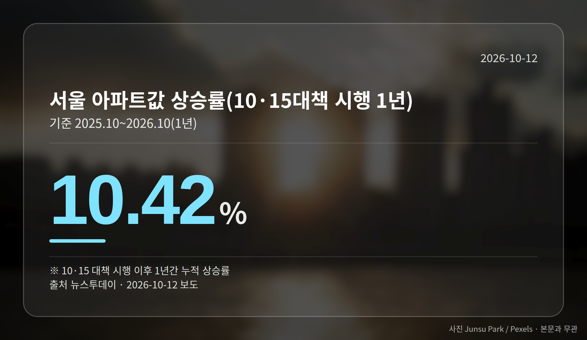
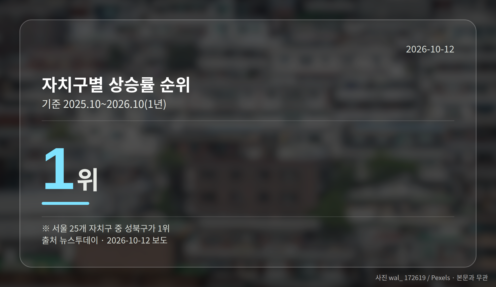
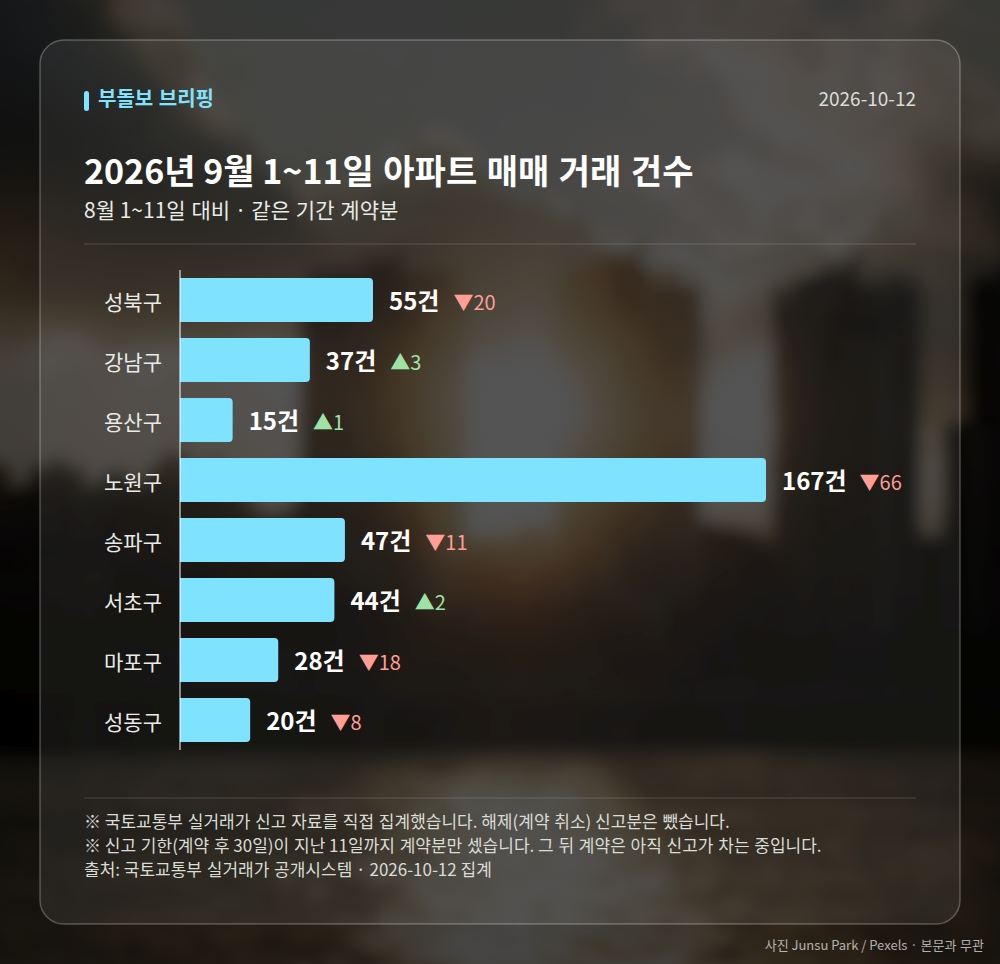

*이 글은 2026년 10월 12일 기준으로 정리한 내용입니다. 실거래 거래 건수는 2026년 9월 1~11일 계약분(신고 기한이 지난 것), 전세가율 등은 2026년 8월 신고분입니다.*
**3줄 요약**

- 대출 규제 중심 10·15 대책이 시행 1년을 맞았습니다
- 1년간 서울 아파트값 10.42% 상승, 성북구가 자치구 1위
- 강남권 위축·중저가 전셋값 동반 상승 흐름을 보면 됩니다
10·15대책 1년 서울 집값을 되짚는 보도가 하루에 여러 건 쏟아졌습니다. 결론은 대체로 비슷했습니다.

강남권은 눌렸지만 중저가·외곽 지역의 매매가와 전셋값은 오히려 올랐다는 진단입니다. '10·15 대책'은 2025년 10월 15일 시행된 대출 규제 중심의 부동산 대책입니다.

## 10·15대책 1년 서울 집값, 숫자로 보면

뉴스투데이는 대책 시행 이후 1년간 서울 아파트값이 10.42% 올랐다고 전했습니다. 25개 자치구 가운데 성북구가 상승률 1위였습니다.

| 항목 | 내용 | 출처 |
|---|---|---|
| 서울 아파트값 상승률(1년) | 10.42% | 뉴스투데이 |
| 자치구 상승률 1위 | 성북구 | 뉴스투데이 |
| 기간 | 2025.10~2026.10 | 뉴스투데이 |

한겨레와 연합뉴스TV는 서울 중저가·중하위권 아파트의 매매가와 전셋값이 뛴 것으로 보도했습니다. 같은 기간 강남권은 상대적으로 위축됐다는 평가가 연합뉴스TV와 아이뉴스24에서 나왔습니다.

## 강남이 아니라 외곽이 오른 이유는

대출을 조이는 규제가 고가 주택이 많은 강남권을 누르는 동안, 수요가 상대적으로 가격이 낮은 지역으로 옮겨간 것으로 해석될 수 있습니다. 이른바 풍선효과(한쪽을 누르면 다른 쪽이 부풀어 오르는 현상)의 가능성입니다.

연합뉴스TV는 '서울 집값은 오르고 공급은 제자리'라는 평가도 함께 전했습니다. 산경투데이 역시 '강남 잡았더니 서울 외곽 집값 급등'이라는 제목의 기사를 냈습니다.

[이미지: 서울 외곽 중저가 아파트 밀집 지역 전경 사진]

## 10·15대책 1년 서울 집값, 실수요자는 무엇을 볼까

눈여겨볼 지점은 매매가뿐 아니라 전셋값도 같이 올랐다는 대목입니다. 중저가 지역에 사는 실수요자에게는 주거비 부담으로 이어질 수 있는 부분입니다.

다만 이번에 보도된 기사 상당수가 제목 위주여서, 지역별 상승률이나 전셋값 상승 폭 같은 세부 수치는 확인되지 않았습니다. '중저가'와 '외곽'이 어디까지인지도 기사마다 달랐습니다.

그래서 앞서 본 상승률 하나로 내 지역을 단정하기보다, 흐름의 방향만 참고하시는 편이 안전합니다.

## 그 밖의 오늘 소식

- 서울시, 15일부터 2차 정비사업 아카데미 20회 운영
- HDC현대산업개발·삼성물산, 숙대입구역세권 조경 MOU 체결
- KCC건설 '향남역 그로브 스위첸' 견본주택 개관, 분양 시작

**그래서 나는?**

- 무주택 실수요자라면, 외곽 중저가 지역 전셋값 추이부터 확인해 보세요
- 1주택자라면, 내 자치구 상승률이 서울 평균과 어떻게 다른지 비교해 볼 시점입니다
- 전세 계약을 앞뒀다면, 중저가 지역 재계약 부담이 커질 수 있습니다

**직접 센 숫자 — 2026년 9월 1~11일 아파트 실거래**

서울 8개 구 계약 매매 **413건** (8월 1~11일 530건, -117건)

거래가 많은 곳: 성북구 55건(-20) · 강남구 37건(+3) · 용산구 15건(+1)

신고 기한(계약 후 30일)이 지난 11일까지 계약분끼리 견줬습니다.

성북구 전세가율 가운뎃값 **56.5%** (같은 단지·같은 면적 45곳)

서울 25개 구 가운데 거래가 가장 크게 움직인 곳: 은평구 +54.1%(74→114건, 응암동에 61.4% 몰림) · 강동구 -35.7%(84→54건)

2026년 9월 계약 신고가

- 노원구 시영3차(라이프)아파트 49.5㎡ — 6.5억 (이전 최고 5.4억, +20.2%, 9월 10일 계약)
- 송파구 송파현대힐스테이트 84.99㎡ — 16.5억 (이전 최고 14.0억, +17.9%, 9월 4일 계약)

*국토교통부 실거래가 신고 자료를 직접 집계했습니다. 해제 신고분은 뺐습니다.*
**여러분이 사는 자치구는 지난 1년 동안 서울 평균보다 많이 올랐나요, 덜 올랐나요?**

---

### 참고한 기사

1. **대출 묶은 ‘10·15 대책’ 1년…서울 중저가 아파트 매매·전셋값 뛰었다**
   - [한겨레](https://news.google.com/rss/articles/CBMiaEFVX3lxTFAwaF94VDlaR0Z1N015cXVGUnd1R3c3eDdIR0tsdkRFdFpLSTN1OWIwWmdGeDMzVFhMX1B5YUdrNGFQZDYxR2pjeURWWXFTWHhMekJ2UXk2a0ctRThycjl1dmF3eHJpQVhT?oc=5)
   - [연합뉴스TV](https://news.google.com/rss/articles/CBMiZ0FVX3lxTFBQRzNlZGJldmVnY3dIdWJaY0lkRFpXZk5uSWdkQ0JwdU1VSVZFOE9fLUFiUl9zOERqdGtuT3Z5NTVwR3RTREJEaFZlYnlnZnRiYWsyYWlMXzlJY0JRZ0I2bjVBYmE2RjQ?oc=5)
2. **모아타운, 조합설립… 서울시, ‘2차 정비사업 아카데미’ 15일부터 운영**
   - [웹이코노미](https://news.google.com/rss/articles/CBMickFVX3lxTE9qbUxfVEo5TnEtaG9Fa3NMQjhoY2J1b2l4czlyQ0RfTG9GR3VjckNpYlpHZWxSWGxhdmV3OWdIcFJTd3NEOE9teE9yQUYzMm01U2ctMmg3d3lSRVRRd0VOa2lUZHlDR2xLdjRaNUtXSU5EZw?oc=5)
   - [한국현대미술신문](https://news.google.com/rss/articles/CBMiWkFVX3lxTE9CN09fdDZCTnhMdndWN1lRU3RLanRyczFFdEo5V1FjRHRRUGZWZGQ3SU5kWDdCTERDN1dmdWxxazIwQmE3YnhBR1JuU0tQb05HZFJnZnU0dDRvdw?oc=5)
3. **IPARK현산·삼성물산 손잡고 … 숙대역세권 재개발 조경 특화**
   - [매일경제·부동산](https://www.mk.co.kr/news/realestate/12173018)
   - [뉴스웍스](https://news.google.com/rss/articles/CBMib0FVX3lxTFBxVUxuandSTUs2YVlBalV5azVDcEpENjFNeklnUlppNE80Y3ZzOTBwMHFpa19hYmhydUV3WDNYUkZneGxFVVBsOUFUeTRLeWZTbFhlZEVHc1JsZjA5RkxZTEtBMnNETGxyczlfcFh3SdIBc0FVX3lxTE00dUJJcmswempkblRKNVlJR185TDNwN1k1UGlwY1dvV0VRdVdwN0t5dThSZ2djaXI1ZWY5RDBzYS0tS2pfdkhIcGRYemlsQW80YndFbTJYOWlPN3hyRGYyeThUUWhSQ1JDaUdEUHZSdFdVWFE?oc=5)
4. **10·15 부동산 대책 1년…강남 잡았더니 서울 외곽 집값 급등**
   - [산경투데이](https://news.google.com/rss/articles/CBMicEFVX3lxTE5mWDctdHZTMzlORmhIbndvU3VMWExqUFBwOXU0ak9iaGdJdmpsM3VUYXA1UmNpVmdNd1hTQUhIaTU4aFlTLUZnSk5vZXRseEZyNHlqQ3padUtjajhnTUJkaUk0Yy10VmQ5NEw1dUk3SjfSAXRBVV95cUxNZnlWTGlvRUtURV9DS1IzMmZQbGdsREE4VmdhelpFSDc4M3VtVlBPSFBQYzFWaThoVHpHN2F3NUtaSE4zNGFtTjNjUXRoNHU2MFVhdVVfNzlOU29kUlE2NDZUd1BwM01WZXRtRDU1a19weDBmbg?oc=5)
5. **부동산 AD ‘향남역 그로브 스위첸’ 분양**
   - [현대일보](https://news.google.com/rss/articles/CBMibkFVX3lxTE1KUk1jLXg4UEZkR1dzNEZ2MVdRVWVrVVFWM1FTMXZNOC1ETXNPVmJFNFpJVmRuLTNZUjdjVDJNZFpZbkZWdXBDSXNaRWRHa2MwNGE1QWp4Vm16ZWh2a1A5dERra2hHcUlGbmMxMTFn?oc=5)
   - [인천일보](https://news.google.com/rss/articles/CBMicEFVX3lxTE9vYXlERm1DSXlpbG15anFXY2VxU0dKRnZrNm5ILWhjUFlXamNndGZzS0J4bDVHLXgzUm1kWTJUa3RtTjNabzZwU3NkUkg1M0M4TmpMR0ZtNkZhWVhqekRHa1dZbHNqUmtidWprcF8tdUg?oc=5)

---

*본 글은 공개된 언론 보도를 정리한 것이며, 투자 판단의 책임은 이용자 본인에게 있습니다.*
