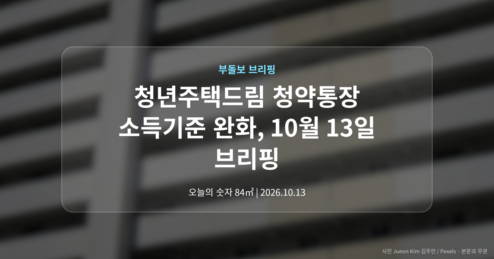
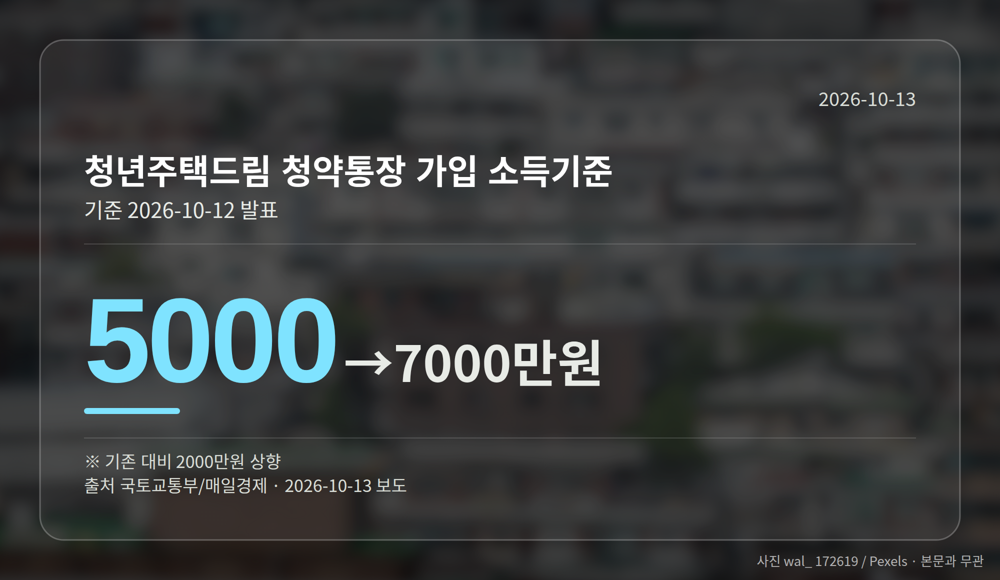
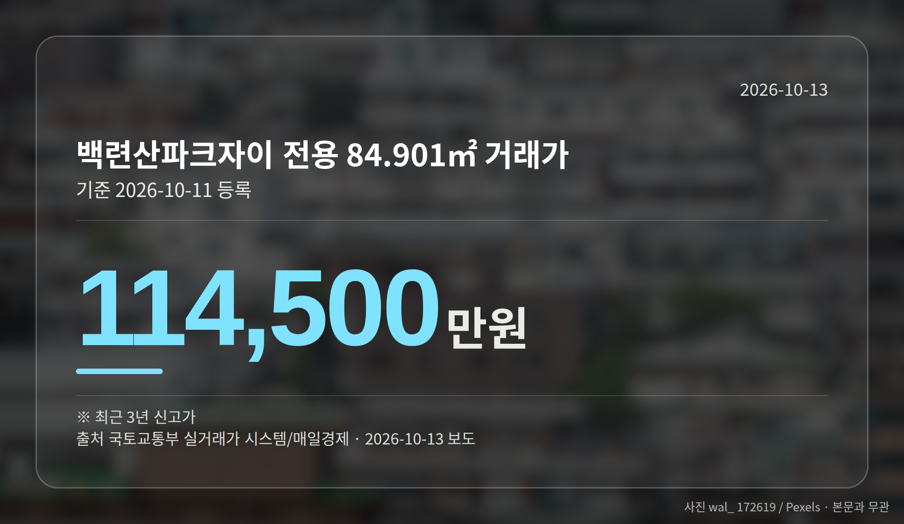
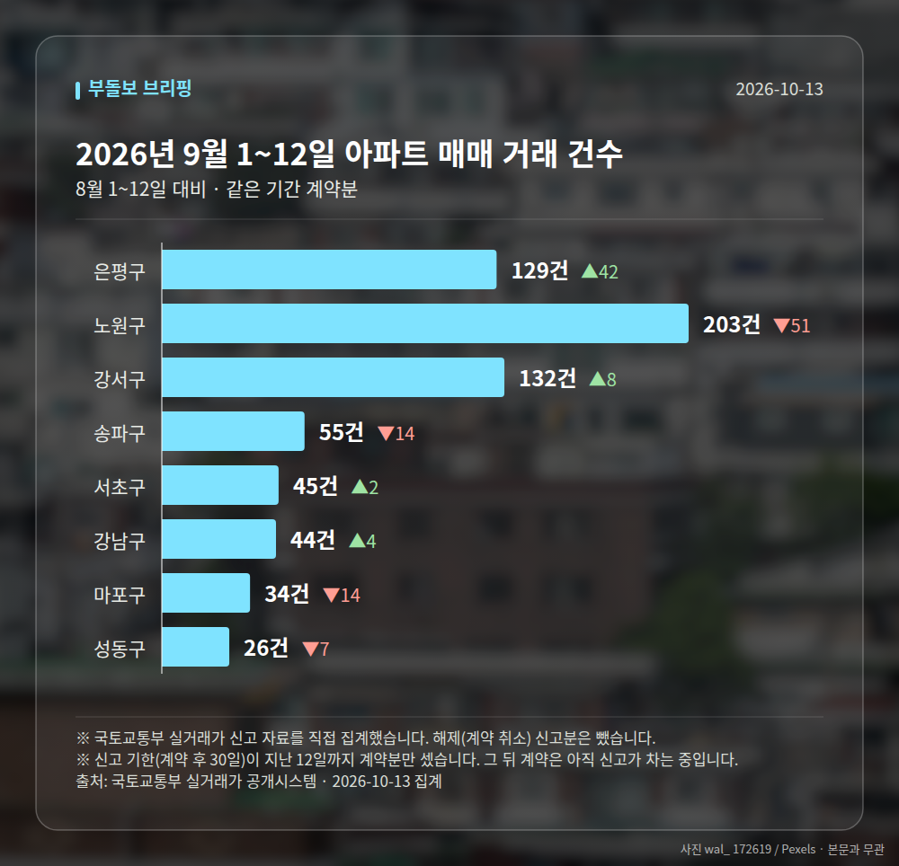

*이 글은 2026년 10월 13일 기준으로 정리한 내용입니다. 실거래 거래 건수는 2026년 9월 1~12일 계약분(신고 기한이 지난 것), 전세가율 등은 2026년 8월 신고분입니다.*
**3줄 요약**

- 국토부, 청년주택드림 청약통장 가입 소득기준 완화 발표
- 연 5000만원에서 7000만원으로, 2000만원 상향
- 디딤돌·버팀목 완화는 아직 예고 단계라 세부안 확인 필요
국토교통부가 청년주택드림 청약통장 소득기준을 연 5000만원에서 7000만원으로 완화한다고 어제 발표했습니다. 주거안정플랜 후속 조치입니다.

가입 문턱이 올라간 만큼, 그동안 소득 때문에 대상이 아니었던 분들은 다시 확인해 보실 만합니다.

## 청년주택드림 청약통장 소득기준, 어떻게 바뀌나

청년주택드림 청약통장은 청년 무주택자를 대상으로 만든 청약통장입니다. 이번에 달라지는 부분은 가입할 수 있는 연 소득 기준입니다.

| 구분 | 가입 가능 연 소득 |
| --- | --- |
| 기존 | 5000만원 |
| 변경 | 7000만원 |

(출처: 국토교통부·매일경제, 2026년 10월 12일 발표)

기준이 2000만원 올라가면서, 그 사이 구간에 있던 청년층이 새로 가입 대상에 들어옵니다. 중소득 실수요자에게는 선택지가 하나 늘어나는 셈입니다.

## 디딤돌·버팀목은 아직 '예고' 단계입니다

함께 전해진 내용은 디딤돌·버팀목 대출 기준도 완화될 예정이라는 보도입니다. 디딤돌은 집을 살 때, 버팀목은 전세보증금을 마련할 때 낮은 금리로 빌려주는 정책 대출입니다.

다만 시행일과 세부 조건은 기사에 나오지 않았습니다. 지금 단계에서 한도나 금리를 미리 계산해 두기는 어렵다는 뜻입니다.

[이미지: 은행 창구에서 주택 자금 상담을 받는 30대 부부의 모습]

## 청년주택드림 청약통장 소득기준 완화와 엇갈린 시장 신호

같은 시기 국정감사에서는 이성훈 LH 사장이 "집값 급락 가능성"을 언급했습니다. 앞서 대출을 더 죄어야 한다는 취지로 한 발언에 대해 해명을 요구받고 나온 답변입니다.

발언의 근거나 시점, 지역 범위는 제시되지 않았습니다. 반대로 서울 은평구에서는 신고가 거래가 나왔고요.

청약 문턱은 낮아지는데 대출 쪽 메시지는 조이는 방향입니다. 한쪽만 보고 판단하기 어려운 국면이라고 보는 편이 안전합니다.

## 그 밖의 오늘 소식 — 은평구 신고가와 정비사업

- 은평구 백련산파크자이 84.901㎡, 11억 4500만원 신고가
- 은평구 응암푸르지오 84.2㎡, 8억 7800만원 신고가
- 삼성물산, 반포푸르지오 리모델링 제안·24일 시공사 선정 총회

**그래서 나는?**

- 무주택 청년이라면, 연 소득 7000만원 기준으로 가입 대상인지 먼저 확인해 보세요
- 전세 계약을 앞뒀다면, 버팀목 기준 완화 세부안 발표 시점을 지켜볼 만합니다
- 은평구 아파트 보유자라면, 단일 신고가 두 건이라는 점을 함께 보셔야 합니다

**직접 센 숫자 — 2026년 9월 1~12일 아파트 실거래**

서울 8개 구 계약 매매 **668건** (8월 1~12일 698건, -30건)

거래가 많은 곳: 은평구 129건(+42) · 노원구 203건(-51) · 강서구 132건(+8)

신고 기한(계약 후 30일)이 지난 12일까지 계약분끼리 견줬습니다.

은평구 전세가율 가운뎃값 **54.8%** (같은 단지·같은 면적 35곳)

서울 25개 구 가운데 거래가 가장 크게 움직인 곳: 은평구 +48.3%(87→129건, 응암동에 58.1% 몰림) · 강동구 -31.5%(89→61건)

2026년 9~10월 계약 신고가

- 송파구 현대백조 31.0㎡ — 8.3억 (이전 최고 6.8억, +22.1%, 10월 7일 계약)
- 노원구 시영3차(라이프)아파트 49.5㎡ — 6.5억 (이전 최고 5.4억, +20.2%, 9월 10일 계약)

*국토교통부 실거래가 신고 자료를 직접 집계했습니다. 해제 신고분은 뺐습니다.*
**여러분은 이번 소득기준 완화로 새로 가입 대상에 들어오셨을까요, 아니면 이미 통장을 갖고 계신 쪽일까요?**

---

### 참고한 기사

1. **청년주택드림 청약통장, 연 소득 7000만원까지 가입 가능해져**
   - [에너지경제신문](https://news.google.com/rss/articles/CBMiYkFVX3lxTFBRc1lnWkVHSEJhejJfN2dKS05nS0FFdUtlaTViOHVUU1B0Qks5RkhJQlBFaFBhUUpadzhLWU4zWEZDZWs1STJNOGZEU2E1SVdtQ1BQRlFDWUhXWlphYWwtWk9n?oc=5)
   - [남도일보](https://news.google.com/rss/articles/CBMibEFVX3lxTE40ckdzQlpMb29RNmtmUmdNRWVfSlFOS00tYl9sM254RHJBN1psQ1p5eVEzaUZpdTNTM2pHUjU0NU5GTG02VmN2akxYVl9mSFJoN09QTmJobjhPeXdrUUtUU2NVbTdFSkFoZVBnetIBcEFVX3lxTE1uc3hLZlF2YVhVXzBXNzlkY1ZDdlh1OFZDSmtNMnVEb040akxEck9oeENNc05vRjFjSlNpVmZwV01KV054QldoajkwRkcya2dTQnVyQWllSGh0ZlJIUU5GMEtQTWs3UGNIaDY4cGhPR3Y?oc=5)
2. **"대출 더 죄야" 발언 LH 사장, 이번엔 "집값 급락 가능성"**
   - [조선일보](https://news.google.com/rss/articles/CBMiiAFBVV95cUxOSXNjelAwWWhZNjBwTlVkdHJ4WS0xdHBEME8zdEJWYlZPWVdCaEM2MkpiX0NnMW9yQUZvX3VtanJhZ09hbGhSekJXVm81NERVN19xNjh6akJMa3NtVVItSnNiWGRQN0tmbDNuTE5vWW82QVJHLVRUYk9DcHR2aXZpRkRneWRPMWt3?oc=5)
   - [공공뉴스](https://news.google.com/rss/articles/CBMiakFVX3lxTE1Ocy1kcXppcjl5ZjUwUVM2UWhBT21tUVlESkVKWEZjc0dHTUhpbWZVZS1xTENoRW5ORTUzNUF5cWFqdVhJSDBmUW82a19CUWhsR0RrSlphTFFrLWV6alh2a25ic2pJS0hSVkHSAW5BVV95cUxQTlhNRHBtZ25mWVBrOXpnX05FVXM1WUJlZUNnTkxRX0VIbjJmSHIyWkVzbGVtM1hDcnBxOHFaUUhhOHRURlV0bDhOM2RPS25PVlp2Mm90anMzeGxNeEtqWFJpaTdST3VJT2k4bVNoUQ?oc=5)
3. **서울시, 재개발·재건축 궁금증 해결… 아카데미 2차 운영**
   - [송파타임즈](https://news.google.com/rss/articles/CBMib0FVX3lxTE5iR010NUtzVHVLVnlaVko0STRQbXdDMWRPelNPY3VOZi1ENUs2UDV2MFkyOFhkVE04ZWttcDEteXVMQm4tZVd4OEFPNmlDY3piTXlCSnctZW8zQ3l6N0NBYTdrRk9XaG91R0k3cHZoYw?oc=5)
   - [더구루](https://news.google.com/rss/articles/CBMiY0FVX3lxTFBHUVgzc0ZqWkcyMWhfN3hSWG82WG1RdEZJd21hWkxHNnVIRkJLbTFubkRZSmFGUTJaSnVrSWZIMFNiV3JVOWxrZjhqMGlYSHZ3bjExVWlfdGFIUjdTVXR0ck50VQ?oc=5)
4. **삼성물산 넥스트 리모델링 1호 반포 푸르지오 아파트…벽식구조 한계 깬 평면 개발**
   - [매일경제·부동산](https://www.mk.co.kr/news/realestate/12173569)
   - [한국경제·부동산](https://www.hankyung.com/article/202610126035i)
5. **은평구 백련산파크자이 84.901㎡ 11억 4500만원… 최근 3년 신고가 [MAI부동산]**
   - [매일경제·부동산](https://www.mk.co.kr/news/realestate/12173315)

---

*본 글은 공개된 언론 보도를 정리한 것이며, 투자 판단의 책임은 이용자 본인에게 있습니다.*
