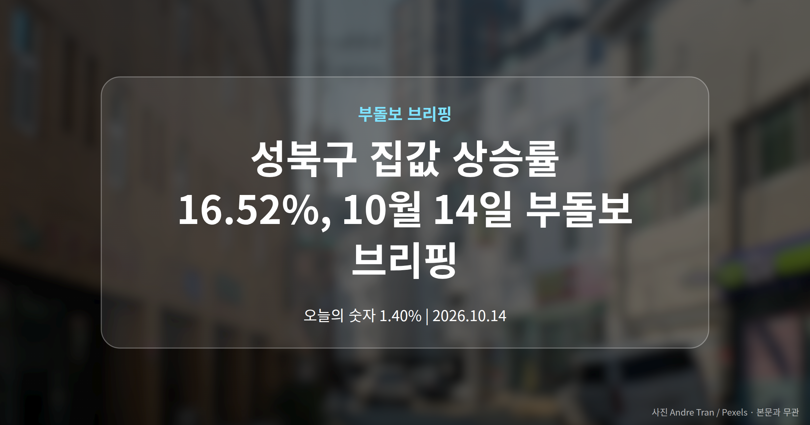
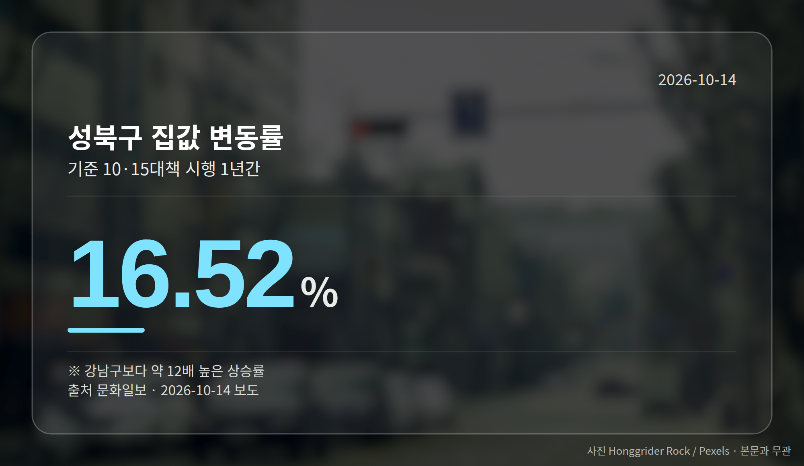
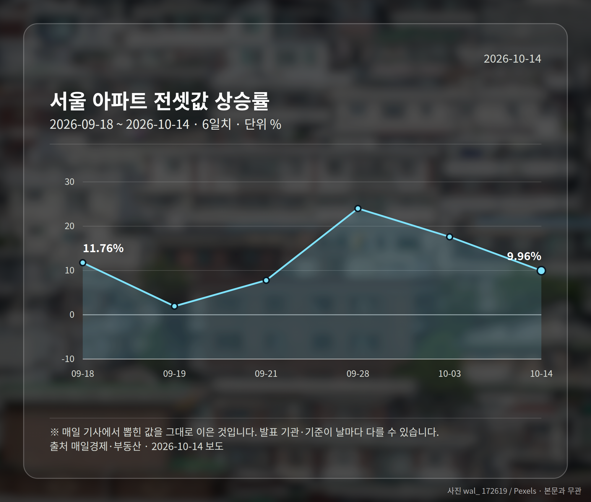
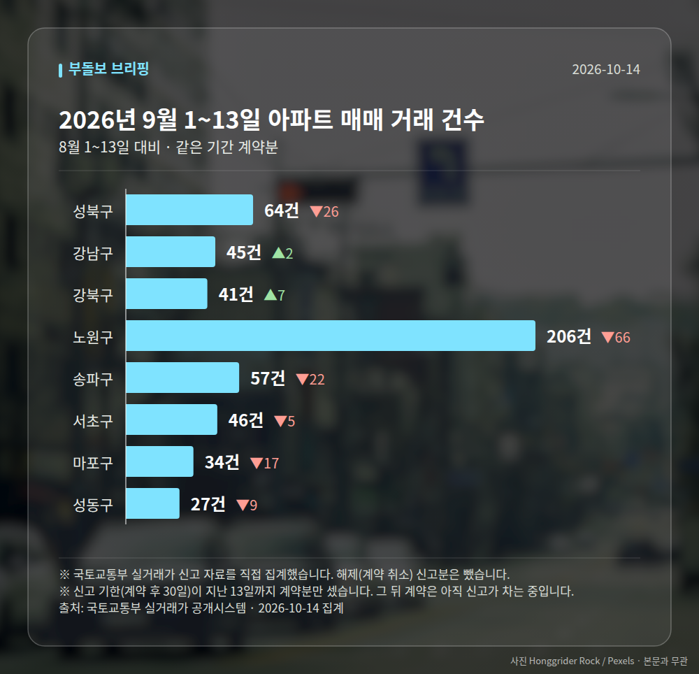

*이 글은 2026년 10월 14일 기준으로 정리한 내용입니다. 실거래 거래 건수는 2026년 9월 1~13일 계약분(신고 기한이 지난 것), 전세가율 등은 2026년 8월 신고분입니다.*
**3줄 요약**

- 10·15대책 시행 1년, 지역별 집값 격차가 더 벌어졌습니다
- 성북구 16.52% 상승, 강남구는 1.40%로 10배 이상 차이
- 전셋값 9.96% 상승과 LH 착공 26% 이행률을 함께 보세요
10·15부동산대책이 시행된 지 1년이 지났습니다. 성북구 집값 상승률은 16.52%인데 강남구는 1.40%에 그쳤다고 문화일보가 보도했습니다.

같은 서울 안에서 상승폭이 10배 이상 벌어진 셈입니다. 오늘은 이 격차를 중심으로 짚어 보겠습니다.

## 성북구 집값 상승률이 강남구의 12배가 된 배경

여러 매체가 대책 1년 결산 기사를 내놨는데, 공통된 평가는 "투기 수요는 줄었지만 집값 상승세는 꺾이지 않았다"는 쪽이었습니다.

갭투자(전세보증금을 활용해 적은 자기자본으로 집을 사는 방식)는 줄었지만, 집값과 전셋값이 함께 뛰었다는 진단입니다.

| 지역 | 1년 변동률 | 출처 |
| --- | --- | --- |
| 강남구 | 1.40% | 문화일보 |
| 성북구 | 16.52% | 문화일보 |
| 성북구(다른 표기) | 16.5% | 더퍼블릭 |

성북구 수치는 매체에 따라 16.52%와 16.5%로 조금 다르게 적혔습니다. 반올림 차이로 보이지만, 수치를 인용하실 때는 출처를 함께 확인하시는 편이 좋습니다.

문화일보는 대출 규제가 지역별 집값 지도를 바꿔놓았다고 분석했습니다. 규제가 집중된 강남보다 상대적으로 덜했던 지역으로 수요가 옮겨간, 이른바 풍선효과(한쪽을 누르면 다른 쪽이 부푸는 현상)의 가능성이 거론되는 대목입니다.

[이미지: 서울 아파트 단지와 주택가가 함께 보이는 전경 사진]

## 전셋값 9.96%, 한강벨트는 식고 노도강은 올랐습니다

서울 전체 집값은 10% 올랐다는 보도가 한국일보·뉴닉·충청메트로에서 공통으로 나왔고, Queen 이코노미퀸은 10.4%로 적었습니다. 전셋값도 매일경제 기준 1년 새 9.96% 올랐습니다.

매일경제는 한강벨트가 식는 사이 노도강(노원·도봉·강북 등 외곽권)은 상승세를 보였다고 전했습니다. 성동·마포·광진 거래량은 절반 이하로 줄었습니다.

한국일보는 서울 외곽 전세 매물이 반토막 났다고 보도했습니다. 다만 구체적 건수는 제시되지 않았습니다.

가격 부담 때문에 실수요가 외곽 중저가 지역으로 옮겨가는 흐름으로 읽히는데, 이는 앞서 본 성북구 집값 상승률과도 맞물려 있습니다.

## 그 밖의 오늘 소식

- LH 착공 실적, 연간 목표의 26% 수준이라는 국감 지적
- 국감서 여야 모두 규제 강화보다 공급 이행 주문
- 입주절벽 속 일부 분양권·입주권 신고가 기록

앞으로는 LH의 연말 착공 목표 이행 여부와 국감 후속 공급 논의가 지켜볼 지점으로 꼽힙니다.

**그래서 나는?**

- 무주택 실수요자라면, 강북·외곽 진입 문턱이 올라갔는지 먼저 확인해 보세요
- 전세 계약을 앞뒀다면, 외곽 전세 매물 감소 흐름을 미리 살펴볼 필요가 있습니다
- 1주택자라면, 내 지역이 상승권인지 정체권인지 구분해 보는 게 출발점일 수 있습니다

**직접 센 숫자 — 2026년 9월 1~13일 아파트 실거래**

서울 8개 구 계약 매매 **520건** (8월 1~13일 656건, -136건)

거래가 많은 곳: 성북구 64건(-26) · 강남구 45건(+2) · 강북구 41건(+7)

신고 기한(계약 후 30일)이 지난 13일까지 계약분끼리 견줬습니다.

성북구 전세가율 가운뎃값 **56.5%** (같은 단지·같은 면적 45곳)

서울 25개 구 가운데 거래가 가장 크게 움직인 곳: 은평구 +36.5%(96→131건, 응암동에 57.3% 몰림) · 강동구 -34.7%(95→62건)

2026년 9~10월 계약 신고가

- 송파구 현대백조 31.0㎡ — 8.3억 (이전 최고 6.8억, +22.1%, 10월 7일 계약)
- 노원구 시영3차(라이프)아파트 49.5㎡ — 6.5억 (이전 최고 5.4억, +20.2%, 9월 10일 계약)

*국토교통부 실거래가 신고 자료를 직접 집계했습니다. 해제 신고분은 뺐습니다.*
**여러분이 사는 동네는 지난 1년 사이 강남 쪽에 가까운 흐름이었나요, 성북 쪽에 가까운 흐름이었나요?**

---

### 참고한 기사

1. **10·15부동산대책 1년, 강남구 1.40% 오를 때 성북구 16.52% 올랐다**
   - [문화일보](https://news.google.com/rss/articles/CBMiUEFVX3lxTE9ocjVaVG0wS2pQZllOdEpwTFdmRDBYTC1aYUJ2VHJNWEI1TkM2WE5YQTJENGZ6eHNrS1gxUGtsTDFkTUFTM3F4eEJLRkwxZlBM?oc=5)
   - [핀포인트뉴스](https://news.google.com/rss/articles/CBMic0FVX3lxTFBzYUs5MW1QWDJsYkdtS2xWQmpiZUxIMC1TRk9fS2VfYXRzSG1MZ213SUEtX2lHaU81UHhTdDZ4UnBfaEFXeVlmeFBMOVZlQ2IyUlhEUUg3R2tJOFdfQ185anE1SFdTUUp0T3h5RzFyRWNZNEXSAXdBVV95cUxPVjZ5Y0hUVTBnd1RhS3JTUGNod1dFZmJVdFRMODI4NzZ6VU1GR25MM2tmZ1JYSnFLUkd0UHYxTlBYVlpYZjd1YloxclRjTHNJNW53UF9rSzJMZVpkclFyd3FLbmJNS2JHaVZIYlh4eVdycERJelZ5dw?oc=5)
2. **규제지역 넓힌 '10·15 대책' 1년... 서울 집값 10% 오르고 외곽 전세 매물은 반토막**
   - [한국일보](https://news.google.com/rss/articles/CBMibkFVX3lxTE1nVy1pQzFYMkJUMVZSQ01oMWJ2eUdWZnVidzMwQnVNeFVrVHNnaDdTdDhTZ1A5WDB0RTZuRjNiTUczTzBTd0xKUjRhM0diSUdWejBLUjE3V3ZuVGkwNFdUa3NGS3NSVmgyaWNpMTl30gFzQVVfeXFMTWNUTkdhWEdLc3BGek5lR2NhOVBpTy12b3V4dG8zUmhLcl9yTEZqUmhWam5teW9GZ1RIZ3BrYWRRUURlSmswLWtzTHlVd05DcV9HWVBwanZpY0xqLWtfVVVPejJDWFNCV0NWbFdxTWRUMHBQcw?oc=5)
   - [뉴닉](https://news.google.com/rss/articles/CBMiU0FVX3lxTE5mUFJEQU90N3NDb05Sd0pJYnp3OG95TUhmeHFmQWlOenVVMzlfRzQxb3N0dkJMLWdOTWFnd2pHdTVyYlpfN21VV0FiUUh3LXhtY2E0?oc=5)
3. **대출 규제는 유지, 공급은 연말 집중…국감서 드러난 주택정책**
   - [매일경제·부동산](https://www.mk.co.kr/news/economy/12174227)
4. **“지금 서울 아파트값, 평탄화예요? 양극화예요?”…부동산 온도차 커져**
   - [매일경제·부동산](https://www.mk.co.kr/news/realestate/12174206)
5. **"거래 줄었는데 신고가"…입주절벽에 분양권·입주권 몸값 '껑충'**
   - [뉴시스](https://news.google.com/rss/articles/CBMiYEFVX3lxTE9pWm5RT1lzQmdTRHEzLXRxVHNNWUR5T0V0T1dXZkZ1S2hPUy1qdXhLdEZIempYRVBLX3FRMUdSZXNiR1prdTVTbWRpSWN4WmYyTEpTdmNuNVR3UDNpd3hQaNIBeEFVX3lxTE9ZRXZYMkwzUGwyYnJYaWhPelZNb0pLemJPaUxKZFlyUVFaWFlndEx3Y3ZPbDcxSGpZVFBFLUJleXdyZi1rMUczNWhSTENYY1RPNV9rVXJpZHJuUmh3Y2RXWUhKVGE2QmUzR0xELUVEZHVaRUlCLTNPbg?oc=5)

---

*본 글은 공개된 언론 보도를 정리한 것이며, 투자 판단의 책임은 이용자 본인에게 있습니다.*
