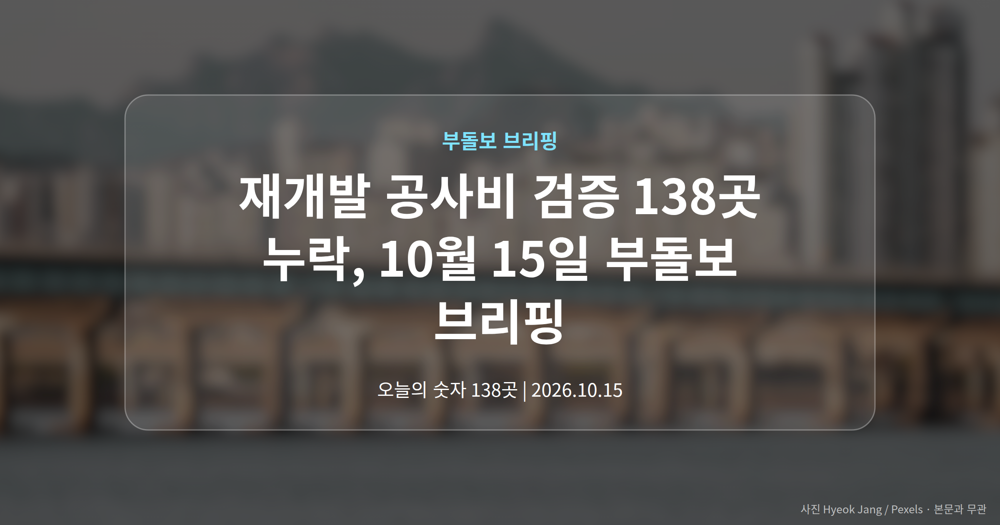
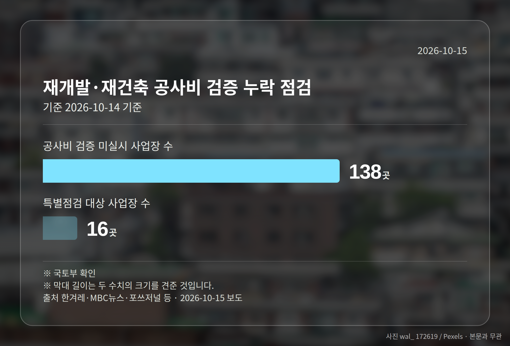
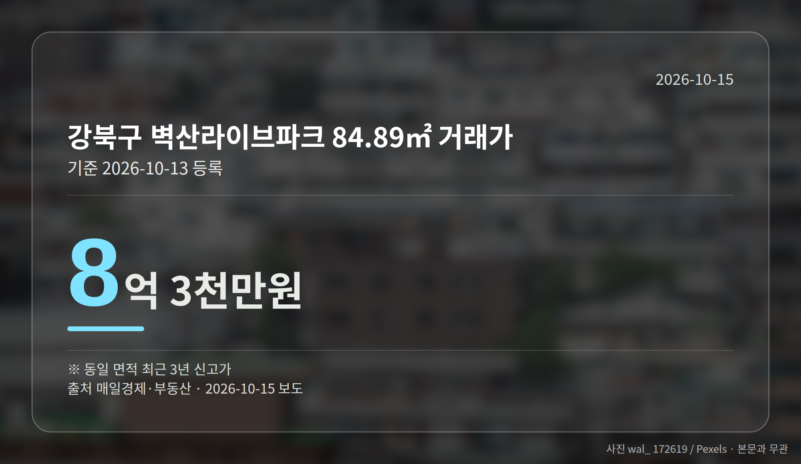
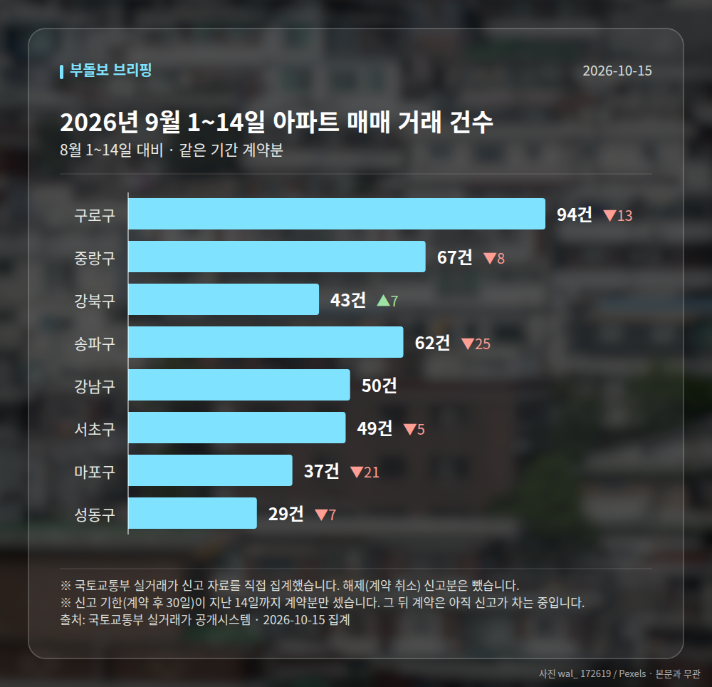

*이 글은 2026년 10월 15일 기준으로 정리한 내용입니다. 실거래 거래 건수는 2026년 9월 1~14일 계약분(신고 기한이 지난 것), 전세가율 등은 2026년 8월 신고분입니다.*
**3줄 요약**

- 국토부, 재개발 공사비 검증 누락 사업장 138곳 확인
- 이 중 16곳 특별현장점검 착수, 10·15 대책 1년 평가는 48.9점
- 정비사업 조합원이라면 내 사업장 검증 여부부터 확인
10월 15일 부동산 뉴스의 중심은 재개발 공사비 검증입니다. 국토교통부가 법으로 정해진 공사비 검증을 받지 않은 재개발·재건축 사업장 138곳을 확인하고, 이 가운데 16곳에 특별현장점검을 시작했습니다.

같은 날 10·15 부동산 대책 시행 1년을 맞아 시장 평가가 48.9점에 그쳤다는 보도도 나왔습니다. 규제와 실제 가격 흐름 사이의 온도차가 함께 드러난 하루였습니다.

## 재개발 공사비 검증 138곳 누락, 무슨 일인가

공사비 검증은 조합이 시공사와 정한 공사비가 적정한지 외부 기관의 확인을 받는 절차입니다. 일정 요건에 해당하면 법에 따라 반드시 거쳐야 합니다.

국토부 확인 결과, 이 절차를 거치지 않은 사업장이 아래와 같이 집계됐습니다.

| 구분 | 수치 | 기준 |
|---|---|---|
| 공사비 검증 미실시 사업장 | 138곳 | 10월 14일 기준, 국토부 확인 |
| 특별점검 착수 사업장 | 16곳 | 국토부 착수 |

여러 매체는 치솟는 공사비 문제가 이번 점검의 배경이라고 전했습니다. 다만 138곳의 구체적 지역명과 점검 항목, 일정은 아직 확인되지 않았습니다.

## 재개발 공사비 검증이 조합원에게 뜻하는 것

공사비는 결국 조합원 분담금으로 이어집니다. 검증 절차가 빠졌다면 분담금이 어떤 근거로 산정됐는지 설명이 부족할 수 있습니다.

그래서 정비사업을 추진 중인 단지에 계시다면, 내 사업장이 재개발 공사비 검증 대상인지, 실제로 검증을 받았는지부터 확인해 보시는 편이 좋습니다. 조합 총회 자료나 공사비 변경 안내문이 출발점이 됩니다.

국토부는 같은 16개 사업장을 대상으로 위법행위 특별점검도 함께 진행한 것으로 보도됐습니다. 정비사업 현장에 대한 정부 관리 강도가 높아지는 흐름으로 읽힙니다.

[이미지: 재개발 구역의 노후 주택과 공사 현장 사진]

## 강북구·중랑구 아파트도 신고가, 10월 13일 등록 거래

한편 10월 13일 실거래가 시스템에 새로 등록된 거래에서는 서울 비강남권 신고가가 여러 건 확인됐습니다. 강북구 미아동 벽산라이브파크 전용 84.89㎡가 8억 3천만원에 거래됐습니다.

중랑구 신내동 동성1 전용 59.4㎡는 6억 8천만원, 용산구 도원동 삼성래미안 전용 114.99㎡는 21억 8천만원이었습니다. 모두 같은 면적 기준 최근 3년 신고가입니다.

다만 개별 단지 사례의 나열이어서 자치구 전체의 가격 추세로 보기는 어렵습니다.

## 그 밖의 오늘 소식

- 10·15 대책 1년 시장 평가 48.9점 보도(파이낸셜뉴스)
- 종부세(공시가격 합이 기준을 넘으면 내는 세금) 강화가 헛바퀴 돌았다는 지적
- 서울 입주절벽 속 입주권·분양권 가격 상승세 보도

**그래서 나는?**

- 재개발 조합원이라면, 내 사업장의 공사비 검증 여부부터 확인해 보세요
- 1주택자라면, 강북·중랑구 신고가는 개별 사례임을 함께 보셔야 합니다
- 무주택 실수요자라면, 대책 1년 평가와 공급 보도를 같이 살펴볼 시점입니다

**직접 센 숫자 — 2026년 9월 1~14일 아파트 실거래**

서울 8개 구 계약 매매 **431건** (8월 1~14일 503건, -72건)

거래가 많은 곳: 구로구 94건(-13) · 중랑구 67건(-8) · 강북구 43건(+7)

신고 기한(계약 후 30일)이 지난 14일까지 계약분끼리 견줬습니다.

구로구 전세가율 가운뎃값 **56.0%** (같은 단지·같은 면적 40곳)

서울 25개 구 가운데 거래가 가장 크게 움직인 곳: 양천구 -36.9%(65→41건, 8월 1~14일엔 신정동에 49.2% 몰렸음) · 강동구 -36.5%(104→66건)

2026년 9~10월 계약 신고가

- 중랑구 엘지,쌍용아파트 84.67㎡ — 9.3억 (이전 최고 7.5억, +23.6%, 9월 2일 계약)
- 송파구 현대백조 31.0㎡ — 8.3억 (이전 최고 6.8억, +22.1%, 10월 7일 계약)

*국토교통부 실거래가 신고 자료를 직접 집계했습니다. 해제 신고분은 뺐습니다.*
**여러분이 살고 계신 동네의 정비사업은 공사비 안내가 어떻게 이뤄지고 있나요?**

---

### 참고한 기사

1. **재개발·재건축 138곳 공사비 검증 안 했다…16곳 특별점검**
   - [코리아리포트](https://news.google.com/rss/articles/CBMicEFVX3lxTE0wRWtKbmNSVjBCY1U3Q0lSSENwWnJOT1lFWUVTNG5nTldvYW9Bd01DTWRrNkwza1VqanIxWU44Um1zN3I0OWFvTUtSN1lNREdjVEhJNUd1cnJPcnp1OE5XbVc3TXFDQmZ1dnp2LV81SV8?oc=5)
   - [SR타임스](https://news.google.com/rss/articles/CBMiaEFVX3lxTE9sWXlXM3c1T285bVlQTkpDdVJVMlZVVkZyODlyVjJBQ3Q5Z2M0d3FQTmtJQTkyMlJQV205V1F2QzhaXzNJb2pLUDFBSnNqRDFxcjdUeE9pVWJadGJac1lGWnFVTmJOcDFG?oc=5)
2. **강북구 벽산라이브파크 84.89㎡ 8억 3천만원 거래… 최근 3년 신고가 [MAI부동산]**
   - [매일경제·부동산](https://www.mk.co.kr/news/realestate/12175183)
3. **약발 안 먹히는 고강도 규제… 주택공급 확대 ‘시험대’ [10·15 부동산 대책 1년]**
   - [세계일보](https://news.google.com/rss/articles/CBMiVEFVX3lxTE9Yd2wxREd3Z3NiVXpHUUxycjB3dGx6RlBMSmVqbFc5YV9FRU01N2FWUDgyUHhZZXBheWdQeGF1YmRMb3JqZC1USDVhcXVPaVNYUTBGV9IBVEFVX3lxTE9Yd2wxREd3Z3NiVXpHUUxycjB3dGx6RlBMSmVqbFc5YV9FRU01N2FWUDgyUHhZZXBheWdQeGF1YmRMb3JqZC1USDVhcXVPaVNYUTBGVw?oc=5)
   - [파이낸셜뉴스](https://news.google.com/rss/articles/CBMiWkFVX3lxTE5VQnJ0V0lNRzFRMHllY1p2S25FR3J4azlPdjFtZFhWdHlCQzhBekhoVVhIRU1JVnRUWUpjYUNFVFI2eGdHWE5scGdKVklzTjhmdlhFVFRTLXd1UQ?oc=5)
4. **재개발·재건축 ‘위법행위’ 현장 단속**
   - [애플경제](https://news.google.com/rss/articles/CBMicEFVX3lxTE5yZ3FmeE5raTRWWlp3RWR5X3JsOTIzc0ZlYkdhN2VsQTR5UDVpbnRqTUZYcmVJVVpvMUlNdG8yX1lBU05lM1JRTzVCMDVPWExrUHdJVEJoN2oyQThaczZSYl9iZmhuUjJTQlJjX0d3aE8?oc=5)
   - [대한경제](https://news.google.com/rss/articles/CBMidEFVX3lxTE9mV2NJTlJBODJmay1TdkVyaEFTczdPLUwyNHNTbkJGaHhYTHRWMF92S3hLOEthSHM4MlZZZ3JQZVF1ODV4a3d4VnpyZ1RTMzFyUTBwQ0JLSlpyQkpxcXJVSWJNaWQzLVAxZzluX0x6UkowOVJT?oc=5)
5. **서울 아파트 입주절벽 현실화…입주권·분양권 신고가 속출**
   - [팩트인뉴스](https://news.google.com/rss/articles/CBMicEFVX3lxTE9UVmxOaGxkbHNQY1NOSjZ5c190Y0VRb3FSLXFQRVVXUUNmREJzLVBXeVhtU2RPTWFheUwza1JSek9LbXdmTjM2Y1lSWUtZcnl1TTRjeTZFOUhCbVVBWHFjMWJXU2tWOXBoVXB5RnA2ZlLSAXRBVV95cUxQS3VBcmxvTnNhMXJ2ZW9iUGk2Q3Jna0h3VnJiYWFlUHRQc1RaUWVxMllXcEVkeG9HaUZ5S1pueUVKWlV1NzBPbzZmMkdhTkdLWmo5eVlvY3dFTl94VXBrd0h0b0dneGdOdFpCbGJ6bVBPTmtWUQ?oc=5)
   - [서울뉴스통신](https://news.google.com/rss/articles/CBMia0FVX3lxTE1hV1hIbEgzbVpLOGxQbldqZl9zSjhfMk5wSjNIZFZ3bDJORW5hOWZEODRMRldVV1lFQzJ4UlFUQ3hkbEJDMFRZZU1JdE5SMjFBUEJNQ2pzcDFCOEdjZmlZTDR5dDQxcHhSUjNr?oc=5)

---

*본 글은 공개된 언론 보도를 정리한 것이며, 투자 판단의 책임은 이용자 본인에게 있습니다.*
