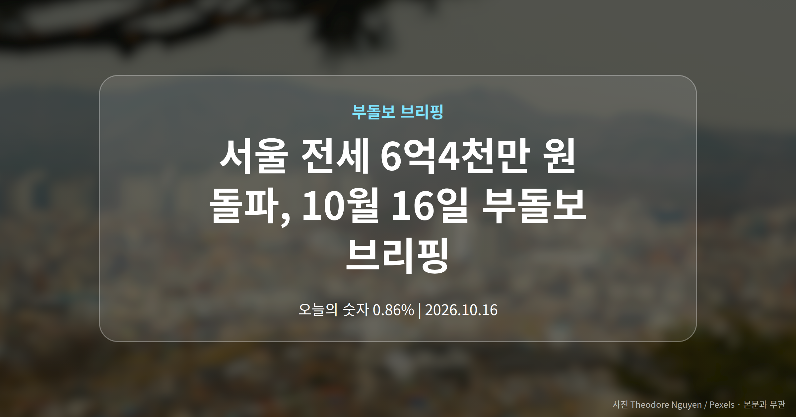
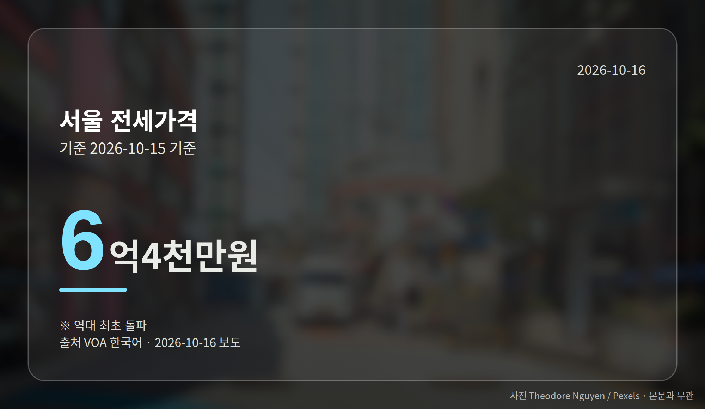
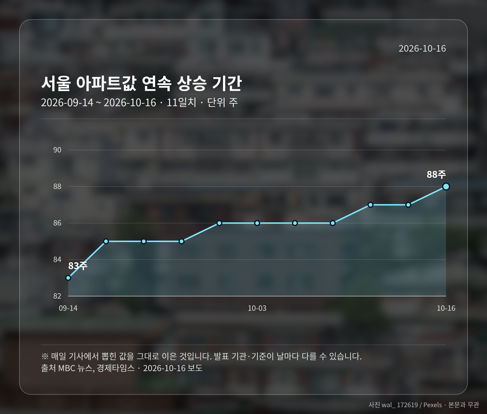
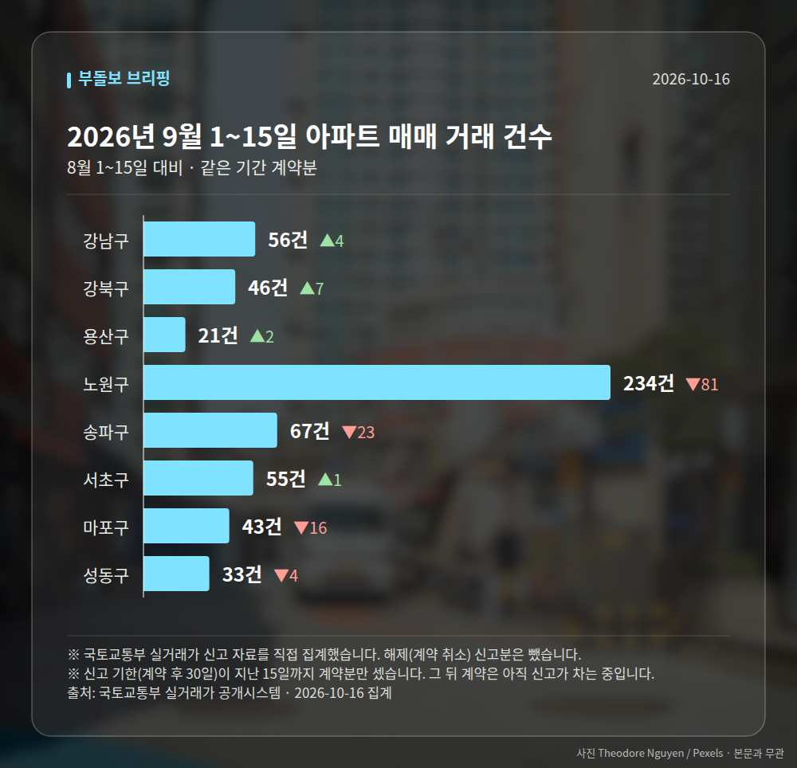

*이 글은 2026년 10월 16일 기준으로 정리한 내용입니다. 실거래 거래 건수는 2026년 9월 1~15일 계약분(신고 기한이 지난 것), 전세가율 등은 2026년 8월 신고분입니다.*
**3줄 요약**

- 10·15 대책 1년, 서울 전셋값이 처음 6억 원대 중반을 넘었습니다.
- 서울 전세 6억4천만 원, 서울 아파트값은 88주 연속 상승입니다.
- 전세 만기와 아파트 밖 대안 수요 이동을 함께 보셔야 합니다.
오늘 브리핑의 중심은 전세입니다. 서울 전세 6억4천만 원이 역대 처음으로 돌파됐고(VOA 한국어), 서울 아파트 매매가격은 88주 연속 상승을 이어갔습니다.

10·15 부동산 대책이 시행 1년을 맞은 시점이라 더 눈에 띄는 숫자입니다. 여러분이 체감하는 '전세금 올려줘야 하는 상황'이 통계로도 확인된 셈입니다.

## 서울 전세 6억4천만 원, 어떤 숫자인가

이번에 나온 수치는 서울 전세가격이 사상 처음 6억4천만 원 선을 넘었다는 내용입니다. 같은 시점 서울 아파트 매매가격은 88주 연속 상승 기록을 썼습니다(MBC 뉴스, 경제타임스).

여기에 또 하나의 숫자가 붙습니다. 아파트 매수가 어려워지면서 서울 연립·다세대 '생존매수'가 19% 늘었다는 보도입니다(헤럴드경제).

| 항목 | 수치 | 기준 |
| --- | --- | --- |
| 서울 전세가격 | 6억4천만 원 돌파 | 2026-10-15, 역대 최초 |
| 서울 아파트값 연속 상승 | 88주 | 2026-10-15 |
| 서울 연립·다세대 생존매수 | 19% 증가 | 2026-10-15 기준 보도 |

다만 이 증가율은 어떤 기간과 비교한 것인지 원문에 나와 있지 않습니다. 숫자의 방향만 참고하시는 편이 안전합니다.

## 서울 전세 6억4천만 원이 뜻하는 것

전세가 오르면 선택지가 줄어듭니다. 매매로 넘어가기도, 같은 동네에서 재계약하기도 부담이 커지는 구간입니다.

아파트 대신 연립·다세대로 수요가 옮겨가는 '생존매수'라는 표현이 나온 배경도 여기에 있습니다. 가격이 좋아서가 아니라 선택지가 좁아져 움직인다는 뜻으로 읽힙니다.

여당(與)은 신속한 공급이 근본적인 해답이라는 입장을 밝혔습니다. 다만 구체적인 공급 계획 수치는 이번 보도에서 확인되지 않았습니다.

[이미지: 서울 주거지 전경과 다세대 주택이 보이는 사진]

## 서울 안에서도 방향이 다릅니다

'88주 연속 상승'은 서울 전체 평균입니다. 세부를 보면 강남3구는 하락한 반면, 강북과 경기 남부는 상승세를 유지했습니다(뉴시스, 조선비즈 등).

용산은 상승으로 전환됐습니다. 이번 조사는 토지거래허가제(일정 지역에서 땅·집을 사고팔 때 지자체 허가를 받아야 하는 제도) 시행 1년 시점과 함께 보도됐습니다.

구별 변동률 수치는 공개되지 않았으니, 서울 전세 6억4천만 원 같은 평균값을 내 동네에 그대로 적용하지는 않으시는 게 좋습니다.

## 그 밖의 오늘 소식

- 전국 오피스텔 매매가 3분기 0.33% 하락, 월세는 0.86% 상승(한국부동산원)
- 대구 아파트값 상승 전환, 대구 전셋값은 13주 연속 상승(대구MBC)
- 경북은 매매·전세 동반 하락, 포항·경주 약세 지속

**그래서 나는?**

- 전세 계약을 앞뒀다면, 재계약 시 올라갈 보증금 폭부터 확인해 보세요.
- 서울 무주택 실수요자라면, 아파트 외 선택지 조건도 함께 비교해 볼 시점입니다.
- 대구·경북 보유자라면, 같은 지방이라도 방향이 달라 지역 수치를 따로 보셔야 합니다.

**직접 센 숫자 — 2026년 9월 1~15일 아파트 실거래**

서울 8개 구 계약 매매 **555건** (8월 1~15일 665건, -110건)

거래가 많은 곳: 강남구 56건(+4) · 강북구 46건(+7) · 용산구 21건(+2)

신고 기한(계약 후 30일)이 지난 15일까지 계약분끼리 견줬습니다.

강남구 전세가율 가운뎃값 **36.5%** (같은 단지·같은 면적 29곳)

서울 25개 구 가운데 거래가 가장 크게 움직인 곳: 강동구 -38.4%(112→69건) · 동작구 -37.9%(66→41건)

2026년 9~10월 계약 신고가

- 송파구 현대백조 31.0㎡ — 8.3억 (이전 최고 6.8억, +22.1%, 10월 7일 계약)
- 노원구 시영3차(라이프)아파트 49.5㎡ — 6.5억 (이전 최고 5.4억, +20.2%, 9월 10일 계약)

*국토교통부 실거래가 신고 자료를 직접 집계했습니다. 해제 신고분은 뺐습니다.*
**여러분의 전세 만기는 언제이고, 그때 올려줘야 할 보증금은 어느 정도로 보고 계신가요?**

---

### 참고한 기사

1. **한국부동산원, 3분기 오피스텔 매매가 0.33% 하락…전세·월세는 동반 상승**
   - [국제뉴스](https://news.google.com/rss/articles/CBMibkFVX3lxTE05MENKeVUxYVFwZWtzaTAzTkN6RjZLOFJQampGQ0hDWTJLa3RBcDQ5dG5mOVVubndKbFZLYzZrMU9hemwtbGpDVmJtT1hIVnRGQmRRYWJRUE5uVHlIbUh5dzZDcUQwVEpjQzNLWmZn?oc=5)
   - [울산최초, 최고의 조간신문](https://news.google.com/rss/articles/CBMiakFVX3lxTE1YTTJ0SGZoZ2dMdVBGbmg4R05ycXQ0Z01XWmVqNVNiXzhyaThodkl4V29MOHZFM3I2NWplZ1JwRzdncW55NXM0SmtTV3EyOEtSQjFzZTA3ckF6blFVV2RSemJRUUxSeHItVXfSAW5BVV95cUxPS1ZhNHc3QlNsYnpGQjBORGhJWjVhMWpsNHFjVTNHSWh2bWM0WTRxWENZNWxNWUdXbXdFcVI3LW5Xb3hrTk9GS2tpdkRlM1pZYV9ra0dqdFJfN2V1T2UxenBBdWJMQWhRVEhoODNsdw?oc=5)
2. **대구 집값 하락 멈췄다…아파트 매매가격 상승 전환**
   - [경북매일](https://news.google.com/rss/articles/CBMiWkFVX3lxTE9rcXNpWXlLeGFIWWxEc2MxazYwVWlBVHJBTVBINlE5STdwdzdRQWFlQmltREJPZV9JMlgxalFOZmxjTENzbXFaN1JJMWJlNFJ6ckxlakNzY1dEQQ?oc=5)
   - [경상매일신문](https://news.google.com/rss/articles/CBMiX0FVX3lxTFBwTHQ3cTRhTWFtSHVjeWVvTzZQallGaW9seS1hd0RJSjNqYW85aVFmTG8yd1BKYUVRQkl4eXNwX1Q3TDBZSmN6Y0V0MzQ0dmJySUFmekJHWFVFeHd2a0U4?oc=5)
3. **10·15 부동산 대책 1년…서울 전셋값 첫 6억4천만 원 돌파**
   - [VOA 한국어 홈페이지](https://news.google.com/rss/articles/CBMiakFVX3lxTE9VbnRXaXZmbWZKcWVJNXVSTjQxTXNZbmFDcHVJU1RLWXM0SGdqb3JQM2VKN2RTUURTVkdWamxBVWFrMm9wSFMyNG5aQWFZdVJKbkpPbm1qejZCU0FXa3ppWFRKSjd2UGdEc1HSAWpBVV95cUxPVW50V2l2Zm1mSnFlSTV1Uk40MU1zWW5hQ3B1SVNUS1lzNEhnam9yUDNlSjdkU1FEU1ZHVmpsQVVhazJvcEhTMjRuWkFhWXVSSm5KT25tano2QlNBV2t6aVhUSko3dlBnRHNR?oc=5)
   - [MBC 뉴스](https://news.google.com/rss/articles/CBMieEFVX3lxTE85MEQ5ZXJfdmwxM0g5eGNVYVdiQXBsMnlxTmkzd2RVYS1kbXBWRUU2VE9KdmdzSUJhcnVhcU1PcEdocnBvakYzekF5QVFjN1gxNFphN3dPMWhUclExbk1sb2JraVMwRW9FdUNodExjLW5iVGtWNmJsUtIBeEFVX3lxTE85MEQ5ZXJfdmwxM0g5eGNVYVdiQXBsMnlxTmkzd2RVYS1kbXBWRUU2VE9KdmdzSUJhcnVhcU1PcEdocnBvakYzekF5QVFjN1gxNFphN3dPMWhUclExbk1sb2JraVMwRW9FdUNodExjLW5iVGtWNmJsUg?oc=5)
4. **서울 집값 88주 연속 상승…강북·경기 남부 오르고 강남3구는 하락**
   - [더나은미래](https://news.google.com/rss/articles/CBMiUkFVX3lxTFBucGRQdjI2aVR1SmNFWVVVWThZdF80cWJKWmhLTExtdHQ4Smk1MkhSMHhhN0Z4Ml9CaXZ4STQybVZWamRfaUZtdnVMcEw2VVRhZ2c?oc=5)
   - [민주신문](https://news.google.com/rss/articles/CBMia0FVX3lxTE9NUVgxUDhYaURQSmhBYlRLWHBKWWk2TExLQ0NqSkdNMzVQZktDWDVObDlKM2NzVGgxLXJhNUhkblM0TVNoei1mclJPSmxKcDhSS3otNkZKTDhqTkR1VlFkc2l4cXctY3J5ZlpR0gFrQVVfeXFMT01RWDFQOFhpRFBKaEFiVEtYcEpZaTZMTEtDQ2pKR00zNVBmS0NYNU5sOUozY3NUaDEtcmE1SGRuUzRNU2h6LWZyUk9KbEpwOFJLei02RkpMOGpORHVWUWRzaXhxdy1jcnlmWlE?oc=5)
5. **"집값 뛰고 전세 품귀 탓"…수도권 아파트 입주전망 대폭 개선**
   - [CBC뉴스](https://news.google.com/rss/articles/CBMiaEFVX3lxTE1hUnlWNzJNZVhVTHlwaWVYRGZITURMa2xFZE5wS2IteVdfdUJZNk1XVDZMbXBzQmJfOFE5SERzQWJoZi0tUnNYN2M5WDE3S1VmMTg3S01pQXY2NnR1aHNmOGt4MXQxeWlx?oc=5)
   - [연합뉴스](https://news.google.com/rss/articles/CBMiYEFVX3lxTE5rb0pmMkNENXl4TFY0UTZnLVBPWXFQNGhlR3ZSYVltYXEtRjRabjFRNjFzLXI2ZlI4cjFvZ1ZtZDhSS2VqVGpOZ1lVb1RBdDNkV1NCYVVmeFdiWW5zX19qWdIBYEFVX3lxTE5rb0pmMkNENXl4TFY0UTZnLVBPWXFQNGhlR3ZSYVltYXEtRjRabjFRNjFzLXI2ZlI4cjFvZ1ZtZDhSS2VqVGpOZ1lVb1RBdDNkV1NCYVVmeFdiWW5zX19qWQ?oc=5)

---

*본 글은 공개된 언론 보도를 정리한 것이며, 투자 판단의 책임은 이용자 본인에게 있습니다.*
