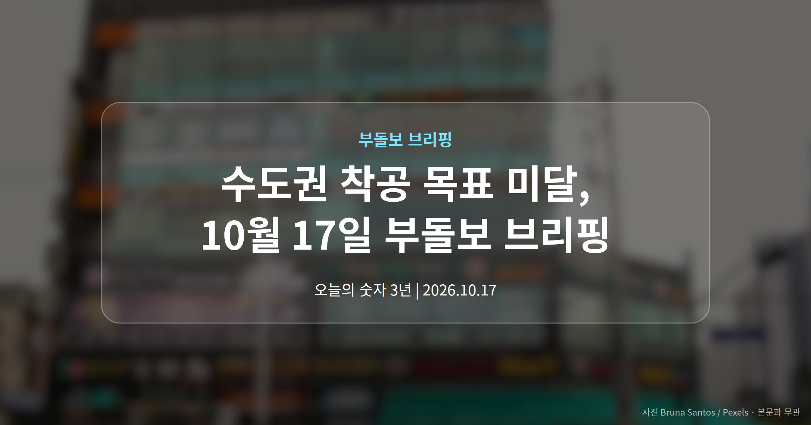
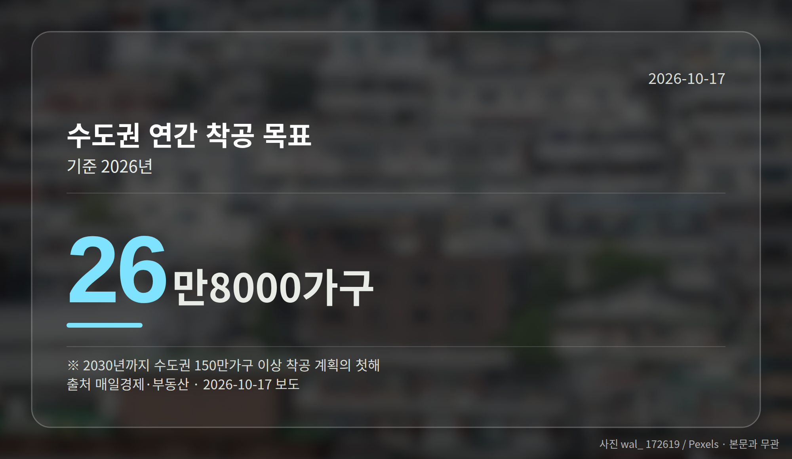
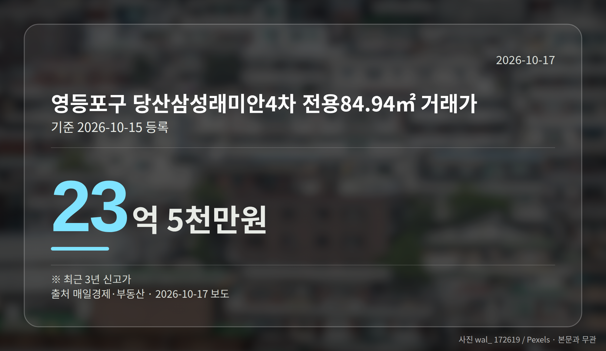
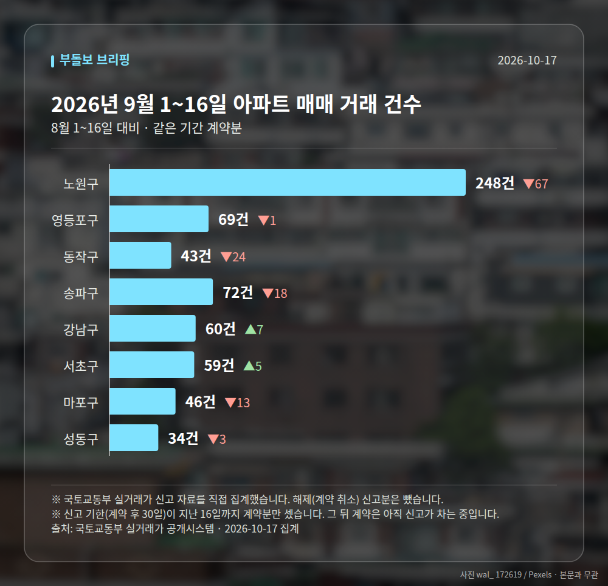

*이 글은 2026년 10월 17일 기준으로 정리한 내용입니다. 실거래 거래 건수는 2026년 9월 1~16일 계약분(신고 기한이 지난 것), 전세가율 등은 2026년 8월 신고분입니다.*
**3줄 요약**

- 정부가 첫 정례브리핑에서 수도권 착공 목표 미달을 인정했습니다.
- 목표 26만8000가구, 예상 21만8000~23만5000가구입니다.
- 4분기 '디지털 주택공급 상황판' 공개 여부를 지켜볼 때입니다.
오늘 브리핑의 중심은 **수도권 착공 목표 미달**입니다. 정부가 올해 수도권 주택 착공이 목표보다 최대 5만가구 모자랄 것으로 전망했습니다.

같은 날 서울에서는 최근 3년 신고가 거래가 여러 자치구에서 등록됐습니다. 공급은 더뎌지고 가격은 오르는 흐름이 함께 나타난 하루였습니다.

## 수도권 착공 목표 미달, 숫자로 보면

국무조정실과 국토교통부는 16일 정부서울청사에서 제1차 주택공급 정례브리핑을 열었습니다. 올해 수도권 착공 목표 달성이 어렵다고 직접 밝혔습니다.

착공(터를 파고 공사를 시작하는 단계)은 보통 수년 뒤 입주 물량으로 이어집니다. 그래서 이 수치가 중요합니다.

| 구분 | 목표 | 실적·전망 |
|---|---|---|
| 수도권 전체(연간) | 26만8000가구 | 21만8000~23만5000가구 전망 |
| 1~9월 누적 | — | 9만9000가구(목표의 약 37%) |
| 민간 정비사업 | 7만2000가구 | 1만7000가구(23.6%) |
| 공공주택 | 6만2000가구 | 1만6200가구(약 26%) |
| 신축매입주택 | 4만2000가구 | 1만3000가구(31%) |

정부는 민간 정비사업과 비아파트 공급 부진, 관련 법 개정 지연을 주원인으로 지목했습니다.

## 수도권 착공 목표 미달이 뜻하는 것

2030년까지 수도권 150만가구 이상 착공을 추진하겠다고 밝힌 계획의 첫해입니다. 그 첫해부터 목표에 미치지 못한 셈입니다.

수도권에서 내 집 마련을 준비하는 분께는 장기적으로 신축 공급이 줄어들 수 있다는 신호로 읽힐 수 있습니다. 다만 전망치는 범위로 제시됐고, 기사에 따라 부족분을 '3만3000~5만가구'로 적은 곳도 있었습니다.

정부는 4분기에 국토부 홈페이지에 '디지털 주택공급 상황판'을 만들고, 매월 두 차례 정례브리핑을 열겠다고 했습니다. 수도권 착공 목표 미달이 반복되는지는 이 자료로 확인해 볼 수 있겠습니다.

[이미지: 공사가 시작되지 않은 도심 주택 건설 현장]

## 서울 신고가 거래는 어떻게 봐야 할까

10월 15일 실거래가 시스템에 등록된 서울 아파트 6건이 최근 3년 내 신고가를 기록했습니다. 영등포구 당산삼성래미안4차 전용 84.94㎡가 23억 5천만원으로 가장 높았습니다.

동작구 상도동 동원베네스트 16억 3천만원, 마포구 중동 현대 10억 2,500만원, 노원구 상계주공9단지 7억 9,800만원 등 지역 구분 없이 등록됐습니다.

다만 이는 개별 단지의 개별 거래 6건입니다. 서울 전체 추세로 묶기에는 근거가 부족하다는 점을 함께 보셔야 합니다.

## 그 밖의 오늘 소식

- 서울 전역 토지거래허가구역(토허제·거래 시 허가 필요) 연장 여부 주목
- 한국부동산원, AI 경영시스템 국제표준 인증 획득 발표
- '아크메르 동탄' 견본주택 개관, 26~28일 청약 접수

**그래서 나는?**

- 수도권 무주택 실수요자라면, 청약 일정과 착공 통계를 함께 확인해 보세요.
- 서울 아파트 매수를 고민 중이라면, 신고가는 개별 사례임을 감안해 보세요.
- 전세 계약을 앞뒀다면, 부동산원 시세 자료부터 한 번 확인해 보세요.

**직접 센 숫자 — 2026년 9월 1~16일 아파트 실거래**

서울 8개 구 계약 매매 **631건** (8월 1~16일 745건, -114건)

거래가 많은 곳: 노원구 248건(-67) · 영등포구 69건(-1) · 동작구 43건(-24)

신고 기한(계약 후 30일)이 지난 16일까지 계약분끼리 견줬습니다.

노원구 전세가율 가운뎃값 **52.9%** (같은 단지·같은 면적 107곳)

서울 25개 구 가운데 거래가 가장 크게 움직인 곳: 동작구 -35.8%(67→43건) · 강동구 -33.9%(112→74건)

2026년 9~10월 계약 신고가

- 송파구 현대백조 31.0㎡ — 8.3억 (이전 최고 6.8억, +22.1%, 10월 7일 계약)
- 노원구 시영3차(라이프)아파트 49.5㎡ — 6.5억 (이전 최고 5.4억, +20.2%, 9월 10일 계약)

*국토교통부 실거래가 신고 자료를 직접 집계했습니다. 해제 신고분은 뺐습니다.*
**여러분이 눈여겨보는 지역은 공급 쪽과 가격 쪽, 어느 신호가 더 또렷하게 보이시나요?**

---

### 참고한 기사

1. **AI가 시세 자동 산정…부동산원, '국제 표준 경영 시스템' 인증**
   - [신아일보](https://news.google.com/rss/articles/CBMicEFVX3lxTE1OSzhLcFp2OG1MY09IY0hWa0JFV0MxTHk0NjVJVDluS3JHOXFRNXpDdkZaV1V2Q2EyMGIzVmM2enY4UzctN3dqOFE0d1FQc2tzdzJleVJwNXRIc21pWGZrT1BiYnl5dmY4VENpN29sX2c?oc=5)
   - [국토일보](https://news.google.com/rss/articles/CBMiY0FVX3lxTE9OVW5zMVZuaW9IWlhBeEUtS28yQVVMYzY5NU5ZaUR6Rm9VMWpxbWJpNTBSZHpfZlJDMktvV09McVFkTVhndEtkMnJVeS1ZanhrT0Y4TEVVLW9QRHZuaVp2eUtHTQ?oc=5)
2. **'아크메르 동탄', 16일 견본주택 개관**
   - [뉴스로드](https://news.google.com/rss/articles/CBMia0FVX3lxTE5ST1lrZHhBb1N0R0tzc2ctR1p4SWtSZk1WaWJEdkdiazE5YVZGa29SR2NLaWdSSGVST2RmYm1xM2hEd1U0OHZrWVJ5ekFUdDRsTkJoRDZQaXJUaW0xaGRwc0xDM3JBX2dQZnI40gFvQVVfeXFMT0plcG43eWJjVVBvVkQ1VWJ5TnVabWxLTkZhc1pUT3RDaWdyZzJUN0dMR3ZDX3hZZzNoSi1YNWVQWGd2WEh6RElkYW5ocWlTamQ3WUhIX1pjclREdHM1NXh3ZE1GVmg4NmF6YTRRY1pj?oc=5)
   - [매일경제·부동산](https://www.mk.co.kr/news/realestate/12177448)
3. **영등포구 대림동 우성1 62.37㎡ 8억 4천만원… 최근 3년 신고가 [MAI부동산]**
   - [매일경제·부동산](https://www.mk.co.kr/news/realestate/12177476)
4. **시작부터 흔들리는 닥공…정부 “수도권 착공 최대 5만가구 부족”**
   - [매일경제·부동산](https://www.mk.co.kr/news/realestate/12178242)
5. **10·15 부동산 대책 1년…서울 전역 토허제 연장 촉각**
   - [대한데일리](https://news.google.com/rss/articles/CBMia0FVX3lxTE9LUmJQMzVZaXlBZFhJRVUxSXJVV0NZLWpDcTUxaUpNNk5jV21oLUZ6OUt3STN2REY0Zy10eUptN3d6czhFZkxvRjdiT2lfYnVaMThMZnl0blAzTGtmOVlfeUQyLWd0cXhWLXM4?oc=5)
   - [핫콘뉴스](https://news.google.com/rss/articles/CBMib0FVX3lxTE9yRHcyZXZINjc0alFTeGp5Q3FNS3BWRFhyb0lPWTFTX0Zrb2tpUGh4TVAybmQ3czZFSkxOdmtqeS11WjlBOVN5SFUzbFZmRE1zaHZxSzlLUExMMUpVSEhCRnJiNS0xUnN3NExwdGZoRdIBb0FVX3lxTE9yRHcyZXZINjc0alFTeGp5Q3FNS3BWRFhyb0lPWTFTX0Zrb2tpUGh4TVAybmQ3czZFSkxOdmtqeS11WjlBOVN5SFUzbFZmRE1zaHZxSzlLUExMMUpVSEhCRnJiNS0xUnN3NExwdGZoRQ?oc=5)

---

*본 글은 공개된 언론 보도를 정리한 것이며, 투자 판단의 책임은 이용자 본인에게 있습니다.*
