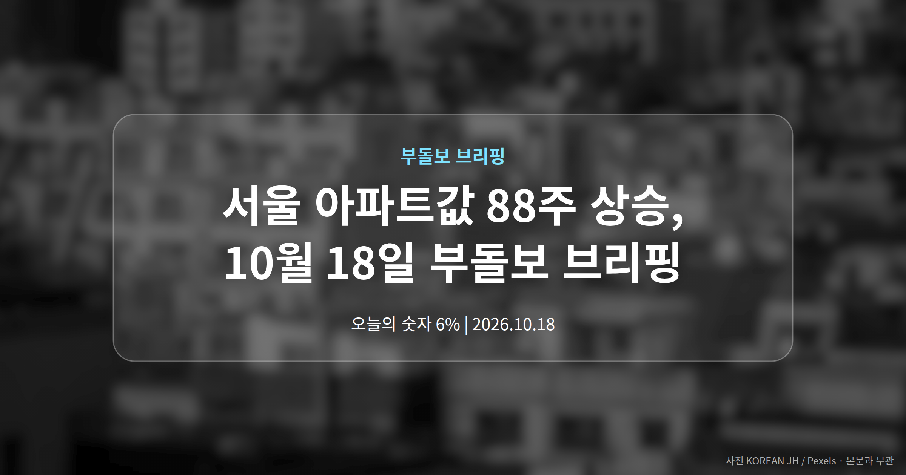
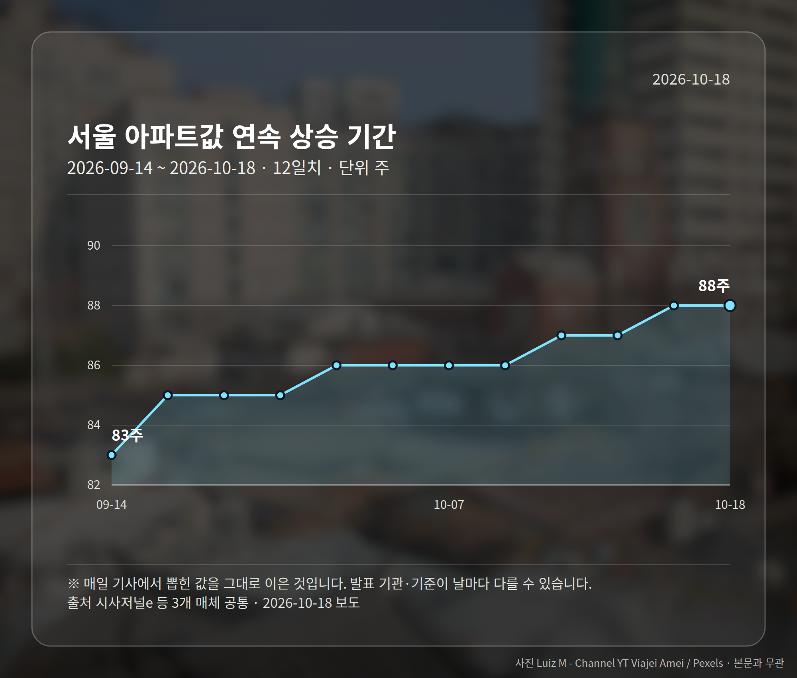
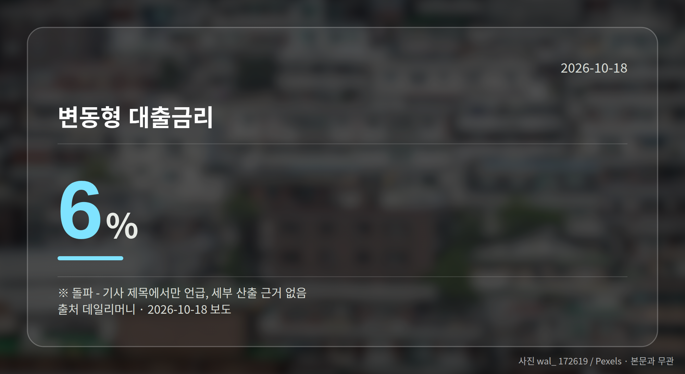
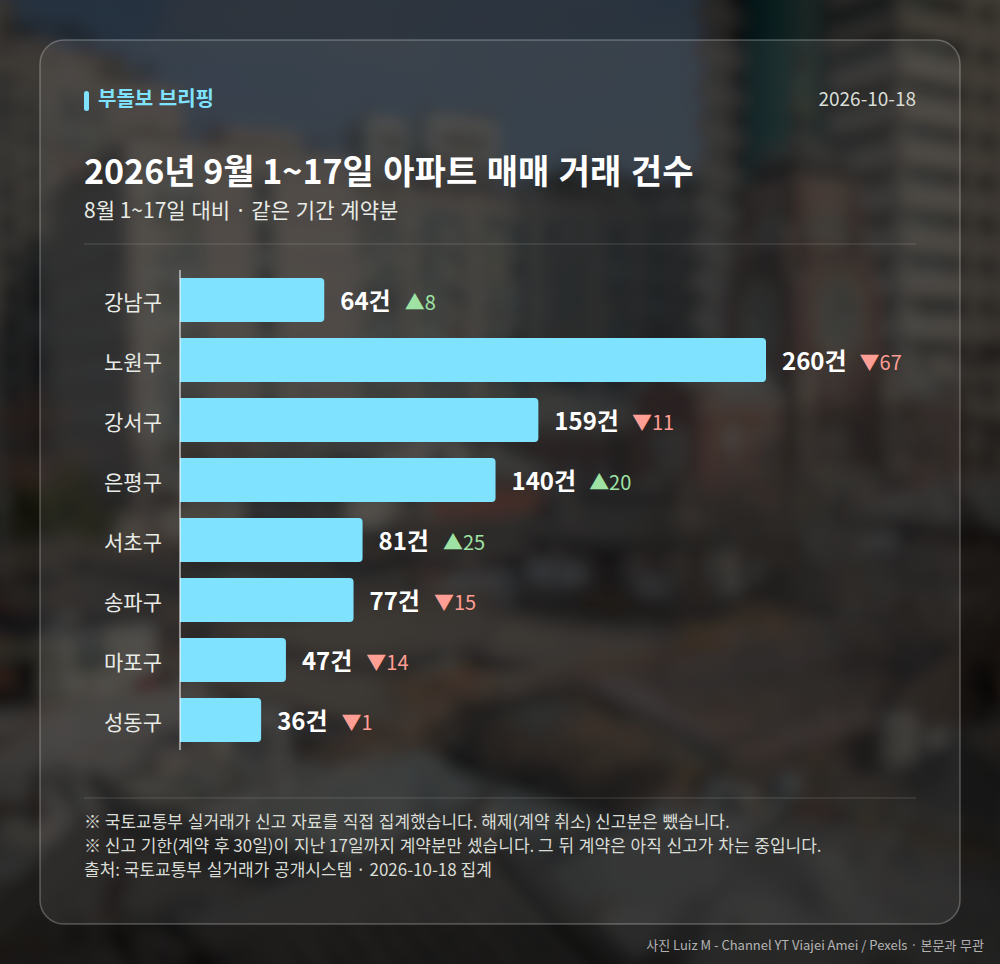

*이 글은 2026년 10월 18일 기준으로 정리한 내용입니다. 실거래 거래 건수는 2026년 9월 1~17일 계약분(신고 기한이 지난 것), 전세가율 등은 2026년 8월 신고분입니다.*
**3줄 요약**

- 서울 아파트값이 88주 연속 올랐다는 보도가 이어졌습니다.
- 강남3구는 하락, 외곽은 강세로 지역 간 온도차가 났습니다.
- 한은 11월 금리 인상론이 함께 거론돼 대출 조건을 볼 때입니다.
서울 아파트값 88주 상승 소식이 오늘도 복수 매체를 통해 전해졌습니다. 다만 같은 서울 안에서도 강남3구는 하락, 외곽은 강세라는 엇갈린 흐름이 함께 보도됐습니다.

여기에 한국은행의 11월 금리 인상론이 겹쳐, 가격보다 대출 조건을 먼저 점검해야 할 국면으로 보입니다.

## 서울 아파트값 88주 상승, 어디까지 확인됐나

위키트리, 펜앤마이크, 시사저널e 세 매체가 공통으로 서울 아파트값이 88주 연속 상승했다고 보도했습니다. 이 기간이 오늘의 핵심 숫자입니다.

| 항목 | 내용 | 출처 |
|---|---|---|
| 연속 상승 기간 | 88주 | 시사저널e 등 3개 매체 |
| 지역별 흐름 | 강남3구 하락, 외곽 강세 | 시사저널e |

주의할 점이 있습니다. 구체적인 주간 상승률이나 강남3구의 하락폭 같은 세부 수치는 제목 수준에서만 전해졌고, 본문 근거는 확인되지 않았습니다.

또 야권에서 "현실을 외면한다"는 비판이 제기됐다는 보도(펜앤마이크), 정부 대응을 '정신승리'로 표현한 보도(위키트리)가 함께 나왔습니다. 정치적 논조가 섞인 기사들이라 사실과 평가를 구분해 읽으실 필요가 있습니다.

## 금리 인상론이 겹친 이유

데일리머니는 한국은행의 11월 금리 인상론이 점화되고 있다고 보도했습니다. 같은 보도에 변동형 대출금리(시장금리에 따라 주기적으로 이자율이 바뀌는 대출)가 6%를 돌파했다는 내용이 제목에 포함됐습니다.

이 수치 역시 제목에서만 언급됐고 산출 근거는 제공되지 않았습니다. 사실로 확인된다면 이른바 '영끌족'의 이자 부담이 커질 수 있다는 지적이 나오는 대목입니다.

더해서 대출 규제가 전·월세 가격 상승으로 옮겨가는 악순환이 지적됐습니다. 집을 사려는 분뿐 아니라 무주택 임차 가구에도 닿는 이야기라, 서울 아파트값 88주 상승 흐름과 묶어서 볼 필요가 있습니다.

## 공급 쪽은 어떤 신호가 나왔나

연합뉴스 한민족센터는 올해 서울 일반분양 물량이 작년 대비 3배에 육박한다고 보도했습니다. 이른바 '청약 대어' 단지들이 줄지어 공급된다는 내용입니다.

다만 세대수나 비교 기준 시점이 제시되지 않아, 늘어난 물량이 가격 안정으로 이어질지는 추가 확인이 필요합니다.

[이미지: 서울 아파트 단지와 분양 현장이 보이는 전경 사진]

## 그 밖의 오늘 소식

- 다음 주 전국 대규모 아파트 분양 예정(공감신문)
- 수도권·지방 모두 청약 열기 이어진다는 보도
- 2030세대 대상 서울 재개발 지역 소개 기사(뉴시스), 근거 미확인

내일 이후로는 한국은행의 11월 금리 결정 여부와 다음 주 청약 일정 두 가지가 확인 지점입니다.

**그래서 나는?**

- 변동금리 대출자라면, 내 대출의 금리 변동 주기부터 확인해 보세요.
- 무주택 실수요자라면, 서울 분양 물량 증가 일정을 먼저 챙겨볼 수 있습니다.
- 전세 계약을 앞뒀다면, 대출 규제가 임대료에 미칠 영향을 함께 살펴보세요.

**직접 센 숫자 — 2026년 9월 1~17일 아파트 실거래**

서울 8개 구 계약 매매 **864건** (8월 1~17일 919건, -55건)

거래가 많은 곳: 강남구 64건(+8) · 노원구 260건(-67) · 강서구 159건(-11)

신고 기한(계약 후 30일)이 지난 17일까지 계약분끼리 견줬습니다.

강남구 전세가율 가운뎃값 **36.5%** (같은 단지·같은 면적 29곳)

서울 25개 구 가운데 거래가 가장 크게 움직인 곳: 서초구 +44.6%(56→81건, 서초동에 48.1% 몰림) · 강동구 -34.7%(118→77건)

2026년 9~10월 계약 신고가

- 송파구 현대백조 31.0㎡ — 8.3억 (이전 최고 6.8억, +22.1%, 10월 7일 계약)
- 노원구 시영3차(라이프)아파트 49.5㎡ — 6.5억 (이전 최고 5.4억, +20.2%, 9월 10일 계약)

*국토교통부 실거래가 신고 자료를 직접 집계했습니다. 해제 신고분은 뺐습니다.*
**여러분이 보고 계신 지역은 강남3구 쪽 흐름에 가까운가요, 외곽 쪽 흐름에 가까운가요?**

---

### 참고한 기사

1. **한은 11월 금리 인상론 점화와 영끌족 절규 -> 무너진 주거 사다리의 비극 => 변동금리 6% 돌파와 트리플 주거비 폭등 > 금융당국 정책 실책의 대가 >> 대출 틀어막자 전·월세 폭등 악순환 = 벼랑 끝 몰린 서민 가계의 한숨**
   - [데일리머니](https://news.google.com/rss/articles/CBMic0FVX3lxTE1YVnpLYVpEY205emVRSmNuaEtGb2NjMl9VN3lpaXc5UE5zWmdPNC1FTjhfY2x6STBobW03bzQtZDk4QlVSYzJiMi1RMEprNTQxakpsYnhTYXFwS2dfWHFTODVRWVlvUnBCQ2V6MnlmRXhYWG8?oc=5)
2. **“서울 아파트값 88주 연속 올랐는데... 이재명정부는 정신승리”**
   - [위키트리](https://news.google.com/rss/articles/CBMiVkFVX3lxTFBad2U3cE1HYlVwY2ZpX0FrQ0p0TzVqeTJkOWY5TGI3cldEWG5NbE94cDhidUZzYXliVTJFQ1hjU001c05VZkc5VTBnU2pzTnVPX0R4aWJR?oc=5)
   - [펜앤마이크](https://news.google.com/rss/articles/CBMia0FVX3lxTFB1YllmMFgzaVdiR3VTbUdHMU1HQXlNSEt0b3FyeHBKbHYtc1V3TDhPOTFVOVdsRHJtcm9tTWhRX3VrOENwTUVCOHhxQ1c5c3VvYW5lcDdZSzd3dmV0SW0yRDJhQ0RITzF6RGhR0gFvQVVfeXFMT3RJb0gwUDhCczhrQXZZYWxtY0I0OGNPUVdYUlZ1V0Y3djF5V3kta3dlTVpnRllWSXVDYVdSYUJnQl93dXY3emx4bU1LdVB2bWFxZHMwem5CLUNUbF8tMTlTZ3luM2tNM3k2U2NfZy04?oc=5)
3. **다음 주 전국 대규모 아파트 분양, 수도권·지방 청약 열기 뜨겁다**
   - [공감신문](https://news.google.com/rss/articles/CBMiaEFVX3lxTE5nT2I0RXlRU1N6NlBNcE1FeTNWa01sUHE0UTQ2UWVzU1hNZTV0OHZPdEY3Nl9WVzRQUjl5a2V2TGRETmxxNEs0RldZV0ZzV1kyMGVlcXU5R2xmTExZSGR6TDdmZS1nQWNF?oc=5)
4. **올해 서울 일반분양 작년 3배 육박…'청약 대어' 줄이어**
   - [연합뉴스 한민족센터](https://news.google.com/rss/articles/CBMidEFVX3lxTE5tcDlqbFY1bUltdjRQa19hUWhpUEFoc29mMXFRNUdDZ21nMGxxWXBQRXRJc28xUlRvaWFmTFpfbFJRbTFCbkNuT2picS1QVHhQaC1GZnFzOTRHU2tmbUY1b0pncm9hUWxRS1Qzak0zV0k2bjJY?oc=5)
5. **2030 내 집 마련, 청약 어렵다면…부동산 전문가가 꼽은 서울 재개발 투자 지역**
   - [뉴시스](https://news.google.com/rss/articles/CBMiYEFVX3lxTE5HVVJBanF5V0xwckpFRzdRREktLWI2REZtdjRqTkFZcGVsZDMzQzZyQnZ4UXRCYzJrNW10eTdCVDA4dC1SSmZ3enJIdzZaUG5HRGtSejhpQmtSYmVJU2FxNNIBeEFVX3lxTE5nZXhWOVpVRTR2Rkh4SUM2Y3NJOF9leW9wREhRSzNFVGxMSmpxblU1eHgxOFdPUGV3VzNnLXo2VzVlN0tEUE9CYkNzUUtRNS1CU3MzSTJ2TkZ3SlJQOUkzMGZLaVA1MUEtVkhCN2ZnQWw2YllLcWp3RQ?oc=5)

---

*본 글은 공개된 언론 보도를 정리한 것이며, 투자 판단의 책임은 이용자 본인에게 있습니다.*
