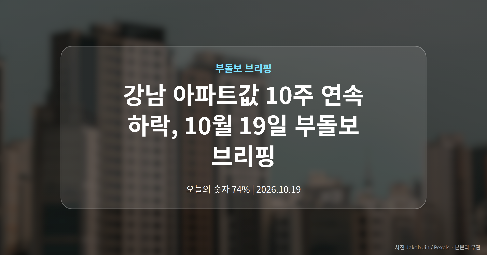
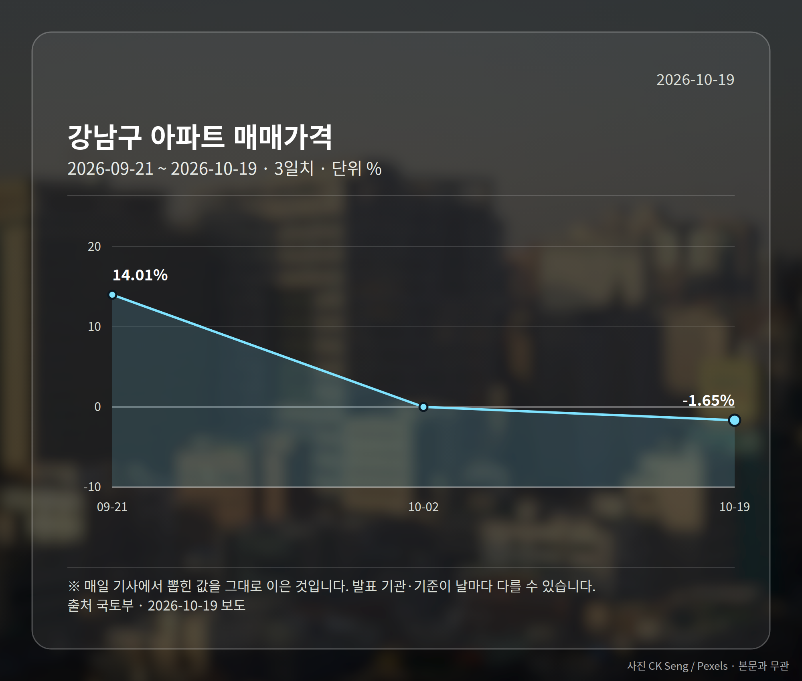
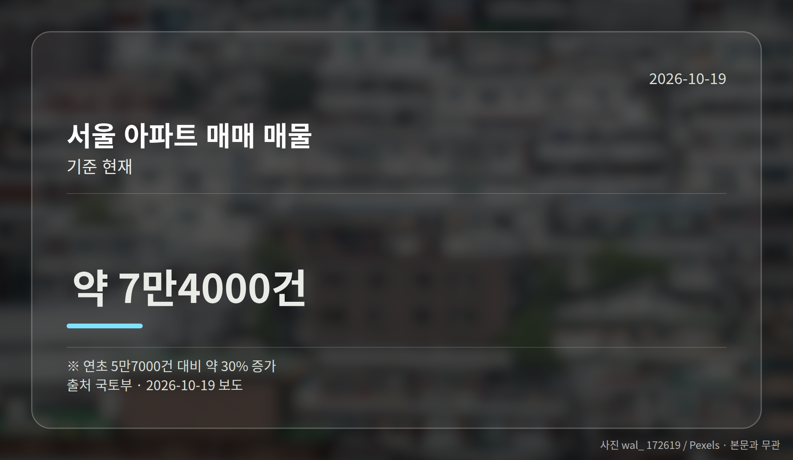
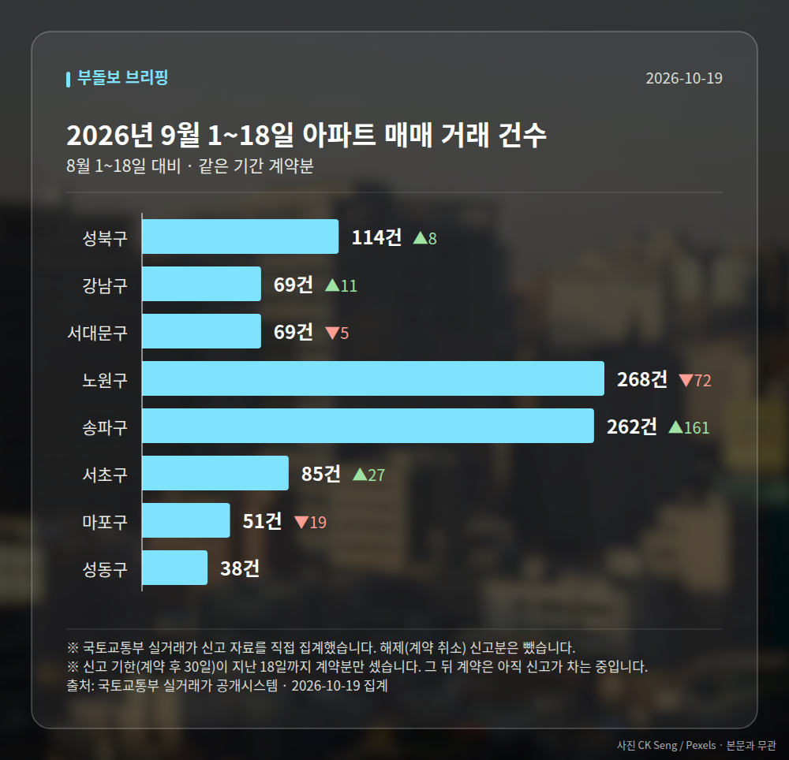

*이 글은 2026년 10월 19일 기준으로 정리한 내용입니다. 실거래 거래 건수는 2026년 9월 1~18일 계약분(신고 기한이 지난 것), 전세가율 등은 2026년 8월 신고분입니다.*
**3줄 요약**

- 국토부가 서울 집값 하향 안정 신호를 공식 진단했습니다.
- 강남구 9월 -1.65%, 강남·서초 10주 연속 하락입니다.
- 다만 수도권 입주 물량은 10년 평균보다 42% 적습니다.
국토교통부가 10월 18일 서울 주택시장에 '하향 안정 신호'가 나타나고 있다고 공식 진단했습니다. 근거는 **강남 아파트값 하락**과 거래량 감소, 매물 증가입니다. 다만 입주 물량은 여전히 적어 공급 공백이 변수로 남아 있습니다.

국토부 발표와 함께 오세훈 서울시장의 반박, 비강남권 신고가 거래 소식까지 하루에 몰렸습니다. 오늘은 그중 가장 무게가 큰 국토부 진단 하나만 들여다보겠습니다.

## 강남 아파트값 하락, 숫자로 보면 어디까지 왔나

국토부가 제시한 9월 월간 변동률은 강남구 -1.65%, 서초구 -1.25%, 송파구 -0.45%입니다. 강남구와 서초구는 주간 기준으로 10주 연속 하락했습니다.

거래 자체도 줄었습니다. 서울 전체 아파트 거래량은 5월 8,900건에서 6월 7,700건, 7월 6,600건, 8월 4,600건으로 내려왔습니다.

반대로 팔려는 물건은 늘었습니다. 서울 아파트 매매 매물은 현재 약 7만 4,000건으로 연초 5만 7,000건보다 약 30% 많습니다.

여기에 갭투자(세입자 보증금을 활용해 적은 자기 돈으로 집을 사는 방식) 거래 비중이 지난해 10월 37.9%에서 올해 8월 6.1%로 떨어졌습니다. 국토부는 대출 규제와 토지거래허가구역(일정 규모 이상 토지·주택을 사려면 구청 허가를 받아야 하는 구역) 지정 효과라고 설명했습니다.

국토연구원의 서울 주택매매시장 소비심리지수도 7월 139.9에서 8월 132.5, 9월 130.8로 두 달 연속 내려갔습니다.

## 공급은 어떤가, 2028년이라는 시점

공급 지표는 방향이 엇갈립니다. 숫자로 정리하면 이렇습니다.

| 구분 | 3~8월 실적 | 전년 동기 | 10년 평균 |
|---|---|---|---|
| 서울 주택 인허가 | 3만 6,000가구 | 2만 1,000가구 | 2만 8,000가구 |
| 서울 주택 착공 | 1만 7,000가구 | 1만 2,000가구 | 3만 1,000가구 |

인허가는 74% 늘어 10년 평균을 넘었지만, 착공은 45% 증가해도 평균에 못 미칩니다. 인허가는 '지어도 된다'는 허락, 착공은 실제 공사 시작이니 입주까지는 시간이 더 걸립니다.

정작 당장의 입주는 줄어드는 흐름입니다. 수도권 아파트 입주 물량은 2023년 20만 4,000가구에서 지난해 13만 가구, 올해는 10만 5,000가구로 전망됩니다. 10년 평균 18만 가구보다 약 42% 적습니다.

국토부는 3기 신도시 입주가 올해 1,300가구에서 2028년 1만 가구 이상으로 늘면서 수급이 개선될 것으로 내다봤습니다. 서울의 가구 증가세 둔화도 중장기 안정 요인으로 함께 제시했습니다.

[이미지: 신축 아파트 공사 현장과 타워크레인]

## 강남 아파트값 하락을 그대로 서울 전체로 읽기는 어렵습니다

같은 기간 비강남권에서는 다른 그림도 나왔습니다. 10월 17일 실거래가 시스템에 성북구 길음뉴타운경남아너스빌 114.63㎡가 11억 6,000만원, 서대문구 e편한세상서대문 59.991㎡가 12억 9,500만원에 등록돼 최근 3년 신고가를 기록했습니다.

개별 거래 사례라 지역 전체 추세로 단정할 수는 없습니다. 다만 하락 흐름과 신고가가 같은 날 함께 보도되는 만큼, 지역별 온도차는 각자 확인하실 부분입니다.

또 '하향 안정'은 정부 측 진단이고, 입주 물량은 전망치가 섞여 있다는 점도 함께 보셔야 합니다.

## 그 밖의 오늘 소식

- 오세훈 시장, 10·15 대책 1년 '성적표 참담' 비판
- 서울시 백서 인용, 정비구역 389곳 해제·43만호 언급
- 노원·구로·관악구에서도 3년 내 신고가 거래 등록

**그래서 나는?**

- 무주택 실수요자라면, 2028년 전까지 입주 물량 추이를 함께 보셔야 합니다.
- 전세 계약을 앞뒀다면, 입주 물량 감소가 임대 수급에 영향 줄 수 있습니다.
- 1주택자라면, 내 지역 거래량과 매물 수부터 확인해 보세요.

**직접 센 숫자 — 2026년 9월 1~18일 아파트 실거래**

서울 8개 구 계약 매매 **956건** (8월 1~18일 845건, +111건)

거래가 많은 곳: 성북구 114건(+8) · 강남구 69건(+11) · 서대문구 69건(-5)

신고 기한(계약 후 30일)이 지난 18일까지 계약분끼리 견줬습니다.

성북구 전세가율 가운뎃값 **56.5%** (같은 단지·같은 면적 45곳)

서울 25개 구 가운데 거래가 가장 크게 움직인 곳: 송파구 +159.4%(101→262건, 장지동에 69.8% 몰림) · 서초구 +46.6%(58→85건, 서초동에 49.4% 몰림)

2026년 9~10월 계약 신고가

- 송파구 현대백조 31.0㎡ — 8.3억 (이전 최고 6.8억, +22.1%, 10월 7일 계약)
- 노원구 시영3차(라이프)아파트 49.5㎡ — 6.5억 (이전 최고 5.4억, +20.2%, 9월 10일 계약)

*국토교통부 실거래가 신고 자료를 직접 집계했습니다. 해제 신고분은 뺐습니다.*
**여러분이 보고 계신 동네는 강남권처럼 매물이 쌓이고 있나요, 아니면 신고가 거래가 나오는 쪽인가요?**

---

### 참고한 기사

1. **강남 집값 꺾이고 공급 지표 개선…정부 “중장기 시장 안정 기반 강화”**
   - [서울신문](https://news.google.com/rss/articles/CBMib0FVX3lxTE1lc1QyVjJoMUN5d01RQzhFaHJ1S0J0dERpM25pTFg1a0dnVGNiOERtTnZhWFRTeGllVURVQk94bnBCQWlZSGR5N00xUW1WQW1Wal9sSmFVdUU5ZXhVN0RpLUlDaUk2X3FTOW9Sc2NwOA?oc=5)
   - [헤럴드경제](https://news.google.com/rss/articles/CBMiVkFVX3lxTFAxYVJIb2tBdGZDMC1mbDA3S2UzOUxTY2pKQlllWUpaMS1YcXBJeWJKaU9rSDVkTDZKNFdXS0JLTzJIZ2k2WWx3ZlVXc1BhZmV0RkZqbFFn?oc=5)
2. **강남권 집값 하락에도 공급 공백…정부 "2028년 수급 개선"**
   - [코리아리포트](https://news.google.com/rss/articles/CBMicEFVX3lxTE9aWmV0bmY4eTZUMkxRQ185OEtnYURkQ2tXOVlqQ09qQU5HWlJIYWdiZk9jR2Y0Q1lUVk5VVEE1YlJEMzRZX21qMlMwNmVqUHh3RjFHVDFZWUltQXVrYnRuOEk5T1FZNWkyQl9zYnJYOTA?oc=5)
   - [아시아경제](https://news.google.com/rss/articles/CBMiggFBVV95cUxNUXdQWHQwS2FtcjRuV01zNHV0S0NBa05sTV9wWU05WktBRlYzeWlvckNVZVRCbTFGYWlIazZ3c21KdTFCSWVYY3o0OE9DQjI5cVF5VU51TzM5d1VaSjZfRmt0cGJEN2JJZW5JNEtZOFR2RkUyWmtfYnVkSjdTM2lqcV9B?oc=5)
3. **성북구 길음뉴타운경남아너스빌 114.63㎡ 11억 6천만원… 최근 3년 신고가 [MAI부동산]**
   - [매일경제·부동산](https://www.mk.co.kr/news/realestate/12178726)
4. **국토부 “서울 집값 하향 안정 신호”… 입주물량 감소는 변수**
   - [문화일보](https://news.google.com/rss/articles/CBMiUEFVX3lxTFBFdV9wUGFUeFNJOF95VlJpVFY4R3h4VE9Cd0YwX0NDTWtLX3luckRaUm5iNjdrdEgwTHRfZkN3dUlNUGFwd3FPVWxob2s3Z3hQ?oc=5)
   - [조선비즈·부동산](https://biz.chosun.com/real_estate/real_estate_general/2026/10/18/7OK7F4SPBNDUPBCROUKOVLLCLU)
5. **오세훈 시장 “10·15 부동산 대책 성적표 참담…정부, 실패 인정해야”**
   - [https://spt.co.kr/](https://news.google.com/rss/articles/CBMiXEFVX3lxTE9lQkROb0RmQ0t3aGhYQlF1ejd3WkZ2dGkyUHZTRjBLOWZaTldmTmpPMkdQOXN2dS04RDZMb2NfdlRfUU1tTl9KeklSZVlxek1jM1p5clRLelBxQ2Vk?oc=5)
   - [아시아투데이](https://news.google.com/rss/articles/CBMibkFVX3lxTE1mVlN3WFIzMDljZFVWenZ3LUNNWDFBSVk3TG43TGJuWWVfZ1hsOXo2d1VRWUZEUDlzXzJXaV9VSDZ6ZzZqTTJNbzJaMHlCcUZfWGVsSzFaZEMwelJUY3lGM2pST1FKbVdoNkxPN2hR?oc=5)

---

*본 글은 공개된 언론 보도를 정리한 것이며, 투자 판단의 책임은 이용자 본인에게 있습니다.*
