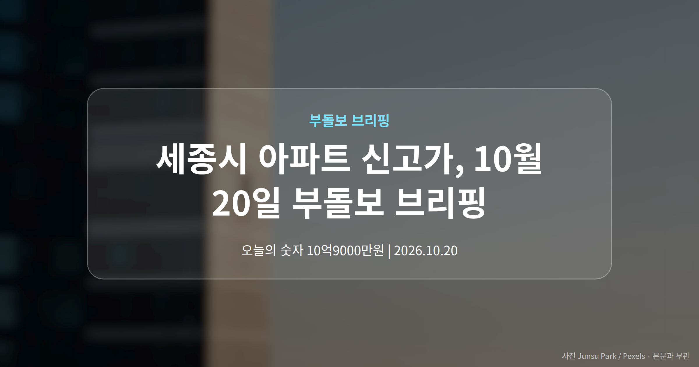
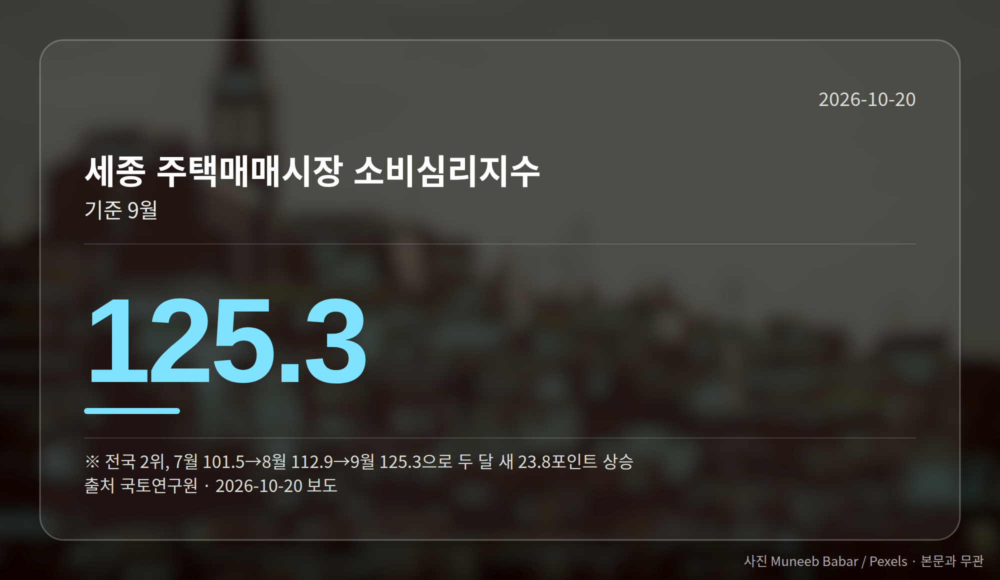
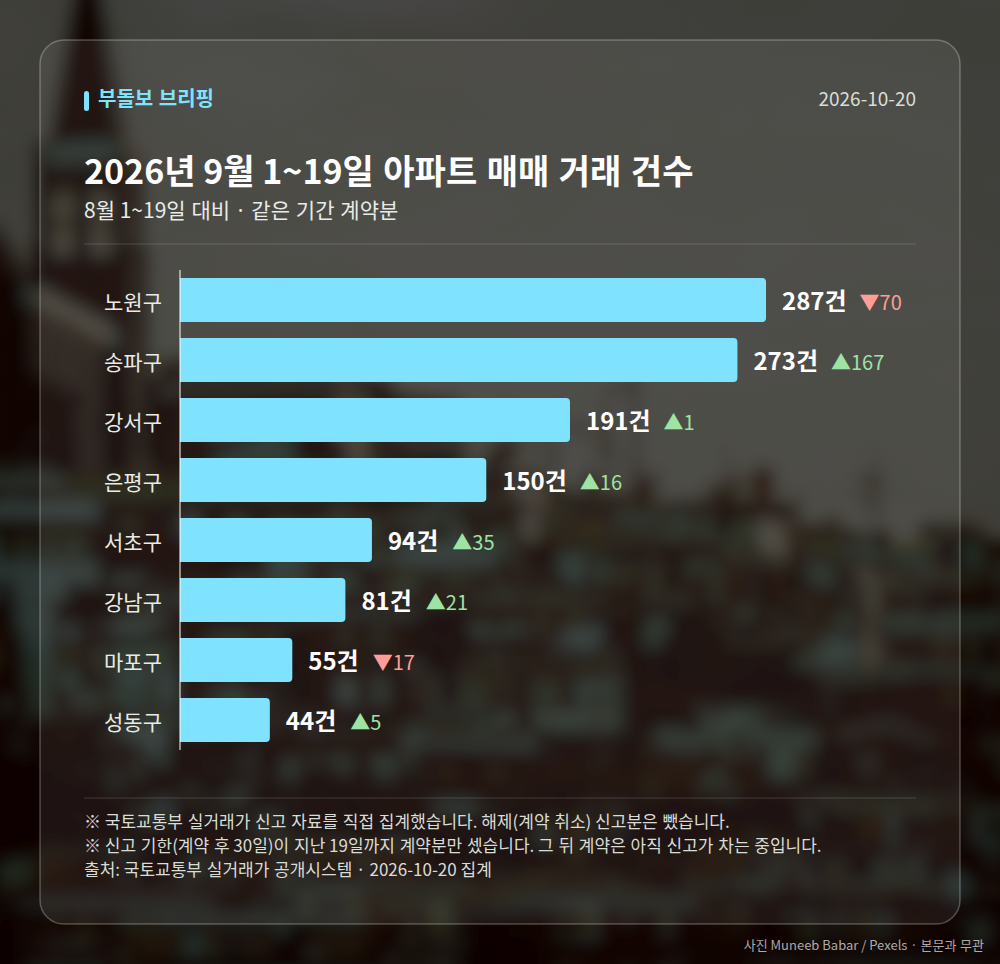

*이 글은 2026년 10월 20일 기준으로 정리한 내용입니다. 실거래 거래 건수는 2026년 9월 1~19일 계약분(신고 기한이 지난 것), 전세가율 등은 2026년 8월 신고분입니다.*
**3줄 요약**

- 중앙행정기관 44곳 세종 이전 발표 후 급매물이 소진됐습니다
- 나릿재6단지 84㎡가 10억9000만원, 직전보다 7000만원 올랐습니다
- 세종 매매가는 0.02% 상승 전환, 정부는 '과열 진정'을 말합니다
오늘 브리핑의 중심은 세종입니다. 중앙행정기관 44곳의 세종 이전 세부 계획이 지난 13일 발표된 뒤, **세종시 아파트 신고가** 거래가 여러 단지에서 확인됐습니다. 같은 날 정부는 전국 기준으로 "집값 과열이 진정됐다"고 평가했습니다.

한쪽은 달아오르고 한쪽은 식었다고 말하는, 신호가 엇갈리는 날입니다.

[이미지: 세종시 아파트 단지 전경 사진]

## 세종시 아파트 신고가, 어떤 단지에서 나왔나

발표 전인 지난달부터 나성동·고운동·종촌동·도담동에서 급매물이 대부분 소진됐습니다. 집주인이 매물을 거둬들이거나, 매매로 내놨던 집을 전세로 돌려 매도 시점을 미루는 사례도 늘었습니다.

국토교통부 실거래가 공개시스템에서 확인된 신고가는 아래와 같습니다.

| 단지 | 전용면적 | 거래가 | 직전 대비 |
|---|---|---|---|
| 나성동 나릿재6단지 | 84㎡ | 10억9000만원 | +7000만원 |
| 새롬동 새뜸13단지 | 84㎡ | 8억5000만원 | +2000만원 |
| 다정동 가온9단지 | 59㎡ | 4억6000만원 | +3000만원 |

호가(집주인이 부르는 값) 쪽은 더 빠릅니다. 현지 중개업소에 따르면 나릿재3단지 34평형은 두 달 전 8억원대 급매물이 가능했지만, 현재 호가는 10억원대 중반이라고 합니다.

## 지표로 본 세종시 아파트 신고가 배경

한국부동산원 주간 아파트 가격동향에서 세종 매매가격은 10월 둘째주에 0.02% 상승 전환했습니다. 수치 자체는 작지만 방향이 바뀐 지점입니다.

심리 쪽은 더 또렷합니다. 국토연구원 주택매매시장 소비심리지수를 보면 세종은 7월 101.5, 8월 112.9, 9월 125.3으로 두 달 새 23.8포인트 올라 전국 2위였습니다. 같은 9월 전국 지수는 119.5입니다.

다만 조심해서 볼 부분이 있습니다. '세종 이전 공무원 1만명', '내년 세종 입주물량 0'은 세종경제뉴스 제목에서만 확인되고 본문 근거가 제공되지 않았습니다. 급매 소진과 매물 회수가 함께 나타나는 국면이라, 당분간 변동성이 커질 수 있다는 점을 염두에 두시면 좋겠습니다.

## 세종은 들썩, 정부는 "진정"

반대편 이야기도 함께 보셔야 합니다. 정부는 아파트 거래량 감소와 매물 30% 증가를 근거로, 규제와 금융 정책이 과열을 차단했다고 평가했습니다.

여기에 오세훈 서울시장은 국정감사에서 서울 집값이 연말·내년 초까지 우상향할 가능성이 높다고 언급하며 실거주 중심 정책 전환을 촉구했습니다. 정부 평가와 엇갈린 전망입니다.

[이미지: 정부세종청사와 국정감사 현장 뉴스 화면 캡처]

## 그 밖의 오늘 소식

- 비강남 토지거래허가구역(땅·집 거래 시 지자체 허가가 필요한 구역) 해제 검토론 보도
- 전세난 해소가 서울 집값 안정의 전제라는 지적 제기
- 한국부동산원, 16일 공공건축물 그린리모델링 의무화 기술지원 설명회 개최

숫자는 모두 한국부동산원·국토연구원·국토교통부 실거래가 공개시스템에서 나온 공개 자료입니다. 판단은 각자의 자금 계획 안에서 하시길 권합니다.

**그래서 나는?**

- 세종 매수 희망자라면, 호가와 실거래가 차이부터 확인해 보세요
- 세종 1주택자라면, 매물 회수 흐름이 가격 변동성을 키울 수 있습니다
- 서울 실수요자라면, 정부와 서울시의 엇갈린 전망을 함께 보세요

**직접 센 숫자 — 2026년 9월 1~19일 아파트 실거래**

서울 8개 구 계약 매매 **1175건** (8월 1~19일 1017건, +158건)

거래가 많은 곳: 노원구 287건(-70) · 송파구 273건(+167) · 강서구 191건(+1)

신고 기한(계약 후 30일)이 지난 19일까지 계약분끼리 견줬습니다.

노원구 전세가율 가운뎃값 **52.9%** (같은 단지·같은 면적 107곳)

서울 25개 구 가운데 거래가 가장 크게 움직인 곳: 송파구 +157.5%(106→273건, 장지동에 67.8% 몰림) · 서초구 +59.3%(59→94건, 서초동에 48.9% 몰림)

2026년 9~10월 계약 신고가

- 송파구 현대백조 31.0㎡ — 8.3억 (이전 최고 6.8억, +22.1%, 10월 7일 계약)
- 노원구 시영3차(라이프)아파트 49.5㎡ — 6.5억 (이전 최고 5.4억, +20.2%, 9월 10일 계약)

*국토교통부 실거래가 신고 자료를 직접 집계했습니다. 해제 신고분은 뺐습니다.*
**여러분이 보시는 동네는 지금 매물이 쌓이는 쪽인가요, 거둬들여지는 쪽인가요?**

---

### 참고한 기사

1. **공무원 1만명 내려가라더니 입주물량 0…세종시 집값 벌써부터 ‘들썩’**
   - [매일경제·부동산](https://www.mk.co.kr/news/realestate/12180093)
   - [세종경제뉴스](https://news.google.com/rss/articles/CBMicEFVX3lxTFBzVV9sX2I4bndJLTl0WEZlYTZBS1dzM1YxeVpZMlh6eWZjNkNocVVYN1BTaWpkazFVSy1HQWg1TnI0dnNiYndESUJmZ3lnZEo4RjNPUDhzUjBDVGxzbUNpcUJ4MFhzX2RRY040T04tdHHSAXBBVV95cUxQc1VfbF9iOG53SS05dFhGZWE2QUtXczNWMXlaWTJYenlmYzZDaHFVWDdQU2lqZGsxVUstR0FoNU5yNHZzYmJ3RElCZmd5Z2RKOEYzT1A4c1IwQ1Rsc21DaXFCeDBYc19kUWNONE9OLXRx?oc=5)
2. **"집값 오늘이 꼭지다?"…매물 30% 쌓이자 정부 "과열 진정"**
   - [파이낸셜뉴스](https://news.google.com/rss/articles/CBMiWkFVX3lxTE5aSWhsM2MtLXFpSWc4M0pfODk4QmY5SzNwQzJQb3NEMWlkbHppdWVzUkxQbXdXYXJDbm5OYnJSVV9LOGZsYW1qRkphNFUtb1hGbFd5ZUVGTmk4QQ?oc=5)
   - [매일경제·부동산](https://www.mk.co.kr/news/realestate/12179326)
3. **정부와 엇갈린 전망…오세훈 "내년 초까지 집값 상승 가능성"**
   - [데일리안](https://news.google.com/rss/articles/CBMilwJBVV95cUxNZnlMZjYwMzV6SzdQdXY1RVVmTmpOeEtIU0lPOFB3elFlVl9jTlpZS3lwa05KRURvbE04UnhCNE5Mc291cS1FWURWYlY2OEdwM28tdlpjNDA3dWxTeTNOR0haUC1TeUN2STE3elgxR0pHWmJHX2ZMdjdMQzVJUVNyNXFzN2dHNkx5dllHUjd2YkZzcl91X283cGVfdi1wWTlEZnlDeVU5WElrVHFRUFRiX3ppYzNlVkdGRjYyTXo3S0o2Ylg5WGs2ZTRiX2tRRko1S095S0tFLXF2dy1DQVRfM01udWNVZm9LdnhzU3c2Q1hZUVZHR05mdmI1Q2RnVGg3dVNydDJZLS1GZGJReVRaZnV2NTNSYVk?oc=5)
   - [에너지경제신문](https://news.google.com/rss/articles/CBMiW0FVX3lxTE5mcVZGVXBmakxXYTNzeTN1VUk3Y2Y0c2pScjkwd05pV2FEcGJyQmtsaFhJMkVEZnZpS3pYQ2ZqVTRTUXl1d0NzX080WlRXZmlLT3NWdkVIbEFvSVE?oc=5)
4. **한국부동산원, 2026년 공공건축물 그린리모델링 의무화 기술지원 사업 설명회 개최**
   - [건설이코노미뉴스](https://news.google.com/rss/articles/CBMiZkFVX3lxTE0tOXgxY0t6WjY5cmZWVUM4aHVLNHY3M2NhVmRncmF4TTJrRElVdDRLamF2SGlJckhrNHFLX0xlcFU5MlNYRlJQaTRyS2tITjc0dFpjUElKTEl3ODFfOEhTR044ZHpjQQ?oc=5)
   - [신아일보](https://news.google.com/rss/articles/CBMicEFVX3lxTE1HQlVTanJCSElWRzZHN2pVMjM1aXlwV0JnejBzczhBb0R0bmk2TXB1UG50cFd5eHZtdDZWb0hmRUdHa1BKamhLaHhpa3NIYUhkalNIOThTdGNxUmNHTkhqa2V1cDJTRUFXeFE3dWMyNmQ?oc=5)
5. **비강남 토지거래허가구역 해제 검토할 때, 전세난 해소해야 서울 집값 안정 가능성 높다**
   - [비즈니스포스트](https://news.google.com/rss/articles/CBMic0FVX3lxTE9NT1NpSVFEY3ZKUVdmSzhLZWRIRVJLMUwxNlM1ZEs0WWxuZjVuYzF4RUU0QnFCWW1YQmpRQjNiNU9xUl9HTl9iUi1KbXBuSXNHUkxiTjlycjMyVW1JSzhVYUFtMjFvTU9yX2xjT1FCMjFYYzQ?oc=5)

---

*본 글은 공개된 언론 보도를 정리한 것이며, 투자 판단의 책임은 이용자 본인에게 있습니다.*
