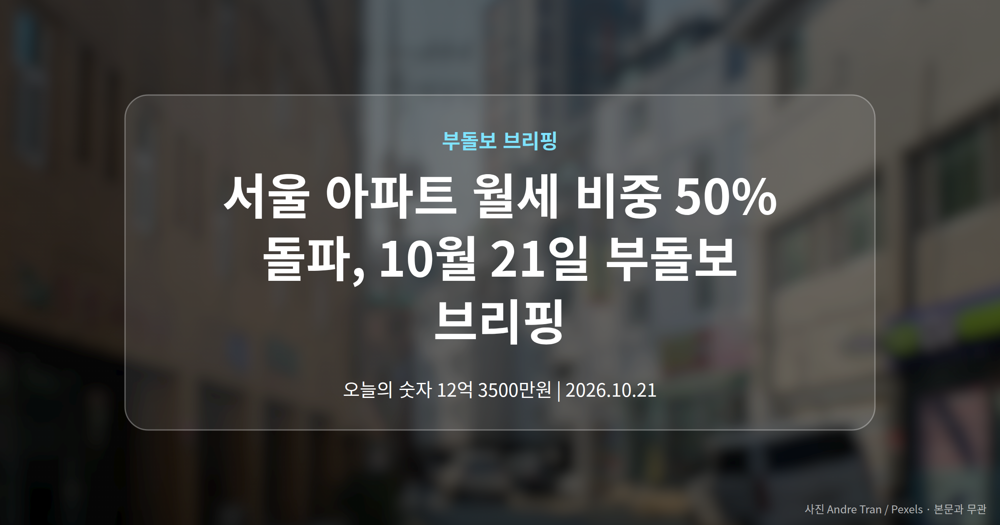
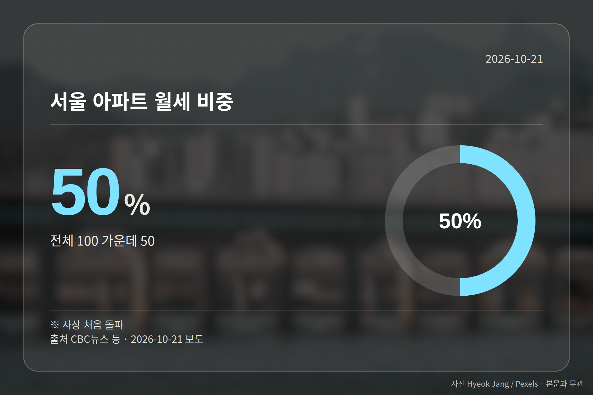
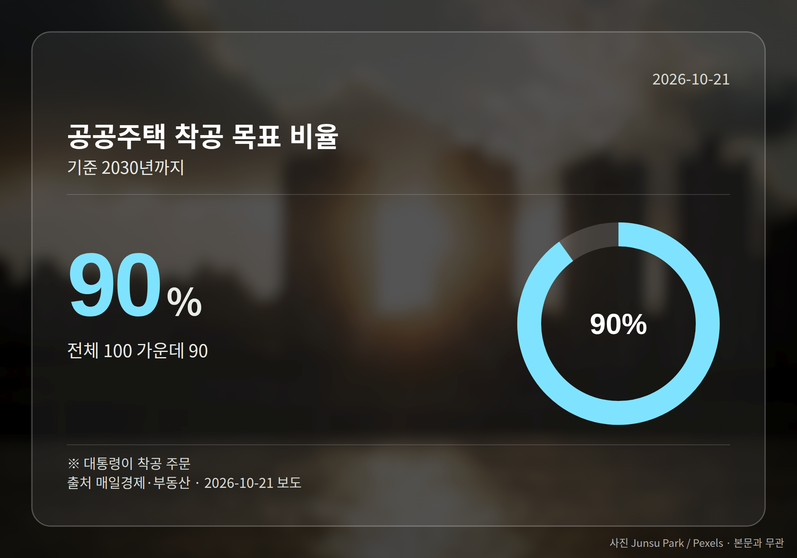
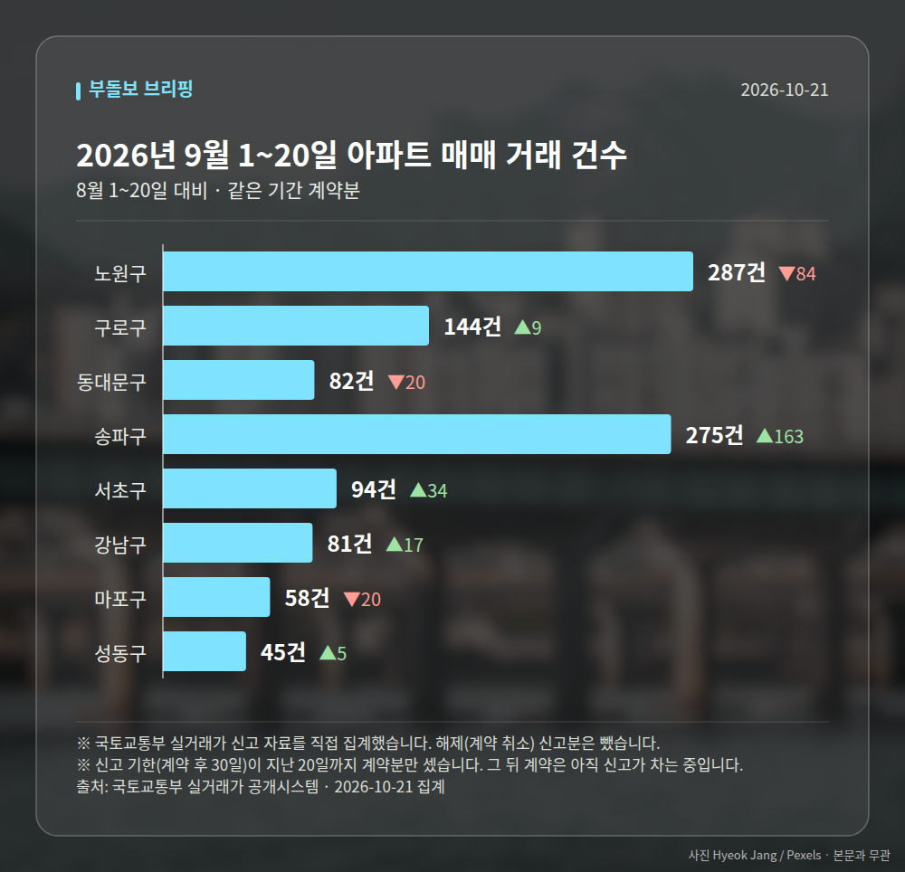

*이 글은 2026년 10월 21일 기준으로 정리한 내용입니다. 실거래 거래 건수는 2026년 9월 1~20일 계약분(신고 기한이 지난 것), 전세가율 등은 2026년 8월 신고분입니다.*
**3줄 요약**

- 서울 아파트 월세 비중이 사상 처음 50%를 넘었습니다
- 같은 기간 전세 거래는 27% 줄었다는 보도가 나왔습니다
- 전세 매물 사정과 월세 전환 여부를 먼저 살펴볼 때입니다
오늘 브리핑에서 가장 또렷한 숫자는 서울 아파트 월세 비중입니다. 사상 처음으로 50%를 넘어섰습니다.

같은 흐름에서 전세 거래는 27% 줄었다고 동아일보가 전했습니다. 전세를 찾던 수요가 월세로 옮겨가는 모습이 숫자로 드러난 셈입니다.

## 서울 아파트 월세 비중, 사상 첫 50% 돌파

| 구분 | 수치 | 출처·설명 |
| --- | --- | --- |
| 서울 아파트 월세 비중 | 50% | 사상 처음 돌파 (CBC뉴스 등) |
| 서울 아파트 전세 거래 | 27% 감소 | 동아일보 보도 |

복수 매체는 전세 급감과 품귀 현상을 배경으로 지목했습니다. 전세 매물 자체가 줄면서 월세 계약이 상대적으로 늘었다는 설명입니다.

다만 이 비중이 계약 건수 기준인지, 어느 기관의 집계인지는 기사 제목과 요약만으로는 확인되지 않았습니다. 숫자를 볼 때 이 점은 함께 기억해 두시면 좋겠습니다.

## 월세 비중이 늘면 내 주거비는 어떻게 되나

전세는 보증금을 맡기는 구조, 월세는 매달 현금이 나가는 구조입니다. 서울 아파트 월세 비중이 커지면 가계의 매달 고정 지출이 늘어날 수 있다는 우려가 나옵니다.

브리핑은 전세 매물 감소 같은 구조적 변화가 임대시장 패턴 자체를 바꾸고 있다는 분석을 전합니다. 영향 범위는 서울 아파트 전월세 임차인 전반입니다.

[이미지: 서울 아파트 단지와 주변 주거지 전경 사진]

## 서울 동북권에서는 신고가 거래도 이어졌습니다

가격 쪽도 조용하지 않았습니다. 동대문구 전농동삼성래미안 84.98㎡가 12억 3500만원에 거래되며 최근 3년 신고가를 기록했습니다.

노원구 하계동 청구 70.69㎡는 9억 3800만원, 도봉구 창동주공4단지 41.3㎡는 5억 8000만원으로 역시 최근 3년 신고가였습니다. 동대문·노원·도봉구를 합쳐 6건이 신고가로 집계됐습니다.

중저가권으로 분류돼 온 동북권에서도 신고가가 잇따른 만큼, 실수요층의 매수가 가격을 밀어올린다는 해석이 나옵니다. 다만 각 보도는 거래 사실과 가격만 담은 단신으로 거래일자나 직전 최고가는 확인되지 않습니다.

## 그 밖의 오늘 소식

- 이 대통령, 인천 계양지구 찾아 착공 앞당기라 주문
- 2030년까지 공공주택 90% 착공 주문(매일경제 보도)
- 수도권 집값·대출 규제 겹쳐 무주택자 부담 커졌다는 보도

**그래서 나는?**

- 전세 계약을 앞뒀다면, 희망 단지의 전세 매물 수부터 확인해 보세요
- 월세로 옮길 분이라면, 매달 고정 지출 증가분을 미리 계산해 보세요
- 동북권 매수를 고민한다면, 단신 거래가 외 직전 가격도 함께 보세요

**직접 센 숫자 — 2026년 9월 1~20일 아파트 실거래**

서울 8개 구 계약 매매 **1066건** (8월 1~20일 962건, +104건)

거래가 많은 곳: 노원구 287건(-84) · 구로구 144건(+9) · 동대문구 82건(-20)

신고 기한(계약 후 30일)이 지난 20일까지 계약분끼리 견줬습니다.

노원구 전세가율 가운뎃값 **52.9%** (같은 단지·같은 면적 107곳)

서울 25개 구 가운데 거래가 가장 크게 움직인 곳: 송파구 +145.5%(112→275건, 장지동에 67.3% 몰림) · 서초구 +56.7%(60→94건, 서초동에 48.9% 몰림)

2026년 9~10월 계약 신고가

- 송파구 현대백조 31.0㎡ — 8.3억 (이전 최고 6.8억, +22.1%, 10월 7일 계약)
- 노원구 시영3차(라이프)아파트 49.5㎡ — 6.5억 (이전 최고 5.4억, +20.2%, 9월 10일 계약)

*국토교통부 실거래가 신고 자료를 직접 집계했습니다. 해제 신고분은 뺐습니다.*
**여러분의 다음 임대차 계약은 전세일까요, 월세일까요?**

---

### 참고한 기사

1. **동대문구 전농동삼성래미안 84.98㎡ 12억 3500만원… 최근 3년 신고가 [MAI부동산]**
   - [매일경제·부동산](https://www.mk.co.kr/news/realestate/12181325)
2. **수도권 집값 오르고 내 집 마련은 더 멀어져…대출 규제에 무주택자 '구매력 역설'**
   - [경인방송 뉴스](https://news.google.com/rss/articles/CBMiZEFVX3lxTE5pNml4b25Gak9hY2RscHNsRnphZG5FdWp1LVhxc25nS1F5ZUNMVjdIUURzS0xQalNSeExDYjd5aUswMUR0b1hRSjBfcVhBeFNrTXE2RTV3Q2JOWEo1V0NHYTl4dVbSAWhBVV95cUxOeUQxal9TSEFnajJjTWlMTjRDcXBleHNCbFpMQ2l0eGRsTjZPTDV5aU5zRHJLSlAzUU9OdXZoUGllVGFSS19WNmQ3cllJZ0RjRFBQSGljbk10QnZsdVVwcXNHOUJpVGxYdA?oc=5)
3. **"전세 급감에 사상 첫 역전"…서울 아파트 월세 비중 50% 돌파**
   - [CBC뉴스](https://news.google.com/rss/articles/CBMiaEFVX3lxTE1aU0ZZdGRFd3p3QVlSN2J5Wl9WQkMyc0lDZnItVEFLR3VrUTJFMTduY3ZKOTdGZ1ZFR2prVExQZmxxblNvQTduamw5RmxRQ3c0djlVcFVGRzlMN2xnSmp3LXVrTjZmYW9m?oc=5)
   - [동아일보](https://news.google.com/rss/articles/CBMidkFVX3lxTE9ncFdWM3dnb0NBRnNfamhCYU1RbzllM0k1LTJyLWRKUE4wdmN0UU1OcDdpVHhseS1hUElKZG9LUnduNjRwVm5oMHUwczBZN25yRGhPZV9yTzJ1dWVnMFRvWnpDR1l6R1JELTlaVUlJa0hpYzZvbVHSAWZBVV95cUxPUE5OUHN5U0NjRzBndGNILV85WklXZ3JhMm1jOVdQcEZROGhNVXlVRjNyd3Q3UDlBWWZkelNXb1ZPRnpUUE1ONW05UGJVR096U3VUVk5XX1ZiVlNrYm5zX1NmVWMyTUE?oc=5)
4. **"3기 신도시 공급에 부동산 성패"…'전격전' 주문**
   - [SBS 뉴스](https://news.google.com/rss/articles/CBMiakFVX3lxTE1Nbkd2ZmNQeXlLQnc0TzZsb3hKMlhlQzN3MG1nUW1aWWNpcTBHQUdSbjVKd2xaUUZVVVlFWllqczhITHh3ZjFRbW5UaHVWcjFIb1FDaHBjQk94b09WUWxYMlhTRUpCWGE2OUHSAWZBVV95cUxPRy01QzZ2X21KajBwbWltY0xNTkFtY1JvWTJkQjRFYVlmODdTWndsZlBvNlBpd184QWJQeUVZTlh3M2FyVzhRZnFzNm1zZ3lES3lhX1JiX0xyT0JqbEhEdlRrNnNwYVE?oc=5)
   - [동아일보](https://news.google.com/rss/articles/CBMid0FVX3lxTFBhVE9GSDA3YlBJbnpnbFI3SnBheEZIT3pQM19uaDRFVE92Zi0tNEJDeWdBTDY3WWdSOHVQMmQwRk9FMW1VeDFZZmVpdnk4a1luRVY0S0VOZ2d2ZHpSQkF5RDBWeTNXNEZQN0hPZkdkUGRyNU90NUlj?oc=5)
5. **계양 간 이 대통령 “3기 신도시 착공 앞당겨야” 속도전 주문**
   - [한겨레](https://news.google.com/rss/articles/CBMia0FVX3lxTE9LZk5YUHRhREdvTHkwa0lzUVBpbm13QXYyZXdmUnpUdmtsNGg0ZUhoTXRqdnR3cldKcURJdWQ0TldRYktwZmVCVUkzcnFELWRNM25SaHJNTjFIdHB5Y2hFZVdUTll3SEJhUEYw?oc=5)
   - [부산일보](https://news.google.com/rss/articles/CBMidEFVX3lxTE95UWEzR1NHQWdzVEJSTTduTU16MWcwWkJrUnA5bE5aSW9rZFhhd21FNXRqMVJPTUpLb0NIN2xSWlFLcVZuOGZOSFdiYVdSZVc0Q2c1eGtYbXR2MFVlNHJCZWtZSWJxdGdsUVFRcWRXUWFfSVpY?oc=5)

---

*본 글은 공개된 언론 보도를 정리한 것이며, 투자 판단의 책임은 이용자 본인에게 있습니다.*
