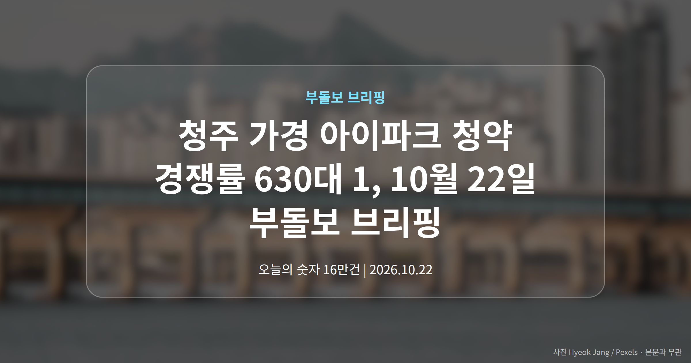
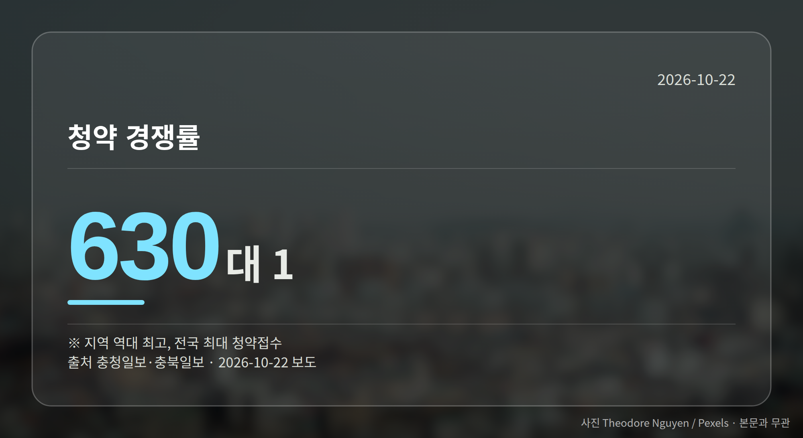
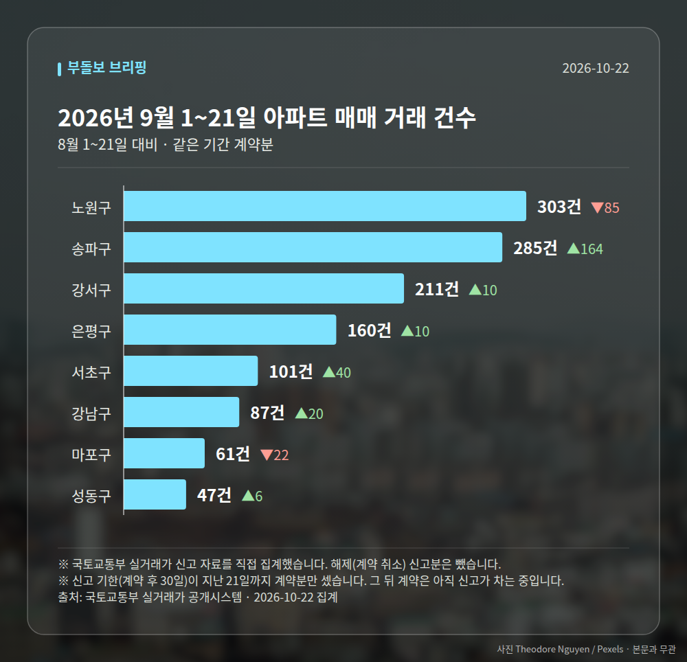

*이 글은 2026년 10월 22일 기준으로 정리한 내용입니다. 실거래 거래 건수는 2026년 9월 1~21일 계약분(신고 기한이 지난 것), 전세가율 등은 2026년 8월 신고분입니다.*
**3줄 요약**

- 청주 가경 아이파크 7·8단지 청약에 수요가 대거 몰렸습니다.
- 경쟁률 630대 1, 접수는 15만~16만 건으로 보도됐습니다.
- 매체별 수치 차이가 있어 공식 집계 확인이 먼저입니다.
청주 가경 아이파크 청약에 수요가 한꺼번에 몰렸습니다. 경쟁률은 630대 1로 지역 역대 최고치를 경신했다는 보도가 나왔습니다.

다만 접수 건수는 매체마다 달라, 정확한 규모는 공식 집계로 다시 확인할 필요가 있습니다. 오늘은 이 소식을 중심으로 정리해 드립니다.

## 청주 가경 아이파크 청약, 숫자로 보면

청주 가경 아이파크 7·8단지에 신청이 대거 접수됐습니다. 충청일보와 충북일보는 경쟁률 630대 1로 지역 역대 최고라고 전했습니다.

접수 건수는 매체별로 차이가 있습니다. 서울경제는 1순위 청약 15만 건으로 올해 전국 최다라고 보도했고, 충청매일은 전체 16만 건이 몰렸다고 전했습니다.

| 항목 | 수치 | 보도 매체 |
|---|---|---|
| 청약 접수 건수 | 16만건 | 충청매일 |
| 1순위 청약 접수 건수 | 15만건 | 서울경제 |
| 청약 경쟁률 | 630대 1 | 충청일보·충북일보 |

충북일보는 이를 전국 최대 청약접수 기록이라고 설명했습니다. 한국경제는 이 단지가 '아이파크 타운'의 마지막 분양이라고 보도했습니다.

## 청주 가경 아이파크 청약이 뜻하는 것

지방 분양시장에서도 특정 단지로 수요가 쏠리는 흐름이 뚜렷하다는 신호로 읽힙니다. 수도권만의 이야기가 아니라는 점이 눈에 띕니다.

다만 앞서 본 접수 건수가 매체별로 엇갈립니다. 여러분이 청주 가경 아이파크 청약 결과를 참고하신다면, 한국부동산원 청약홈 등 공식 집계를 기준으로 삼는 편이 안전합니다.

또한 이 경쟁률이 청주 전역의 분위기를 그대로 보여주는지는 자료만으로 단정하기 어렵습니다. 특정 단지에 집중된 수요일 가능성도 함께 열어 두어야 합니다.

[이미지: 청약 접수 창구 앞에 줄을 선 사람들 모습]

## 그 밖의 오늘 소식

- 규제지역(정부가 대출·세금 규제를 더 두는 지역) 확대 뒤 비규제지역 상승폭이 커진다는 보도가 나왔습니다.
- 인천 계양신도시 첫 민간분양 '카이브 유보라' 견본주택이 23일 문을 엽니다. 전용 84~93㎡, 총 1110가구입니다.
- 세종은 공무원 1만 명 유입 예고 속 신규 공급이 없어 전셋값이 먼저 움직인다는 보도가 있었습니다.

[이미지: 신도시 아파트 견본주택 외관 사진]

내일은 계양신도시 카이브 유보라와 상업시설 '시간' 견본주택 개관이 예정돼 있습니다. 분양가와 청약 일정은 아직 자료에 제시되지 않아, 현장에서 확인하시는 것이 좋겠습니다.

**그래서 나는?**

- 청주 청약 대기자라면, 가점과 순위 조건을 먼저 점검해 보세요.
- 계양신도시 실수요자라면, 23일 견본주택에서 분양 조건을 확인해 보세요.
- 세종 전세 계약을 앞뒀다면, 주변 전셋값 흐름부터 살펴보세요.

**직접 센 숫자 — 2026년 9월 1~21일 아파트 실거래**

서울 8개 구 계약 매매 **1255건** (8월 1~21일 1112건, +143건)

거래가 많은 곳: 노원구 303건(-85) · 송파구 285건(+164) · 강서구 211건(+10)

신고 기한(계약 후 30일)이 지난 21일까지 계약분끼리 견줬습니다.

노원구 전세가율 가운뎃값 **52.9%** (같은 단지·같은 면적 107곳)

서울 25개 구 가운데 거래가 가장 크게 움직인 곳: 송파구 +135.5%(121→285건, 장지동에 64.9% 몰림) · 서초구 +65.6%(61→101건, 서초동에 45.5% 몰림)

2026년 9~10월 계약 신고가

- 송파구 현대백조 31.0㎡ — 8.3억 (이전 최고 6.8억, +22.1%, 10월 7일 계약)
- 노원구 시영3차(라이프)아파트 49.5㎡ — 6.5억 (이전 최고 5.4억, +20.2%, 9월 10일 계약)

*국토교통부 실거래가 신고 자료를 직접 집계했습니다. 해제 신고분은 뺐습니다.*
**여러분이 지금 청약을 준비하는 지역은 공급이 이어지는 곳인가요, 아니면 이번이 거의 마지막 물량인 곳인가요?**

---

### 참고한 기사

1. **“규제 피하기만 하면 억 소리”…풍선효과 판 커지는 수도권 집값**
   - [매일일보](https://news.google.com/rss/articles/CBMiZEFVX3lxTE9tSkJTX1NZN3pxZFRCT2VrYk5YOUY5SEVWRGVnNUZjbk5yZi1PWm9JNWgyem1HTGJSamRlZjlodlBRSkZoZ2tLY2FfNzE2REZpTGd1enRVY3JKOFlFVklWaFlwUkM?oc=5)
   - [지피코리아](https://news.google.com/rss/articles/CBMiakFVX3lxTE85U1ZJRm05MldHNFNvOE1SaVpNSXBIcUc5WU9RZXRpZ3hnVThlVS1jOFgxcF9QVVVQVk9yWU5MVEphWFdrTGlUaVdmalVvZXB1S2hxaWNyRXdZOWR5Y3hvM3JyVk15WkF3ZUHSAW5BVV95cUxOYXhtbHdRS3k0YmxLS1VKVG14TlUxcnpXX0JWbGhKY1ZPWW11TjIzQnNuUW5Kc1dVYmxFTm03dlhHTVNETjdINzBNYV92MWR2NTh6bmFiRzJrV2tGaWp4Q1lmbXpkakQyZDctVTRFUQ?oc=5)
2. **청주 가경 아이파크 7·8단지 청약 16만건 몰렸다**
   - [충청매일](https://news.google.com/rss/articles/CBMiakFVX3lxTE5HcUR3WmpOTDF0ZUNmNHJmckFwT3FqeTZzVWFWWnVmcDFvSkx0NkdocGhrX0dtT1hwYkJKTU44V2w0ZjhSb2ozb0NPelB2enZpaWNIN21xX0FzUzdEZDdMMXlmMnZ1VUVaUnc?oc=5)
   - [충청일보](https://news.google.com/rss/articles/CBMicEFVX3lxTE1wXzZSNTBnc0ROUXFOaEQ3UlFwSGRsVV85N1lnbVJyQVZSbjJHWEs4NTJzYkdFdjVoRl8tZUxSdGRXYndqX0tjd2RBTEZ0RGwtSWwxY0k5QXhYdW9paUpUZUswdVJJeGdlQW12cDVNalk?oc=5)
3. **계양신도시 '카이브 유보라'…반도건설, 23일 견본주택 개관**
   - [매일경제·부동산](https://www.mk.co.kr/news/realestate/12181909)
   - [한국경제·부동산](https://www.hankyung.com/article/2026102153311)
4. **"세종에 새 공무원 1만명 온다"···집값보다 먼저 뛴 전셋값, 공급은 '제로'**
   - [스마트비즈](https://news.google.com/rss/articles/CBMibEFVX3lxTE9jSTlOa1hRbEo2c0d0UWwwbG5DaXFDVmY0TlhjNE9ELU4xVS1NWWZFX3NLVkxxR2Q3NjJNOHhVN1lEUWpaWmt2aDBUck40ZGFQSVFfU0QwWnZUOVdua1lEWkhwRzRnZDVXVlRCQw?oc=5)
   - [지피코리아](https://news.google.com/rss/articles/CBMiakFVX3lxTFBIVnltelJHTTdZOUE5TTJlMi0wYW40MTc5Vnc2WDVIdkVNU1ZQckkwemVYS0FEcXhKbmd2clpReTI0YWQ3OE1HWk9jTnJjRFNsSExMQU1pejNqUmpBeHZ1UEdGWElCSUtlcXc?oc=5)
5. **"분양가 지금이 가장 싸다"…청약·정책대출 문 두드려라**
   - [한국경제·부동산](https://www.hankyung.com/article/2026102152621)

---

*본 글은 공개된 언론 보도를 정리한 것이며, 투자 판단의 책임은 이용자 본인에게 있습니다.*
