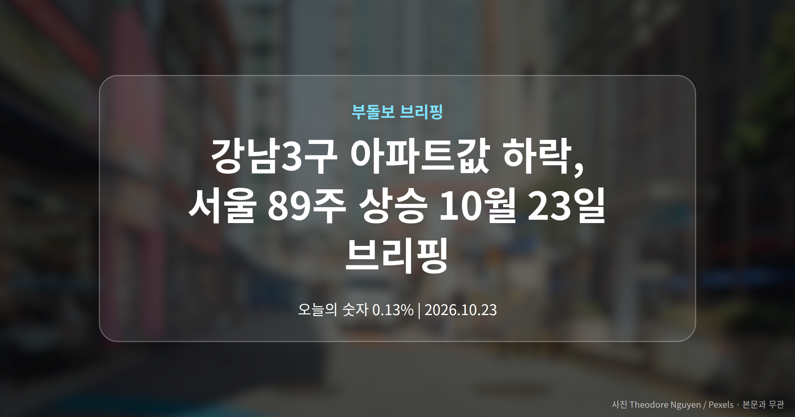
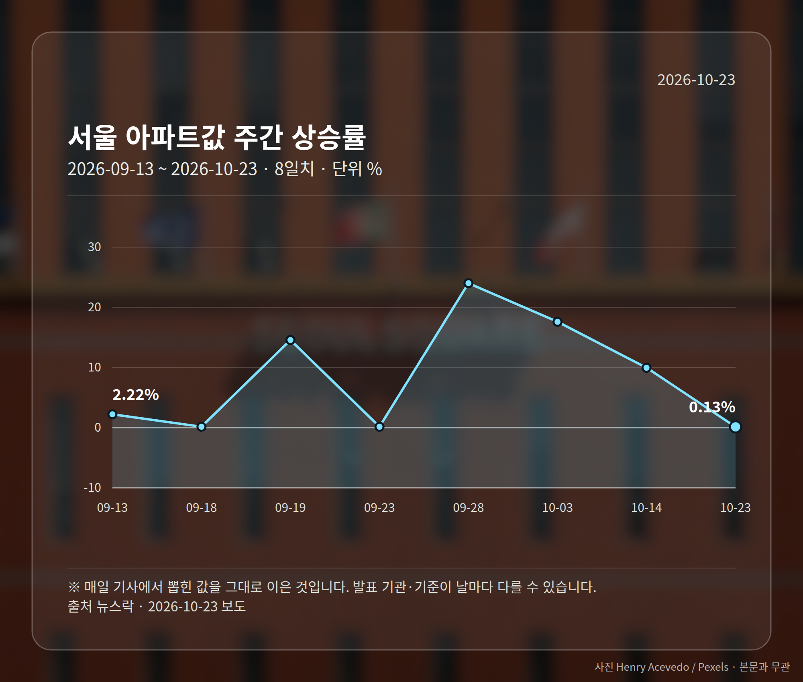
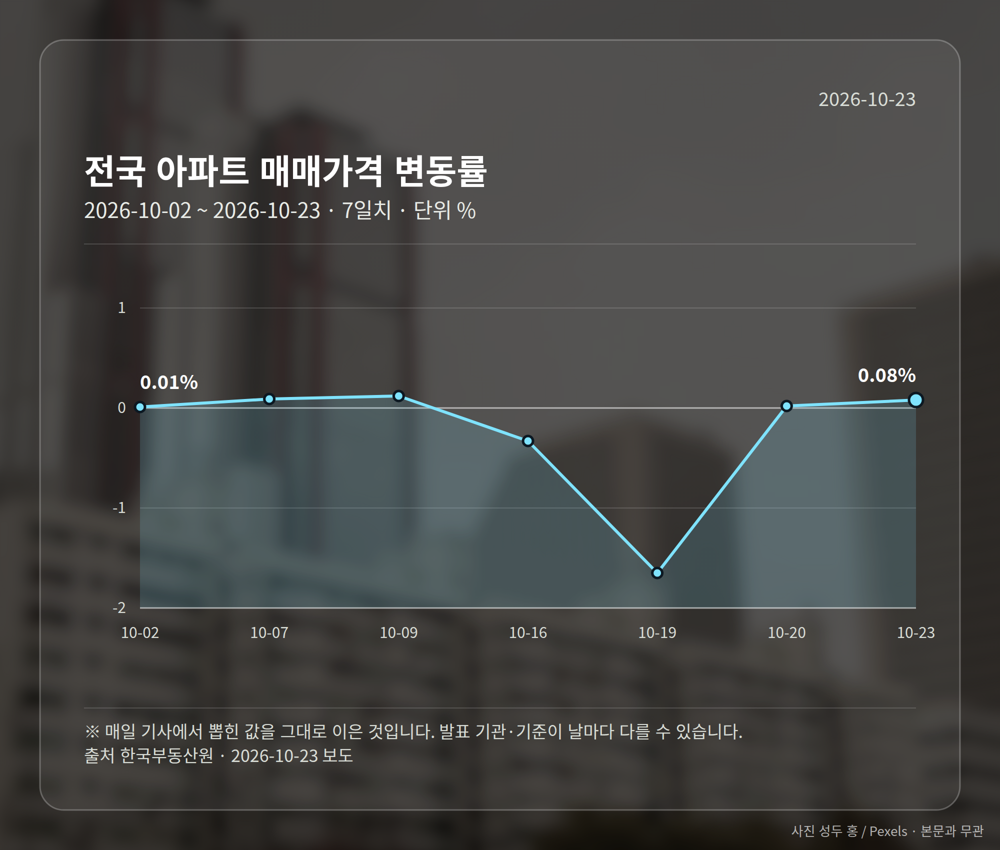
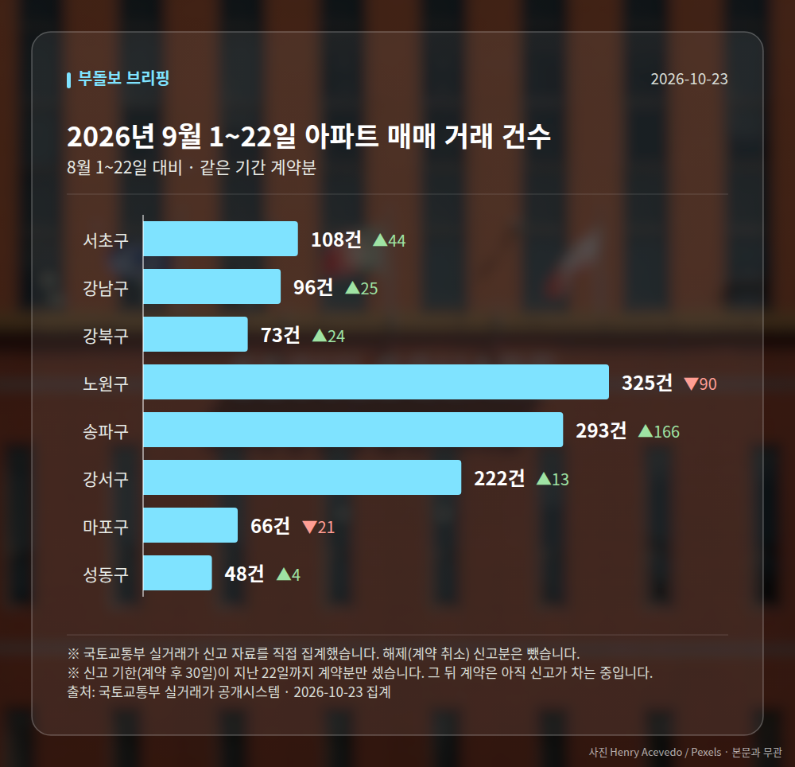

*이 글은 2026년 10월 23일 기준으로 정리한 내용입니다. 실거래 거래 건수는 2026년 9월 1~22일 계약분(신고 기한이 지난 것), 전세가율 등은 2026년 8월 신고분입니다.*
**3줄 요약**

- 서울 아파트값 89주 연속 상승, 강남3구만 하락 지속
- 서울 주간 0.13% 상승, 25개 구 중 19곳 상승률 둔화
- 전국 매매 0.08%·전세 0.11%, 전세가 더 빨리 오름
오늘(2026년 10월 23일) 발표를 모아 보면, 강남3구 아파트값 하락은 계속되는데 서울 전체는 89주 연속 상승을 기록했습니다. 다만 오르는 속도는 3주 만에 느려졌습니다.

한국부동산원이 발표한 10월 3주 전국 아파트 매매가격은 0.08% 올랐습니다. 수도권이 상승을 견인한 것으로 나타났습니다.

[이미지: 서울 아파트 단지가 보이는 도심 전경 사진]

## 강남3구 아파트값 하락, 서울 전체는 89주 연속 상승

서울 아파트값은 10월 3주 기준 89주 연속 상승했습니다. 주간 단위로 1년 7개월 넘게 한 번도 내림세를 기록하지 않았다는 뜻입니다.

그런데 강남3구(강남·서초·송파구)는 하락세가 이어졌습니다. 서울 전체는 오르는데 그동안 가장 비쌌던 지역만 내리는 '집값 역전' 현상으로 보도되고 있습니다.

상승을 이끈 지역에 대해서는 설명이 갈립니다. 강북 지역이 주도했다는 보도와 경기 남부가 강세였다는 보도가 함께 나와, 이 부분은 원문 확인이 필요합니다.

## 숫자로 본 10월 3주 서울과 전국

| 구분 | 수치 | 출처 |
| --- | --- | --- |
| 서울 아파트값 주간 상승률 | 0.13% | 뉴스락 |
| 상승률 낮아진 서울 자치구 | 19개 구(25개 중) | 조세금융신문 |
| 전국 아파트 매매가격 | 0.08% | 한국부동산원 |
| 전국 아파트 전세가격 | 0.11% | 한국부동산원 |

서울 상승률은 앞서 본 수치로 둔화됐고, 자치구 단위에서도 네 곳 중 세 곳 넘게 상승 폭이 줄었습니다.

전국 통계에서 눈에 띄는 대목은 전세입니다. 매매보다 전세가 더 빠르게 올랐습니다.

## 강남3구 아파트값 하락, 어떻게 봐야 할까요

서울 지수는 여전히 플러스지만, 속도는 줄고 특정 지역은 내리고 있습니다. 과열에서 숨고르기로 넘어가는지 지켜볼 구간이라는 해석이 나옵니다.

다만 매체별 표현 차이는 짚어 둬야 합니다. 한 매체는 '3주 만에 하락 전환'이라고 썼는데, 다른 매체들의 '상승폭 축소'와는 의미가 다릅니다.

오르는 폭이 줄어든 것과 실제로 값이 내린 것은 전혀 다른 이야기입니다. 강남3구 아파트값 하락 소식을 볼 때도 서울 전체 지수와 개별 지역을 구분해 읽으시는 편이 안전합니다.

## 그 밖의 오늘 소식

- 인천 주택 매매가격, 9월까지 2개월 연속 하락
- 인천 전세·월세는 같은 기간 상승폭 확대
- 국토부 장관 '전세의 월세화'(전세가 월세로 바뀌는 흐름) 발언에 여야 비판

**그래서 나는?**

- 서울 매수를 준비 중이라면, 구별 상승률 둔화 흐름부터 확인해 보세요
- 강남3구 보유자라면, 서울 전체 지수와 내 지역 흐름이 다를 수 있습니다
- 전세 계약을 앞뒀다면, 매매보다 높은 전세 상승률을 감안할 필요가 있습니다

**직접 센 숫자 — 2026년 9월 1~22일 아파트 실거래**

서울 8개 구 계약 매매 **1231건** (8월 1~22일 1066건, +165건)

거래가 많은 곳: 서초구 108건(+44) · 강남구 96건(+25) · 강북구 73건(+24)

신고 기한(계약 후 30일)이 지난 22일까지 계약분끼리 견줬습니다.

강남구 전세가율 가운뎃값 **37.9%** (같은 단지·같은 면적 30곳)

서울 25개 구 가운데 거래가 가장 크게 움직인 곳: 송파구 +130.7%(127→293건, 장지동에 63.1% 몰림) · 서초구 +68.8%(64→108건, 서초동에 44.4% 몰림)

2026년 9~10월 계약 신고가

- 송파구 현대백조 31.0㎡ — 8.3억 (이전 최고 6.8억, +22.1%, 10월 7일 계약)
- 노원구 시영3차(라이프)아파트 49.5㎡ — 6.5억 (이전 최고 5.4억, +20.2%, 9월 10일 계약)

*국토교통부 실거래가 신고 자료를 직접 집계했습니다. 해제 신고분은 뺐습니다.*
**여러분이 보고 있는 지역은 서울 평균과 같은 방향으로 움직이고 있나요?**

---

### 참고한 기사

1. **"집값 안정화"라는데…서울 아파트값 89주 연속 상승**
   - [데일리안](https://news.google.com/rss/articles/CBMiowJBVV95cUxQTmZ4WGszLXVKVmp2bjllWWM3Rl9QcldJcFNXQU9oeWhCb1M2eGtzbUhLLUlGMlZoemtJdWlKZnNjQUxjYW9wZ2FPYlQtYlozTjN2UTlUNEhBZU15cWJBWTNVSlcya0UxQlJiX3lvTDZwUlI1MFBjckQ5X3dBelkwSnRTMVU4ek5sZ3l5bkR5VXhWYW5yUWcxVXNVTVNyOXhYQXY4eDhfTG9pZ3ZqdERJeVRoQTc1VnBfNFZONm10a0NQLVNaREVXbDZydXF2ekh1YmxNbUJSb3JpNUJzUEQ5ZTBnRFJVMUh6UEtodDh1SjJVVXpaUDRtTlYtVEdScmJadnlQakt0RFQ0cXN4Umc0S2pxRlMyUDdWV2x3VlNGOE02S00?oc=5)
   - [https://www.ppss.kr/](https://news.google.com/rss/articles/CBMiZEFVX3lxTE05WUpEbGNUYVZSMm9GbFNfeVNOVUhYb0Nkbk9tRzBzNXZCY2tvaHlHV1VWNzhGUEZJQWNEWXlkbWJ1ckdOSDlxOXZnRHYwaXA1VmRwWUowUU9fMHQ2Z0FhUURHU24?oc=5)
2. **서울 아파트값 상승폭 축소…강남3구 하락 지속**
   - [코리아리포트](https://news.google.com/rss/articles/CBMicEFVX3lxTE9peEoyU3FEMHFwb3dUckdIeERjMDZSUkhjSE05WGJzY0x4QlJuMXlRS3ZvUTNQUWF1SkhTZGRYUHpqbG5aMUdxRmw3SGlMWGxLc1J6VWgwbzFndGdjbGM0d3VkdFV5WG9BYmFiNXN1UUI?oc=5)
   - [뉴스엔톡](https://news.google.com/rss/articles/CBMibEFVX3lxTE94aHdCYU1DYXByZDN0TUF3VEtUY1hBdzdhQkt2dk9hYzdNemRpanhuSW11bWYyNjhQZDEzQm0wVGdSTTNWYTlEbm9INDNiZHZybnhpMUdvQmFhd1I4dHZ1TTZucG5HSVlWVzV5Rg?oc=5)
3. **국토장관 "1인가구·전세사기에 전세의 월세화"**
   - [연합뉴스TV](https://news.google.com/rss/articles/CBMiZ0FVX3lxTE54M1loRVBHR1dHUzFVSkg4U2Y2d0pfa0Y2dlJlWlJSNlVrc2lLZEhvamRCdHBnel9vRGtaa2M0TG91eENHWWN1QVdpNE5SR21vd2NpN3E3elhiSHRRQzNBWmFyRUpTOEU?oc=5)
   - [한국일보](https://news.google.com/rss/articles/CBMic0FVX3lxTE4yVjRpRnlpMnc1NVBURHExbFVGeWgzYmtqX0c0SGh1TTYwR21hZ0VIUFpHdERzZWZ5TXd6Q1ZBT1VPRjBRc3RIOFQzQnVIQ2JtM2xvb09OSWxNcVB3eHFSbDE4OTRFR1paRVhXOGRxSy1GZlnSAXNBVV95cUxOMlY0aUZ5aTJ3NTVQVERxMWxVRnloM2Jral9HNEhodU02MEdtYWdFSFBaR3REc2VmeU13ekNWQU9VT0YwUXN0SDhUM0J1SENibTNsb29PTklsTXFQd3hxUmwxODk0RUdaWkVYVzhkcUstRmZZ?oc=5)
4. **인천 주택 매매가격 2개월 연속 하락…전세·월세는 상승세**
   - [오늘뉴스](https://news.google.com/rss/articles/CBMiREFVX3lxTE1CYjhyOEJXYWdDbkF1M0JSb05hbkpQc2VCVzg1UktMeVdobkQ3Q05maFp2R0tmcThCc1otUEhqd1B2N2hD?oc=5)
   - [경기신문](https://news.google.com/rss/articles/CBMiYkFVX3lxTFBIZGhuWHkyYnhycF9GdTlKbDUxYlRvNk1VMWt4T1YxYnF5V05jOEw5YlZLdmIwZUlZQU1iMHJWaE9fYUdtcHVFTWJudmVnV0I5dy1WOTM1dE44NVZzUjF3Mm13?oc=5)
5. **한국부동산원, 10월 3주 전국 아파트 매매가 0.08% 상승…수도권이 견인**
   - [국제뉴스](https://news.google.com/rss/articles/CBMibkFVX3lxTE9FU0xHSHdoU3VzQXNWTkEwNXJWdWUzeFh6bFd4SjlBRWhHQVcwS19FV3I0Qk1xZHFUSmgyTkFWVGZKNVRKbWg4MGdUTEFlaF9udlhIa09VQ0d4T0JaQWpld2l4QzlPaEZJVmVTZzZR?oc=5)
   - [전문건설신문](https://news.google.com/rss/articles/CBMia0FVX3lxTE5Wb0xNaHdqclVwSENlZzBFTy0yZXZ5WWpWQWZ3c3hiVW9XeGVYOHNMY0NmUXlTdTdvbmZlMldXekdQX1dPSVg0RE9lLTFyTGNBYVJKWkdEbEY0NENRMGNfYUdYZUx1MG16bnpj?oc=5)

---

*본 글은 공개된 언론 보도를 정리한 것이며, 투자 판단의 책임은 이용자 본인에게 있습니다.*
