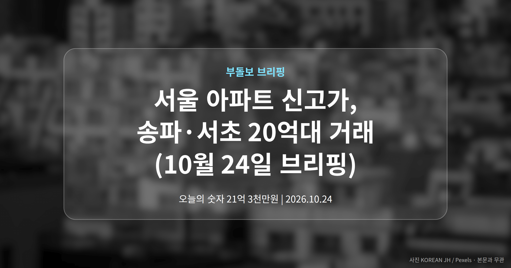
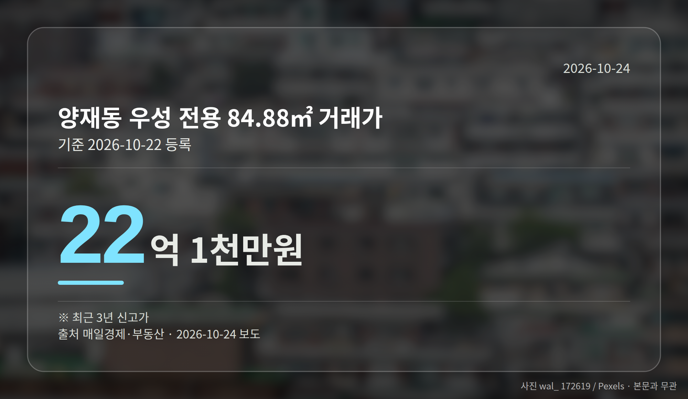
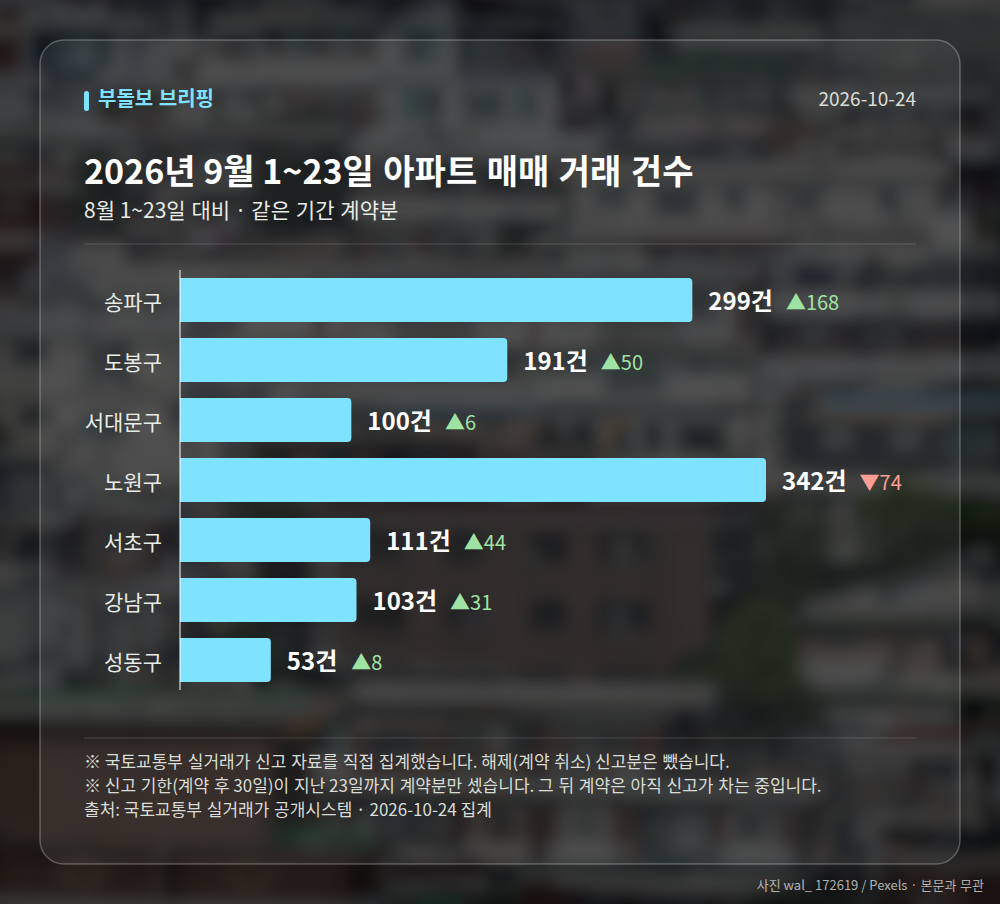

*이 글은 2026년 10월 24일 기준으로 정리한 내용입니다. 실거래 거래 건수는 2026년 9월 1~23일 계약분(신고 기한이 지난 것), 전세가율 등은 2026년 8월 신고분입니다.*
**3줄 요약**

- 10월 22일 등록 실거래서 서울 6개 단지가 3년 내 최고가
- 서초 양재동 우성 22억 1천만원, 송파 문정래미안 21억 3천만원
- 국토부는 상승폭 둔화·연말 안정화 전망, 엇갈린 신호 확인 필요
오늘(10월 24일) 가장 눈에 띄는 소식은 **서울 아파트 신고가**입니다. 10월 22일 국토교통부 실거래가 시스템에 등록된 거래에서 송파·서초를 포함한 6개 단지가 최근 3년 내 최고가를 새로 썼습니다.

같은 날 국회 국정감사에서는 국토부 장관이 "집값 상승폭이 둔화되고 있다"고 밝혔습니다. 시장 신호가 한 방향이 아니라는 뜻입니다.

[이미지: 서울 아파트 단지 전경]

## 서울 아파트 신고가, 어디서 얼마에 거래됐나

국토부 실거래가 시스템에 등록된 내용은 아래와 같습니다. 전용면적은 현관 안쪽 실제 사용 공간의 넓이를 말합니다.

| 단지 | 전용면적 | 거래가 |
|---|---|---|
| 서초 양재동 우성 | 84.88㎡ | 22억 1천만원 |
| 송파 문정동 문정래미안 | 84.96㎡ | 21억 3천만원 |
| 서대문 홍제삼성래미안 | 84.33㎡ | 12억 1,000만원 |
| 구로 개봉동 한마을 | 84.57㎡ | 12억원 |
| 관악 봉천동아 | 59.76㎡ | 11억 6,500만원 |
| 금천 관악산신도브래뉴 | 84.8㎡ | 7억 5천만원 |

여섯 곳 모두 최근 3년 내 신고가로 기록됐습니다. 다만 매일경제 보도는 요약문만 제공돼 계약일과 층수 같은 상세 정보는 확인되지 않았습니다.

## 강남권 밖에서도 나온 서울 아파트 신고가

이번 서울 아파트 신고가에서 눈여겨볼 대목은 지역 분포입니다. 송파·서초 같은 강남권만이 아니라 관악·구로·금천·서대문에서도 함께 나왔습니다.

상대적으로 저가 지역으로 분류되던 곳에서 중소형 평형이 최고가를 쓴 셈입니다. 서울 전역에 걸친 흐름을 보여주는 사례로 읽힙니다.

## 상승폭 둔화 전망과 어떻게 함께 볼까

홍지선 국토교통부 장관은 10월 23일 국회 국토교통위원회 종합국정감사에서 주택가격 상승폭이 둔화하고 있다고 말했습니다. 연말 금리가 상향되면 시장이 안정화될 수 있다는 전망도 내놓았습니다.

동시에 최근 수도권 주택난의 원인으로는 지난 3년간의 인허가 부족을 지목했습니다. 공공 부문은 올해 공급 목표 달성이 가능하지만 민간 공급은 부진하다는 진단도 덧붙였습니다.

정리하면 단기 안정화 전망과 중장기 공급 부족 문제가 같이 놓여 있는 상황입니다. 여기에 서울 아파트 신고가라는 국지적 상승 흐름이 겹치면서, 당분간은 한쪽 신호만 보고 판단하기 어려운 구간으로 보입니다.

[이미지: 국회 국정감사장에서 답변하는 모습]

## 그 밖의 오늘 소식

- 국토부, 집값 폭락·폭등 양방향 대응책 마련 방침 밝힘
- 투기과열지구(거래·대출을 조이는 규제 구역) 재건축 조합원 지위 양도 제한 완화 검토
- 전월세 월세화 현상의 원인은 공급 부족이라고 재확인

**그래서 나는?**

- 무주택 실수요자라면, 관심 단지의 최근 실거래 등록일부터 확인해 보세요
- 1주택 보유자라면, 내 단지 가격이 지역 흐름과 같은지 비교해 볼 시점입니다
- 정비사업 매물을 보는 분이라면, 조합원 지위 양도 완화 검토 경과를 지켜볼 필요가 있습니다

**직접 센 숫자 — 2026년 9월 1~23일 아파트 실거래**

서울 8개 구 계약 매매 **1199건** (8월 1~23일 1053건, +146건)

거래가 많은 곳: 송파구 299건(+168) · 도봉구 191건(+50) · 서대문구 100건(+6)

신고 기한(계약 후 30일)이 지난 23일까지 계약분끼리 견줬습니다.

도봉구 전세가율 가운뎃값 **65.3%** (같은 단지·같은 면적 34곳)

서울 25개 구 가운데 거래가 가장 크게 움직인 곳: 송파구 +128.2%(131→299건, 장지동에 63.2% 몰림) · 서초구 +65.7%(67→111건, 서초동에 43.2% 몰림)

2026년 10월 계약 신고가

- 도봉구 창동주공18단지 41.34㎡ — 6.0억 (이전 최고 4.9억, +22.4%, 10월 1일 계약)
- 송파구 현대백조 31.0㎡ — 8.3억 (이전 최고 6.8억, +22.1%, 10월 7일 계약)

*국토교통부 실거래가 신고 자료를 직접 집계했습니다. 해제 신고분은 뺐습니다.*
**여러분이 지켜보는 단지는 올해 들어 실거래가 얼마나 등록됐나요?**

---

### 참고한 기사

1. **홍지선 국토장관 “집값 폭락·폭등 모두 대응 방안 마련할 것”**
   - [아시아투데이](https://news.google.com/rss/articles/CBMibkFVX3lxTE5CUXFEbnI5eFhGaGZGUjN5TTAxU1pkWVJBdWNiZ1UtNm41eTNBcWZ3b09iR0lTZG5TbGV2MDZSc1lja2JlMDUyb2dUdFFFMks5OGozaXpuNGxJYTJRcVBFaThtR0VWX29keUZxbDJR?oc=5)
   - [비즈워치](https://news.google.com/rss/articles/CBMicEFVX3lxTE94SWNRLU5YWlF6Ry12X2R5bkk3ZXhIVEhDbWFGR0pjakZEV19veWItbGQyRU5Zb09zS2FUMkhsSHlUdk50ZzFCUEJBNkxZZ3ZjZUxBVXBLS2s0cEsxdlNKYWd0WkxkZ0FsY2lFeHp2U04?oc=5)
2. **홍지선 국토장관, 투기과열지구 내 조합원 지위 양도 제한 완화 “검토하겠다”**
   - [MTN 머니투데이방송](https://news.google.com/rss/articles/CBMiX0FVX3lxTFBfTEFaYk52cWtXcDdEc2Z1dHUzcUptclFLaE9kS1o1dDc5dHBSQXJMY2RfVTkyTXROZkJvNTZNSVl0MTFqRndlWG9BdENvX2pwT0lUcXZ6c3N6XzRkNjVJ?oc=5)
   - [서울경제](https://news.google.com/rss/articles/CBMiU0FVX3lxTFBGZ19rQk80UnhKTkQ1SkotTUtYUEJuSTdEV1dmQlhONDJLZjNoQmpQZnh1WFJNSHlDZXpYbTZTTWlFTVAtN1p6Qm5WcGRhM0ZJUk440gFTQVVfeXFMUEZnX2tCTzRSeEpORDVKSi1NS1hQQm5JN0RXV2ZCWE40MktmM2hCalBmeHVYUk1IeUNlelhtNlNNaUVNUC03WnpCblZwZGEzRklSTjg?oc=5)
3. **송파구 문정래미안 84.96㎡ 21억 3천만원… 최근 3년 신고가 [MAI부동산]**
   - [매일경제·부동산](https://www.mk.co.kr/news/realestate/12183842)
4. **홍지선 “집값 상승폭 둔화…연말엔 시장 안정화될 것”**
   - [SR타임스](https://news.google.com/rss/articles/CBMiaEFVX3lxTE0tcjg2WEs2QVBlOHEyYnhDdjQxODhlWno0bVRmYVBfbnZ4QXoxTnNnSVZZVGxJMVNsOWpkd3FJcHFycVZBTFNaVXJhRk9YR2V2ZUU0ZDFhcVlUN0YyaGM3bXZXcFA4WWl5?oc=5)
   - [연합뉴스](https://news.google.com/rss/articles/CBMiYEFVX3lxTFBYVnVHRU1PQk43WHh1MmhzUktJcjllZjZFN3VlS0Y1TXZGRHlfZFJJVUdHRHBWdlpCcHpVSENHWVJuZEVyd1RXYmRPNFVDVlB6X0xPTXNuenhrYUhJSFR3X9IBYEFVX3lxTFBYVnVHRU1PQk43WHh1MmhzUktJcjllZjZFN3VlS0Y1TXZGRHlfZFJJVUdHRHBWdlpCcHpVSENHWVJuZEVyd1RXYmRPNFVDVlB6X0xPTXNuenhrYUhJSFR3Xw?oc=5)
5. **국토부 장관 "월세화는 '공급 부족'이 원인… 집값 폭락·폭등 대책 마련 중"**
   - [한국일보](https://news.google.com/rss/articles/CBMibkFVX3lxTE9CMDJJNllSMkQxVEdBeEJad05jUlJxcXJlTkNOaGNZa0tDUHVBOW8yYUo1cUhhbU1YYk5ES252bk5Yd0d4MXBHdlZnaGV1MU5CTkpDUXo5eEJYSlZCbWdIUzJtdnBheWhNV2dlZjBR0gFzQVVfeXFMUFNxdll6OTZ6N0RKUHF2Q3huT0dVVi1nYXZXUzZDSElEYWl2cDFIRzVuRjZCZ3c3RVFreGJfN25HLS1ETlRZUHNGT2czTG05Zmc4UkpsMEgzYUxvYm1pRDBpZXlveWVyOW9WSVF3aFFLTGVKSQ?oc=5)
   - [딜라이트닷넷](https://news.google.com/rss/articles/CBMickFVX3lxTE5oRl9VU1lfQl81aUZINEtQMVh3c1E4SnROMlJqM2JOZ0loS25wRWJBZy0xSUg4MFZrM1lvb0ItQ1BJdExqb3BrSGZ5VEhtelBQOXY3RWRtZ1NDdVZfZFhsd3dXQmZCMVBzNVdYUWx3QXJOUdIBckFVX3lxTE5oRl9VU1lfQl81aUZINEtQMVh3c1E4SnROMlJqM2JOZ0loS25wRWJBZy0xSUg4MFZrM1lvb0ItQ1BJdExqb3BrSGZ5VEhtelBQOXY3RWRtZ1NDdVZfZFhsd3dXQmZCMVBzNVdYUWx3QXJOUQ?oc=5)

---

*본 글은 공개된 언론 보도를 정리한 것이며, 투자 판단의 책임은 이용자 본인에게 있습니다.*
