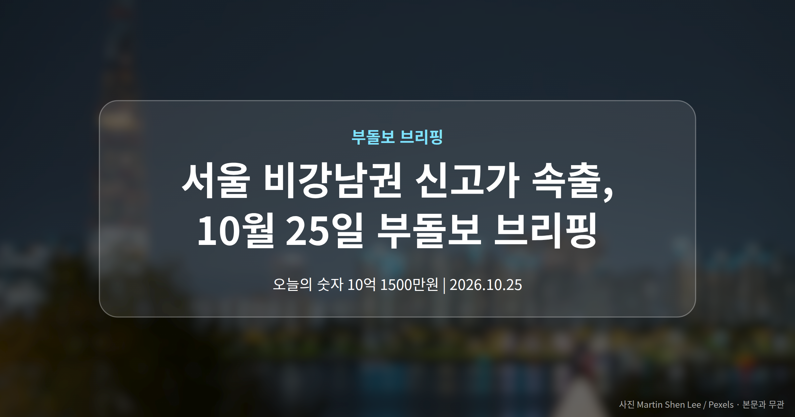
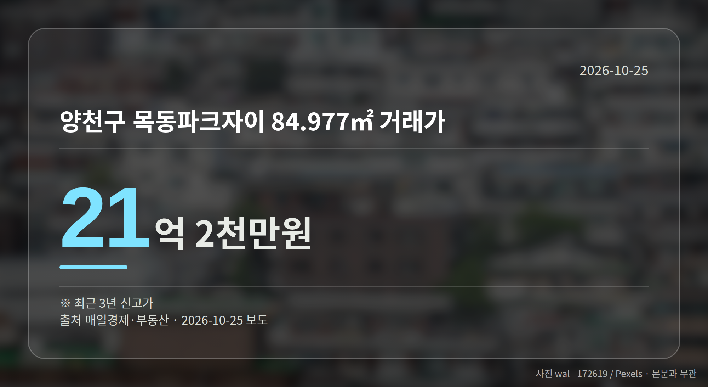
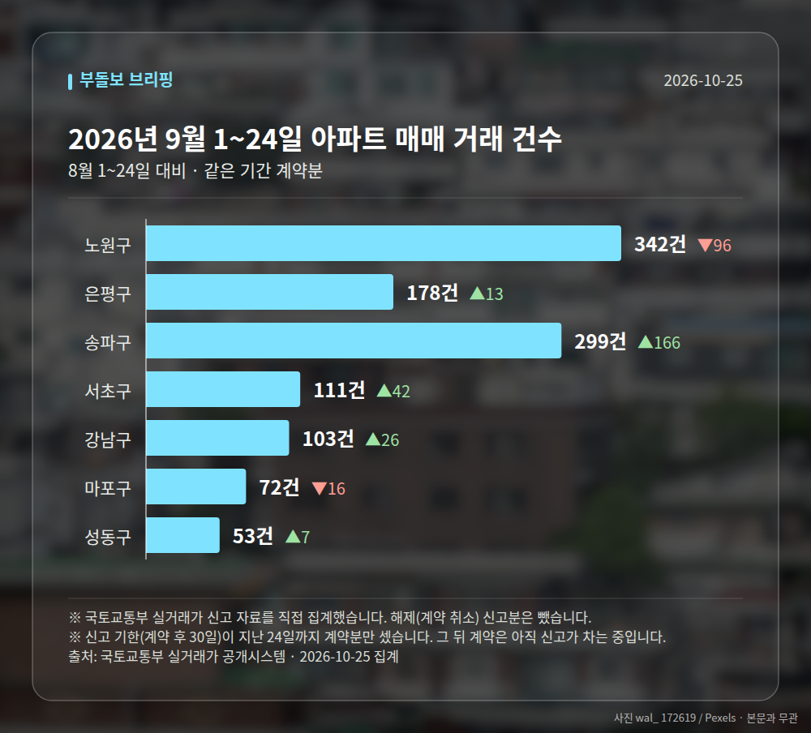

*이 글은 2026년 10월 25일 기준으로 정리한 내용입니다. 실거래 거래 건수는 2026년 9월 1~24일 계약분(신고 기한이 지난 것), 전세가율 등은 2026년 8월 신고분입니다.*
**3줄 요약**

- 서울 외곽 6개 자치구에서 최근 3년 신고가 거래가 동시 확인됐습니다
- 길음뉴타운2단지 13억 2500만원, 목동파크자이 21억 2천만원 거래
- 이번 주 전국 5555가구 청약, 수도권·부산 쏠림 여부를 보면 됩니다
2026년 10월 25일, **서울 비강남권 신고가** 거래가 한 주에 몰려 확인됐습니다. 은평·강북·금천·성북·동대문·중랑 등 6개 자치구에서 최근 3년 내 최고가 거래가 나왔습니다.

여기서 신고가(직전까지 기록된 최고 거래가격을 넘어선 거래)는 단지와 평형 단위로 집계됩니다. 지역 전체 시세가 그만큼 올랐다는 뜻은 아니라는 점을 먼저 짚어 둡니다.

[이미지: 서울 외곽 주거지역 아파트 단지 전경]

## 서울 비강남권 신고가, 어떤 단지에서 나왔나

자치구별로 확인된 거래가는 아래와 같습니다. 모두 매일경제·부동산 집계 기준 최근 3년 신고가입니다.

| 자치구 | 단지·면적 | 거래가 |
| --- | --- | --- |
| 은평구 | 북한산힐스테이트1차 59.817㎡ | 10억 1500만원 |
| 강북구 | 삼성래미안트리베라2단지 58.99㎡ | 10억 3300만원 |
| 금천구 | 금천롯데캐슬골드파크2차 59.27㎡ | 10억 7500만원 |
| 성북구 | 길음뉴타운2단지푸르지오 84.97㎡ | 13억 2500만원 |
| 동대문구 | 답십리청솔우성 59.89㎡ | 10억 8500만원 |
| 중랑구 | 용마금호타운 84.9㎡ | 8억 5500만원 |

전용 59㎡대 단지 네 곳이 모두 10억원선에서 거래됐다는 점이 눈에 띕니다. 이른바 강남3구가 아닌 자치구에서 비슷한 가격대가 동시에 형성된 모습입니다.

## 노원·양천까지 이어진 흐름

양천구 목동파크자이 84.977㎡는 21억 2천만원에 거래되며 신고가를 새로 썼습니다. 목동 재건축(낡은 아파트를 허물고 다시 짓는 사업) 기대가 반영된 가격대로 보입니다.

같은 구에서 이펜하우스2단지 84.51㎡가 9억원, 푸른마을3 59.91㎡가 7억 2천만원에 손바뀜했습니다. 은평구 백련산에스케이뷰아이파크 59.85㎡는 11억 1천만원입니다.

노원구 중계동 주공5는 44.94㎡가 6억원, 44.52㎡가 5억 7500만원으로 소형 두 건이 함께 신고가를 기록했습니다. 중저가 소형 평형에도 매수세가 닿고 있다는 신호로 읽힙니다.

## 서울 비강남권 신고가, 어떻게 읽어야 할까

같은 기간 압구정동 신현대12차가 92억원, 반포동 아크로리버파크가 62억 8천만원에 거래됐습니다. 초고가 시장과 외곽 중저가 시장에서 거래가 함께 확인된 셈입니다.

다만 기사에는 거래일과 직전 최고가 대비 상승폭이 제시되지 않았습니다. 서울 비강남권 신고가라는 사실만으로 내 단지 가격을 가늠하기보다, 같은 평형의 최근 거래 흐름을 따로 확인하는 편이 안전합니다.

[이미지: 부동산 중개사무소 매물 안내판 사진]

## 그 밖의 오늘 소식

- 이번 주 전국 5555가구 청약, 수도권·부산 중심 진행
- '아크메르 동탄' 등 9개 단지가 이번 주 청약 일정
- 단지별 물량·일정 세부 내용은 아직 공개되지 않았습니다

**그래서 나는?**

- 무주택 실수요자라면, 관심 단지의 평형별 최근 거래가부터 확인해 보세요
- 1주택자라면, 내 단지 가격이 지역 흐름과 같은지 따로 비교해 볼 때입니다
- 청약 대기자라면, 이번 주 수도권·부산 물량 일정부터 챙겨 보세요

**직접 센 숫자 — 2026년 9월 1~24일 아파트 실거래**

서울 8개 구 계약 매매 **1158건** (8월 1~24일 1101건, +57건)

거래가 많은 곳: 노원구 342건(-96) · 은평구 178건(+13) · 양천구 0건(-85)

신고 기한(계약 후 30일)이 지난 24일까지 계약분끼리 견줬습니다.

노원구 전세가율 가운뎃값 **52.9%** (같은 단지·같은 면적 107곳)

서울 25개 구 가운데 거래가 가장 크게 움직인 곳: 송파구 +124.8%(133→299건, 장지동에 63.2% 몰림) · 서초구 +60.9%(69→111건, 서초동에 43.2% 몰림)

2026년 9~10월 계약 신고가

- 송파구 현대백조 31.0㎡ — 8.3억 (이전 최고 6.8억, +22.1%, 10월 7일 계약)
- 노원구 시영3차(라이프)아파트 49.5㎡ — 6.5억 (이전 최고 5.4억, +20.2%, 9월 10일 계약)

*국토교통부 실거래가 신고 자료를 직접 집계했습니다. 해제 신고분은 뺐습니다.*
**여러분이 지켜보는 단지의 최근 거래가는 1년 전과 비교해 어느 쪽으로 움직이고 있나요?**

---

### 참고한 기사

1. **은평구 불광동 북한산힐스테이트1차 59.817㎡ 10억 1500만원… 최근 3년 신고가 [MAI부동산]**
   - [매일경제·부동산](https://www.mk.co.kr/news/realestate/12184787)
2. **노원구 중계동 주공5 44.94㎡ 6억원 거래… 최근 3년 신고가 [MAI부동산]**
   - [매일경제·부동산](https://www.mk.co.kr/news/realestate/12184786)
3. **수도권·부산 중심 분양…전국 5555가구 청약 : 네이버 블로그**
   - [Naver Blog](https://news.google.com/rss/articles/CBMijwFBVV95cUxPX3dyVkh4Uk84aF9pa3B6UFEycHBrX1hKLUk5aGd1a0ZfTjJScTJ2ckpudGVtcjJGX1l1emJPRDVSSkxmbDItZjgzQjNtQWxfSWM3RGFNZlpuV3VKcDFDbG5KZ0JTUkRWZ2pFdjRta1VQWnBTRGZZY3didmsteVQwTU5oanF4bWRpeUlrVGtzdw?oc=5)
   - [중앙신문](https://news.google.com/rss/articles/CBMi5AJBVV95cUxNOGtXNGxjNUdNaVQ2eVFVRml0Q0dFeHpmUEJsOVNoanU2WlN3NjFxMC01bDdPNzZZeC1oRlN2UEg0UXRSeWUyWjRlVnB3RFcweGd4OFduNzkzX2V0d0dxTU84Nk5VWFlDb2FmbjJNUGU1aDlQWkg0ZEl0dnltc0o0SDRZM2tGeDN2dHUyeGFuWkgzRzZqelktRDlTUEF0VXREQlpyb1dNN0h2ZlJfOXpuWU1NbGxOdk9vb2tQdnZMczl3aHpyV0RWX0RYcWVBU0x3SVZhdmlzMTU4RnFUUExnQnVzQ2lYZTczd0hiUVNzWDR2V0ZqRnRILW1KNjBzbTBiRVc5YUpYTXJBN05haFhUQk9RYzBSQkl4c1l0OXlTZHJZTW1UUWJTWkgyVmhiZTRWazJOU0VTLVRvMElhQ2o3dFZrdlZmRTlKWk9qQVRMV09fQVdvMm51NUt1RUU2bWZmZ2xGaw?oc=5)
4. **압구정동 신현대12차 92억원·반포동 아크로리버파크 62억 8천만원… 서울 아파트 고가 거래 [MAI부동산]**
   - [매일경제·부동산](https://www.mk.co.kr/news/realestate/12184777)
5. **이주 '아크메르 동탄' 등 9개 단지 청약**
   - [신아일보](https://news.google.com/rss/articles/CBMicEFVX3lxTE1PUXJubEU5THhYUGNSOWNsTTRYMGx4S0pUcHNRcXFxYmxQSWF3UzBZUlBIN3UzN0N6azVTMlRKb3FRRDJDWVpHbUptUElHbHNqaVpfY28tck5zRTlyRW1ObE5JdFdlR2JrR0VXQ280MVU?oc=5)

---

*본 글은 공개된 언론 보도를 정리한 것이며, 투자 판단의 책임은 이용자 본인에게 있습니다.*
