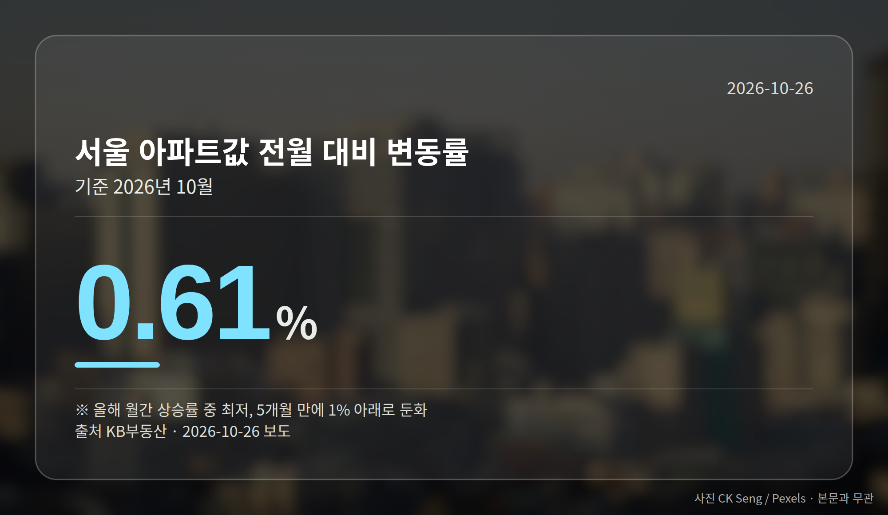
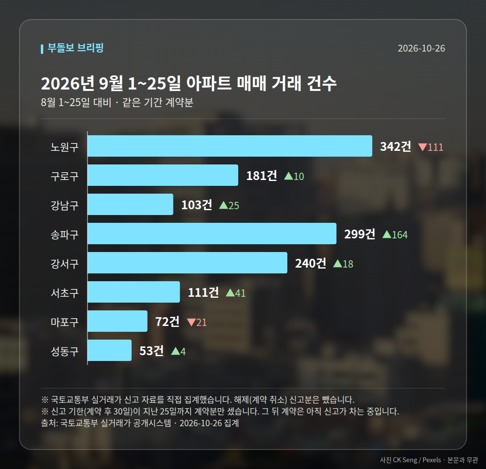

*이 글은 2026년 10월 26일 기준으로 정리한 내용입니다. 실거래 거래 건수는 2026년 9월 1~25일 계약분(신고 기한이 지난 것), 전세가율 등은 2026년 8월 신고분입니다.*
**3줄 요약**

- 10월 서울 아파트값 상승률이 올해 최저로 둔화됐습니다
- KB부동산 집계 0.61%, 5개월 만에 1% 아래로 내려왔습니다
- 다만 노원·강서·강동·구로는 최근 3년 신고가가 이어졌습니다
오늘은 서울 아파트값 상승률 이야기부터 꺼내야 할 것 같습니다. KB부동산 집계에서 10월 서울 아파트값은 전월 대비 0.61% 올라 올해 월간 기준 가장 낮았습니다.

5개월 만에 1% 아래로 내려온 수치입니다. 그런데 같은 달 서울 외곽에서는 최근 3년 신고가 거래가 잇따랐습니다.

## 서울 아파트값 상승률 0.61%, 어떻게 읽을까

KB부동산에 따르면 10월 상승률은 올해 들어 가장 낮은 수준입니다. 보도에 따르면 강남은 하락으로 돌아섰고, 경기 남부는 강세를 보였습니다.

여기서 한 가지는 짚고 가겠습니다. 상승률이 줄었다는 말은 가격이 내렸다는 뜻이 아니라, 오르는 속도가 느려졌다는 뜻입니다.

다만 강남의 하락 폭과 경기 남부의 상승 폭은 자료에 구체적인 수치가 제시되지 않았습니다. 그래서 둔화의 깊이를 숫자로 판단하기에는 아직 이릅니다.

## 노원구·강서구 등 외곽 단지는 최근 3년 신고가

같은 시기 국토교통부 실거래가 시스템에는 서울 외곽 단지의 신고가 거래가 올라왔습니다. 아래는 이번에 확인된 거래들입니다.

| 단지(전용면적) | 거래가 | 비고 |
| --- | --- | --- |
| 노원 중계동 현대1(4차) 71.16㎡ | 6억 6천만 원 | 3년 신고가 |
| 노원 하계동 미성 84.94㎡ | 9억 9천만 원 | 3년 신고가 |
| 강서 가양2단지(성지) 49.56㎡ | 10억 8500만 원 | 3년 신고가 |
| 강동 명일지에스 84.9㎡ | 15억 8천만 원 | 10월 24일 등록 |
| 구로 오류동 금강 84.96㎡ | 5억 7700만 원 | 3년 신고가 |
| 구로 고척동 우성·현대 68.7㎡ | 8억 1800만 원 | 3년 신고가 |

[이미지: 노원구 아파트 단지 전경 사진]

다만 관련 기사 대부분이 본문이 짧아, 이 거래들이 나온 배경이나 해당 지역 전체 흐름은 확인되지 않았습니다.

## 서울 아파트값 상승률 둔화와 신고가가 함께 나온 이유

두 소식은 반대처럼 보이지만, 지역별 온도차로 읽는 쪽이 자연스럽습니다. 서울 전체 평균은 느려졌는데, 상대적으로 중저가인 외곽에서는 거래가 위쪽에서 체결된 셈입니다.

개별 단지의 신고가 한 건이 그 지역 시세 전체를 뜻하지는 않습니다. 같은 단지, 같은 면적의 최근 거래를 여러 건 묶어서 봐야 흐름이 보입니다.

[이미지: 국토부 실거래가 공개시스템 조회 화면 캡처]

## 그 밖의 오늘 소식

- 서초구, 연내 '강남 1호' 재초환(재건축으로 생긴 초과이익 일부를 부담금으로 환수하는 제도) 부담금 부과 예고
- 국토부, 3기 신도시 교통사업 직접 인허가 대상 7곳으로 확대
- 10월 26~30일 전국 8곳 5555가구 청약(아크메르 동탄 1808가구 등)

**그래서 나는?**

- 무주택 실수요자라면, 외곽 단지 실거래가부터 확인해 보세요
- 1주택자라면, 내 지역이 둔화·강세 어느 쪽인지 봐야 합니다
- 청약을 준비 중이라면, 이번 주 8곳 일정부터 챙겨 보세요

**직접 센 숫자 — 2026년 9월 1~25일 아파트 실거래**

서울 8개 구 계약 매매 **1401건** (8월 1~25일 1271건, +130건)

거래가 많은 곳: 노원구 342건(-111) · 구로구 181건(+10) · 강남구 103건(+25)

신고 기한(계약 후 30일)이 지난 25일까지 계약분끼리 견줬습니다.

노원구 전세가율 가운뎃값 **52.9%** (같은 단지·같은 면적 107곳)

서울 25개 구 가운데 거래가 가장 크게 움직인 곳: 송파구 +121.5%(135→299건, 장지동에 63.2% 몰림) · 서초구 +58.6%(70→111건, 서초동에 43.2% 몰림)

2026년 9~10월 계약 신고가

- 송파구 현대백조 31.0㎡ — 8.3억 (이전 최고 6.8억, +22.1%, 10월 7일 계약)
- 노원구 시영3차(라이프)아파트 49.5㎡ — 6.5억 (이전 최고 5.4억, +20.2%, 9월 10일 계약)

*국토교통부 실거래가 신고 자료를 직접 집계했습니다. 해제 신고분은 뺐습니다.*
**여러분이 보고 계신 동네는 상승률이 꺾인 쪽인가요, 신고가가 나오는 쪽인가요?**

---

### 참고한 기사

1. **노원구 중계동 현대1(4차) 71.16㎡, 6억 6천만원 거래… 최근 3년 신고가 [MAI부동산]**
   - [매일경제·부동산](https://www.mk.co.kr/news/realestate/12185006)
2. **재건축 초과이익환수 부담금 연내 부과 가시화…강남권 아파트 거래시장 변수로**
   - [메가경제](https://news.google.com/rss/articles/CBMickFVX3lxTE1XdVBYNENJZVM0QzhpVjRVaEJvUUtjZzJxdEw3NnY3UHFEWmJGUWZzYTVrSlFIWk5kWElHM1VLSzBnck1lRDFjeUJxUXp1ZWlIZjRheHZrdWpLSGVMaEZrUkNLWGRlYzJ5ZlFKRWN5UENBd9IBckFVX3lxTE1XdVBYNENJZVM0QzhpVjRVaEJvUUtjZzJxdEw3NnY3UHFEWmJGUWZzYTVrSlFIWk5kWElHM1VLSzBnck1lRDFjeUJxUXp1ZWlIZjRheHZrdWpLSGVMaEZrUkNLWGRlYzJ5ZlFKRWN5UENBdw?oc=5)
   - [매일일보](https://news.google.com/rss/articles/CBMiZEFVX3lxTFA0M3pOb1dTMWVIbFNxWWMtbGxIbmRUa1lqZk91MERYNno4MkFWOHdZMFh6ZlJ0UUJabG5zaEtqQ0FzUTYtSXNzOWxLMS1xdktHQU5Vb3BXWGNfOF81aVlIa0xJSzQ?oc=5)
3. **3기 신도시 교통사업 직접 인허가 확대…국토부, 지연사업 `속도전`**
   - [소비자를 위한 신문](https://news.google.com/rss/articles/CBMiSEFVX3lxTFB1d0NlTHRHUmZZcXpGZEFURHIxVENwd3BOeHA5Tk1nMFNBZ3M0SnRqY2lwOXhFZUtjaVJfdm5XOUhBaWZTNUo1SA?oc=5)
   - [세계비즈](https://news.google.com/rss/articles/CBMiXEFVX3lxTE05S1JsYVZubXpDTVVPaW5JNkp4cGVnbU8xTzhSMExfYnVXRWxZaXo0V01RbmdOU1hoQ2VsRDZXSmhKMkViQnFSM2pjcXdTSEZ4U3FwNEJPVFB5dmhL?oc=5)
4. **KB부동산, 10월 서울 아파트값 전월比 0.61% 올라… 상승폭 올해 최저**
   - [서울경제TV](https://news.google.com/rss/articles/CBMiZEFVX3lxTE0xNk54ZUJpRkF5TVdRakpLUkI5bnU2OWZSNkxxWDdtUjdfZFIwZ3gtaDhwTVNQTWVsY0RLaHROdlVfWWZoU0VEQ3A4ZU1oSXZEWGdPU05RM1RZMlVWd2VFNHdOQk8?oc=5)
   - [천지일보](https://news.google.com/rss/articles/CBMiakFVX3lxTE5mNTR1eDFoMmJDMy1aUWJpa3p5UzZDMjJqUzh5bFMxY0VmUHNrNjdLNlNySE1sOHBnNXhPeWVIVVJkdVkydGlOa0FtRmhSdnJRU0pqOGZydFFBX0FJNkwxNFhVVk1idV9YVmc?oc=5)
5. **집값 뛰는 동탄서 새아파트 … 이번주 전국 5555가구 분양**
   - [매일경제·부동산](https://www.mk.co.kr/news/realestate/12185152)

---

*본 글은 공개된 언론 보도를 정리한 것이며, 투자 판단의 책임은 이용자 본인에게 있습니다.*
