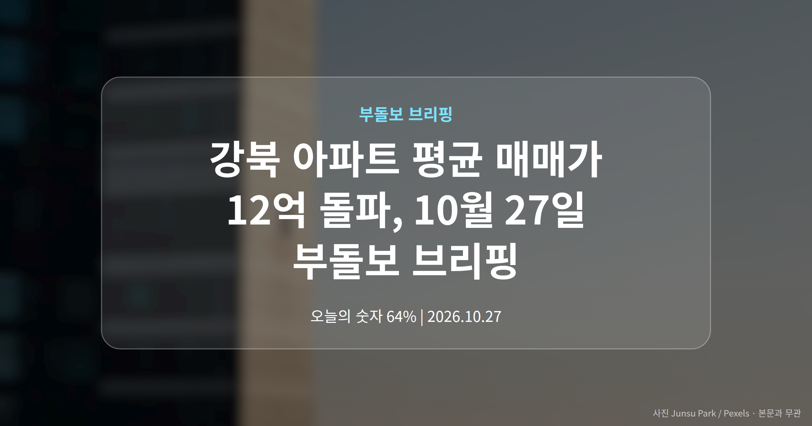
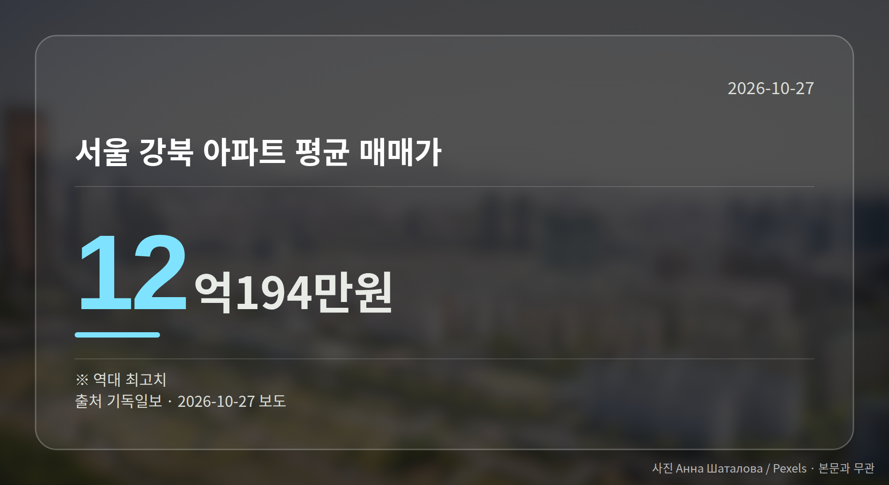
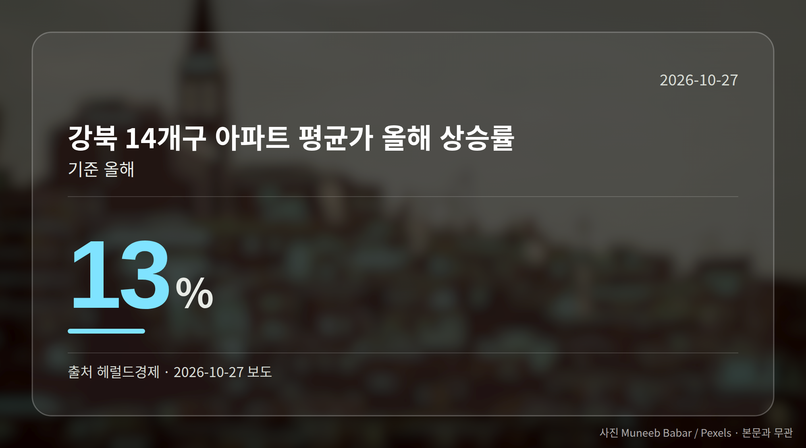

*이 글은 2026년 10월 27일 기준으로 정리한 내용입니다.*
**3줄 요약**

- 서울 강북 14개구 아파트 평균 매매가가 역대 최고를 기록했습니다
- 12억194만원, 반년 새 1억원·올해 13% 올랐습니다
- 서울은 89주 연속 상승이지만 강남3구는 약세, 온도차를 보세요
서울 강북 아파트 평균 매매가가 처음으로 12억원을 넘었습니다. 기독일보 보도 기준 12억194만원, 역대 최고치입니다.

같은 기간 한국부동산원 조사에서 서울 아파트값은 89주 연속 올랐지만, 강남3구는 약세가 이어졌습니다. 오늘은 이 두 장면을 함께 보겠습니다.

## 강북 아파트 평균 매매가, 왜 지금 화제일까

강북 14개구는 한강 북쪽 자치구를 묶어 부르는 구분입니다. 그동안 서울 평균보다 낮은 가격대로 묶여 있던 지역이죠.

그 평균이 12억원 선을 처음 통과했습니다. 반년 새 1억원이 오른 결과라는 보도(서울이코노미뉴스·뉴데일리)가 함께 나왔습니다.

| 항목 | 수치 | 출처 |
|---|---|---|
| 강북 아파트 평균 매매가 | 12억194만원 | 기독일보 |
| 최근 반년간 상승액 | 1억원 | 서울이코노미뉴스·뉴데일리 |
| 올해 상승률(강북 14개구) | 13% | 헤럴드경제 |
| 서울 전체 평균 매매가 | 16억원 | 메디컬투데이 |

다만 매체에 따라 '12억 돌파'처럼 범위로만 적은 곳도 있어, 정확한 금액은 위 수치로 확인하시는 편이 좋습니다.

## 89주 연속 상승인데 강남3구는 약세입니다

한국부동산원 10월 셋째 주(19일 기준) 조사에서 서울 아파트값은 0.13% 올랐습니다. 전주 0.16%보다 오름폭은 3주 만에 줄었습니다.

지역별로는 방향이 갈립니다. 서초구는 -0.32%로 낙폭이 커졌고, 강남구는 11주째 하락했습니다. 반면 성북·서대문구가 0.36%, 중구가 0.35% 올라 상승세를 떠받쳤습니다.

경기도 남부권도 강세였습니다. 화성 병점구 0.65%, 동탄구 0.57%, 안양 동안구 0.56% 순이었습니다. 서울 전세가는 0.16%로 역시 전주보다 둔화됐습니다.

## 강북 아파트 평균 매매가를 어떻게 읽을까

정리하면 서울 상급지는 쉬고, 외곽지와 경기 남부가 움직인 한 주입니다. 강북 아파트 평균 매매가 상승은 그 흐름이 숫자로 드러난 장면에 가깝습니다.

상급지와 외곽지의 가격 간격이 좁아졌다는 뜻이기도 하고, 동시에 서울 어디를 봐도 자금 부담이 올라갔다는 뜻이기도 합니다. 전체 평균 한 줄보다 내가 보는 자치구의 주간 변동률을 따라가시는 편이 체감에 가깝습니다.

[이미지: 스마트폰으로 아파트 시세를 확인하는 사람의 손]

## 그 밖의 오늘 소식

- 수도권 1순위 청약자 60~64%가 서울 신축에 쏠렸습니다
- 서울 공급 비중은 수도권 전체의 6%로 집계됐습니다
- IPARK현산, 군포 금정역세권1구역 4482억원 규모 수주

**그래서 나는?**

- 무주택 실수요자라면, 강북권 예산도 다시 계산해 볼 시점일 수 있습니다
- 1주택자라면, 상급지와 외곽지 격차가 좁혀진 흐름부터 확인해 보세요
- 청약을 준비 중이라면, 서울 공급 비중 6%라는 조건을 염두에 두세요
**여러분이 보고 계신 동네는 올해 어느 방향으로 움직였나요?**

---

### 참고한 기사

1. **서울 공급 감소 전망... 수도권 1순위 청약자 대부분 신축에 몰려**
   - [리얼캐스트](https://news.google.com/rss/articles/CBMiaEFVX3lxTE5PY3VFc0sxTGNVbGtnVXNWRlJOUFdHYVdHVVdwMWh5eHdTV1cySm83ZG1YN3NQenY0VHZyVEVpNnhCTENyRXJyT29saDItSG9nOGVHNHVSWWpFY1RFd2dWYUNuamZWMENm0gFsQVVfeXFMT1FBYlc4R1d4cmduV2RJaFVsVnBCcm8zempBN2RNVHN1cmJ1NUIzUjE3emZoeE5pVjdjRkZMZ280aGQ0YVdydHhpMFZ0dWdtS18xQWpma2VlWDVmZ0Q3a0NZblZxZHI5UDVNT3ht?oc=5)
   - [매일경제·부동산](https://www.mk.co.kr/news/realestate/12185632)
2. **서울 강북 아파트 평균 매매가 12억194만 원, 역대 최고**
   - [기독일보](https://news.google.com/rss/articles/CBMiV0FVX3lxTE1FelAwQWdRbHZOQkNHVXh5eGVYczJrbXFVRWFib3puWHlqQ3hkbjRaVXNWeEJxdWpVQkxPcUZrMmhjRnozbUVTaEs0VzAzUGFPaXJLdXN3WdIBXEFVX3lxTE1zakVqa3A1Mjd5MnQ4LTBnRXhtOVJ6V1JrYlEtdkdVOEd1Y0l2a3g2SHhWeGtEeFdxTGljRWxnWHlkRjc1R2RUS29EWlJTWVNjcGV2cXFMR3h2T0o1?oc=5)
   - [뉴스1](https://news.google.com/rss/articles/CBMiS0FVX3lxTE45VGZHWFdQUUYwb0pJRGF3RWNaTmFCSTRUY2RLVnJvR0MxNElqdkQxdzdXZjRIZHFHQmVDT2E4RnJ2Vnlqdi00cVpqOA?oc=5)
3. **“4000억 규모”…IPARK현산, 군포 금정역세권1구역 재개발사업 수주**
   - [매일경제·부동산](https://www.mk.co.kr/news/realestate/12185941)
   - [KPI뉴스](https://news.google.com/rss/articles/CBMiU0FVX3lxTE1zRWNfaERoc2dkcjI1ZEMtbVZRQTNjbUlKa0JvQ2Y5eFRnVkxoQXBocFM1Y2ZpbThKRXpNUVZKNFVDcUtiNm9MX1pZUjNOdkVoVkpj0gFTQVVfeXFMTXNFY19oRGhzZ2RyMjVkQy1tVlFBM2NtSUprQm9DZjl4VGdWTGhBcGhwUzVjZmltOEpFek1RVko0VUNxS2I2b0xfWllSM052RWhWSmM?oc=5)
4. **경기도 월세도 200만원이 ‘뉴노멀’ … 강남 집값 약세는 지속**
   - [매일경제·부동산](https://www.mk.co.kr/news/realestate/12186106)
5. **3기 신도시 도로공사 인·허가 기간 단축…대상 사업도 확대**
   - [한국방송뉴스](https://news.google.com/rss/articles/CBMiXkFVX3lxTE5YSzF2bDNtbng3TDE5a1NkUWdBVmhjSGpMalFFZVRkdDN4OHdvQ2lzd241eWZaY3NUdGdVTnp4RXFyNUN0Q2l0VGlEVndIeWlkN0lBNExIaGNnWDBLdEE?oc=5)
   - [아유경제](https://news.google.com/rss/articles/CBMiaEFVX3lxTFBZb1F1MDIybmtMLTlReGlZMkl2Q3kzNHhTUlhkYm9ITmdRZDFFSEJ5cnFrQldubV93enk5c2hOcDNhbUlDQW5YQ1hOSGVOajJOeVQ2dXRLaDB5NGFXeUdzNGROYnpHN0Vj?oc=5)

---

*본 글은 공개된 언론 보도를 정리한 것이며, 투자 판단의 책임은 이용자 본인에게 있습니다.*
