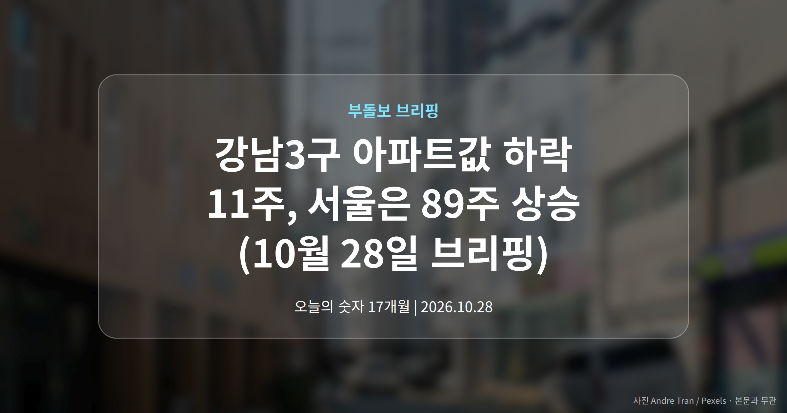
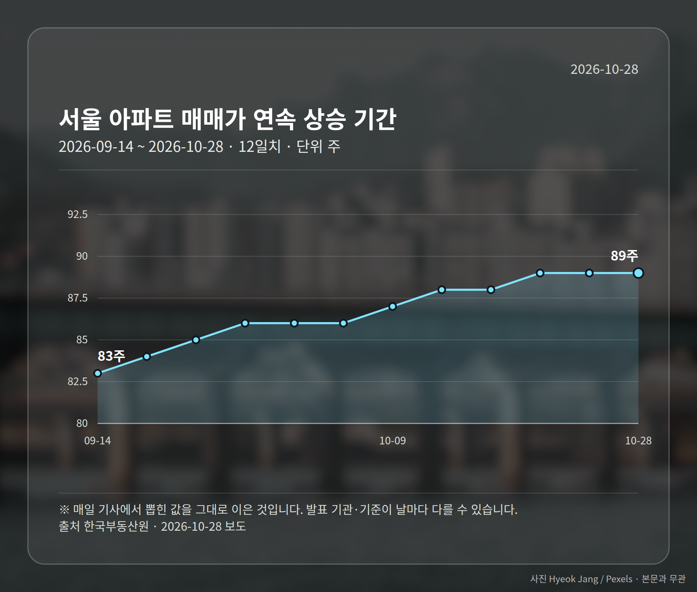
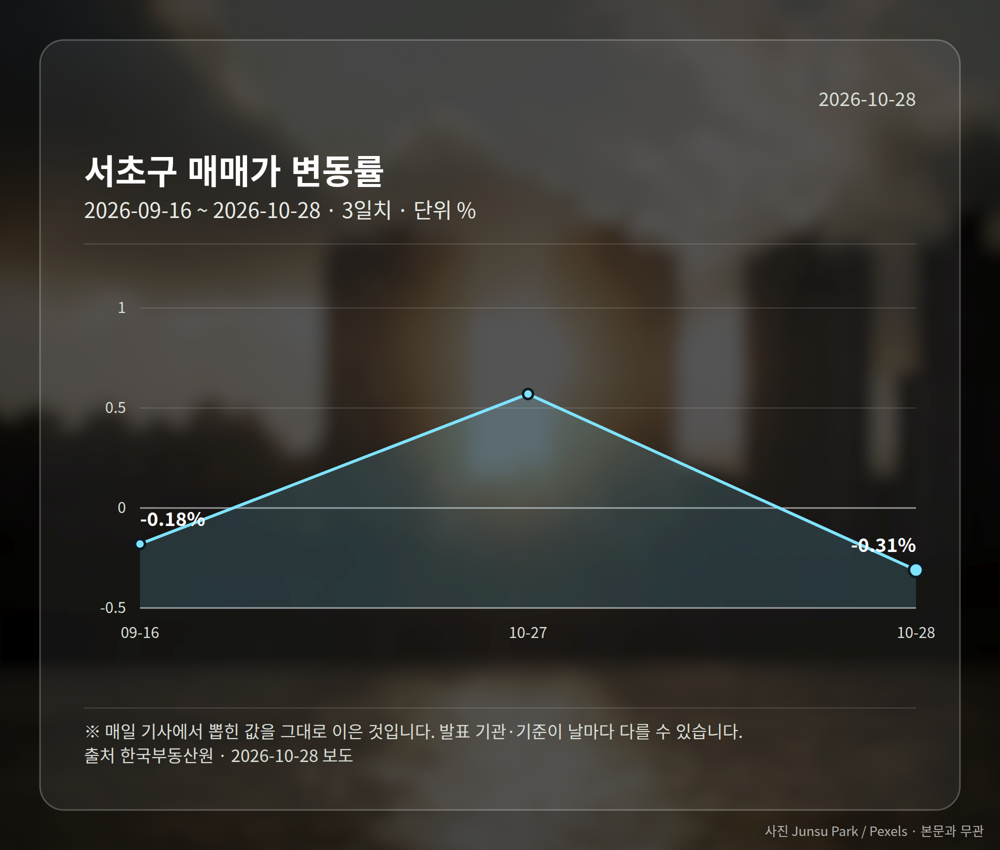
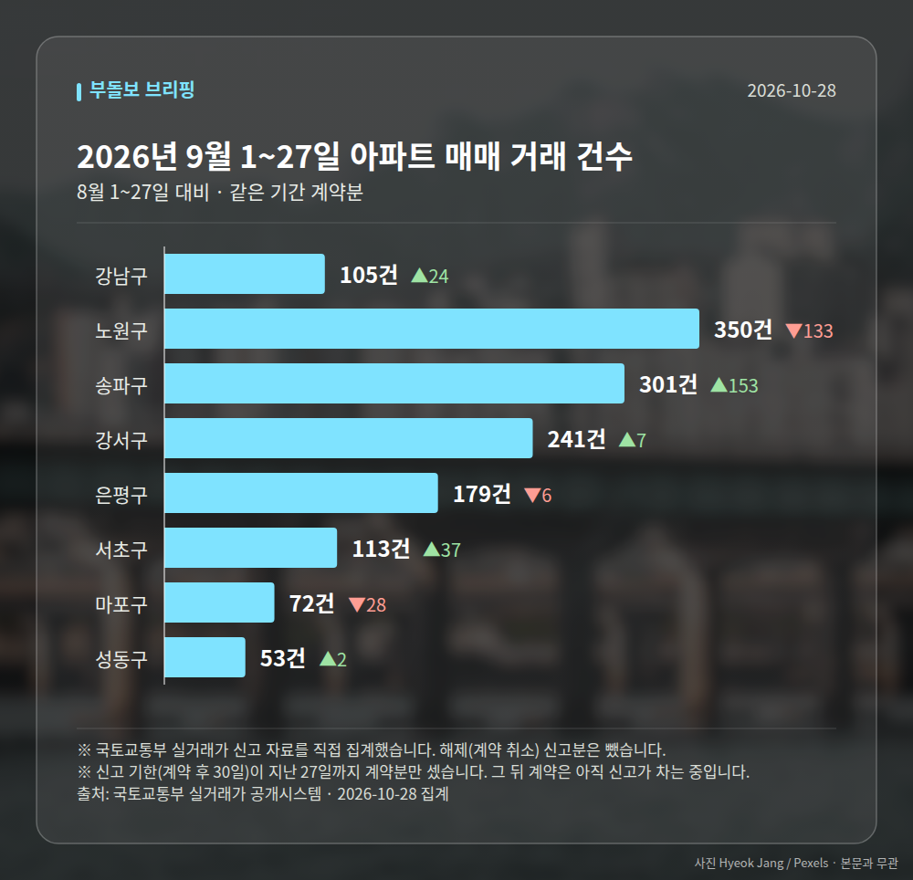

*이 글은 2026년 10월 28일 기준으로 정리한 내용입니다. 실거래 거래 건수는 2026년 9월 1~27일 계약분(신고 기한이 지난 것), 전세가율 등은 2026년 8월 신고분입니다.*
**3줄 요약**

- 서울 아파트값 89주 연속 상승, 강남3구만 반대로 하락
- 서초 -0.32%·강남 -0.31%·송파 -0.13%, 서울 전체는 0.13%
- 세제 정책 불확실성이 어떻게 정리되는지가 관전 포인트
서울 아파트 매매가격이 89주 연속 올랐습니다. 다만 같은 기간 강남3구 아파트값 하락은 두 달을 넘겼습니다. 한국부동산원 10월 셋째 주(19일 기준) 주간 동향에 담긴 내용입니다.

같은 서울 안에서 방향이 갈린 대목만 오늘 짚어 보겠습니다.

## 강남3구 아파트값 하락은 얼마나 이어졌나

서초구와 강남구는 11주 연속, 송파구는 7주 연속 내렸습니다. 서울 25개 자치구 가운데 가격이 떨어진 곳은 이 세 곳뿐입니다.

한국부동산원은 배경으로 세제 관련 정책 불확실성을 들었습니다. 세금 제도가 어떻게 바뀔지 정해지지 않아 사는 쪽과 파는 쪽 모두 판단을 미루는 분위기라는 뜻입니다.

| 구분 | 10월 셋째 주 변동률 | 상황 |
| --- | --- | --- |
| 서초구 | -0.32% | 11주 연속 하락, 전주 -0.27%보다 낙폭 확대 |
| 강남구 | -0.31% | 11주 연속 하락, 전주 -0.35%보다 낙폭 축소 |
| 송파구 | -0.13% | 7주 연속 하락, 전주 -0.21%보다 낙폭 축소 |
| 서울 전체 | 0.13% | 89주 연속 상승, 전주 0.16%에서 둔화 |

세 곳이 같이 움직인 것도 아닙니다. 서초구만 떨어지는 폭이 커졌고, 강남·송파구는 하락 속도가 오히려 줄었습니다.

## 강북 14개구는 반대로 움직였습니다

강북 14개구 평균은 0.26%, 강남 11개구 평균은 0.02%였습니다. 서울 안에서도 한강 북쪽과 남쪽의 온도차가 뚜렷했던 셈입니다.

성북구와 서대문구가 0.36%로 서울에서 가장 많이 올랐고, 중구는 0.35%로 전주(0.16%)의 두 배를 넘었습니다. 성동구 0.21%, 마포구 0.25% 등 한강벨트도 상승을 이어갔습니다.

반면 노원·금천구(각 0.26%)와 구로구(0.25%)는 전주보다 오름폭이 줄었습니다. 경기도 0.21%로 둔화했지만 화성 병점구 0.65%, 동탄구 0.57%, 안양 동안구 0.56%처럼 남부권은 강세였습니다.

서울 전세가격은 0.16%로, 전주 0.18%보다 상승세가 한 단계 누그러졌습니다.

[이미지: 한강을 가로지르는 서울 아파트 단지 전경 사진]

## 강남3구 아파트값 하락, 어떻게 볼까

'서울 집값 89주 상승'이라는 한 줄만 보면 전부 오르는 것처럼 읽힙니다. 실제로는 강남3구 아파트값 하락과 강북·경기 남부의 상승이 동시에 진행되고 있습니다.

다만 이번 수치는 한 주치 통계입니다. 세제 논의가 어떤 방향으로 정리되는지에 따라 흐름이 달라질 수 있어, 한두 주 더 지켜볼 구간이라는 평가가 나옵니다.

## 그 밖의 오늘 소식

- 서울 중형 오피스텔 매매가 17개월 연속 상승, 누적 3.17%
- 서울 오피스텔 월세 0.37% 상승, 2018년 통계 이후 최고
- 황희 의원, 무주택 실거주자 조합원 자격 예외 개정안 발의

여러분이 보고 계신 지역은 이번 주에 오른 쪽이었을까요, 내린 쪽이었을까요?

**그래서 나는?**

- 강남3구 보유자라면, 세제 논의 진행 상황부터 확인해 보세요
- 무주택 실수요자라면, 강북·경기 남부 오름폭 둔화 여부를 함께 보세요
- 전세 계약을 앞뒀다면, 서울 전세 상승률 둔화 흐름을 체크해 보세요

**직접 센 숫자 — 2026년 9월 1~27일 아파트 실거래**

서울 8개 구 계약 매매 **1414건** (8월 1~27일 1358건, +56건)

거래가 많은 곳: 강남구 105건(+24) · 노원구 350건(-133) · 송파구 301건(+153)

신고 기한(계약 후 30일)이 지난 27일까지 계약분끼리 견줬습니다.

강남구 전세가율 가운뎃값 **37.9%** (같은 단지·같은 면적 30곳)

서울 25개 구 가운데 거래가 가장 크게 움직인 곳: 송파구 +103.4%(148→301건, 장지동에 62.8% 몰림) · 서초구 +48.7%(76→113건, 서초동에 42.5% 몰림)

2026년 9~10월 계약 신고가

- 노원구 우방 59.74㎡ — 6.5억 (이전 최고 5.0억, +30.0%, 9월 21일 계약)
- 송파구 현대백조 31.0㎡ — 8.3억 (이전 최고 6.8억, +22.1%, 10월 7일 계약)

*국토교통부 실거래가 신고 자료를 직접 집계했습니다. 해제 신고분은 뺐습니다.*
**여러분이 보고 계신 지역은 이번 주에 오른 쪽이었을까요, 내린 쪽이었을까요?**

---

### 참고한 기사

1. **아파트 대신 중형 오피스텔? 서울 매매가 17개월째 상승**
   - [매일경제·부동산](https://www.mk.co.kr/news/realestate/12187316)
   - [로이슈](https://news.google.com/rss/articles/CBMiekFVX3lxTE52MnZBVmVManduS20wWmgzUUFwNEFMbnBYQmdpQm05NHdWd0QzZTJ1b1cxY0VnSEN3N1lsNS1aak1jNzhCZERnZkp2MDRzUUhIQWZSRkc5cVhZMnV4em5BM25Tb3RuVFpaZTdFUjFnVmt2SHpPUUNuREhB?oc=5)
2. **경기도 월세도 200만원이 ‘뉴노멀’…강남 집값 약세는 지속 [부동산 손품노트]**
   - [매일경제·부동산](https://www.mk.co.kr/news/realestate/12187348)
3. **신상진 성남시장 “국토부 교통영향평가 지침, 분당 재건축 일정 차질 우려”**
   - [에너지경제신문](https://news.google.com/rss/articles/CBMiW0FVX3lxTE55UF9qNlVETU9Oa0xxbnlpRkQ1bVpTNDFfaEpxaWJ3Tm1UcEV5UWJsbGMydUZjOWl4MXZpX2QwYTZUaGtLQ2ZDZEpUWUVRd3ZFTGozb0RvTUdDMWM?oc=5)
   - [경기중앙신문](https://news.google.com/rss/articles/CBMiaEFVX3lxTFBwN2gyNXF4bEpVR0pjTGNxOGE0ZGZIZG5Mb0pidXI0eVBsV3ZGYW1hMk9iemxNOUFLdldMMG5qdE5xcDhoM1ctVlR2ZnJENU9PaWp4NDc5TnVBaXh1aDRLWlZMOEk1OVd3?oc=5)
4. **‘재개발 물딱지’ 사라질까…실수요자 조합원 지위 허용 개정안**
   - [매일경제](https://news.google.com/rss/articles/CBMiVkFVX3lxTE5fa3VvMi15UEpWa1NobUgzYi1QVXFNc1BlSWFrVkFablBaQ3RnMVZrSzRNOERCX2xXb1hBMFdCMHNYTzFKZHU2d2FNNUlYQ3dnUHQ1OTFn?oc=5)
   - [브릿지경제](https://news.google.com/rss/articles/CBMiWkFVX3lxTE1KVmx0TzdVdmJHTFJfVWNKQnRsbFE4RnlvcHdGdmpBYXpLcG1KczVGTjUwbUxHRThxM01EQWtUN19kQjN2NElYbndkU0luaGFlSUJmaXBIdG03UQ?oc=5)
5. **아파트값·전셋값 오르자…수도권 중대형 오피스텔 분양 잇따라**
   - [한국사회복지저널](https://news.google.com/rss/articles/CBMibEFVX3lxTE1NV29fNTZPR0RtQmRGZjJueXRkdE9mWUlDckk3ZTdQZlhDTEY4SnpsN1ZaMlpzaEJLVTNaUXFzNVk2VmwtYUZHRFNraHMxVV9oOVB3MDhEYm1YUWlvV1ZBdGdRUVJQdnZVR3MzRw?oc=5)
   - [유스연합](https://news.google.com/rss/articles/CBMiU0FVX3lxTFAxT2UxdUJ4NkpCRDBNcm1hS3lDMVNqYndDUFgwS3VXU2QyWjRJRTh3MWxTRXF5ZTMzYk41bG5HdEVpSkc1V1pGWDMwb3Z2MkFMZFJF?oc=5)

---

*본 글은 공개된 언론 보도를 정리한 것이며, 투자 판단의 책임은 이용자 본인에게 있습니다.*
