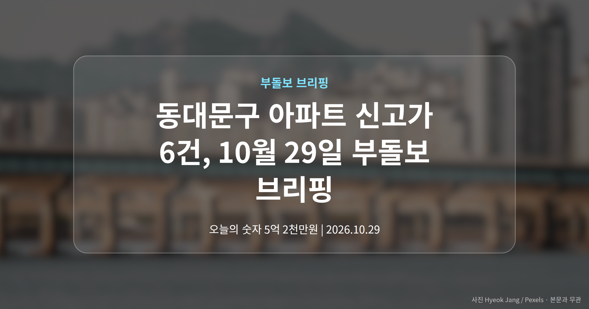
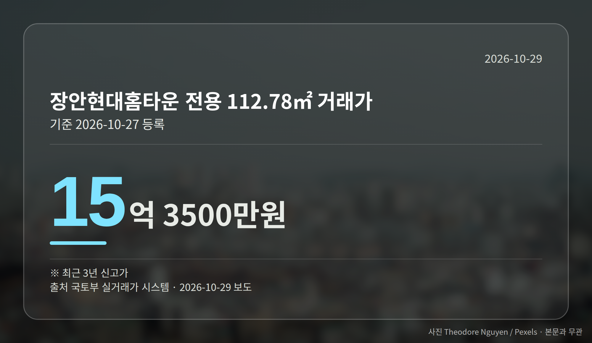

*이 글은 2026년 10월 29일 기준으로 정리한 내용입니다. 실거래 거래 건수는 2026년 9월 1~28일 계약분(신고 기한이 지난 것), 전세가율 등은 2026년 8월 신고분입니다.*
**3줄 요약**

- 중랑·동대문 6개 단지 거래가 신고가로 등록됐습니다
- 5억 2천만원부터 15억 3,500만원까지 면적별로 갈렸습니다
- 단지별 개별 거래라 지역 전체 시세로 보긴 어렵습니다
오늘(10월 29일) 브리핑의 무게는 서울 동북권에 있습니다. 동대문구 아파트 신고가를 포함해 중랑구까지 6개 단지 거래가 최근 3년 내 가장 높은 가격으로 등록됐습니다.

다만 모두 단지별·면적별 개별 거래입니다. 지역 전체가 올랐다는 뜻으로 읽기는 어렵습니다.

[이미지: 서울 동북권 아파트 단지가 보이는 주거지 풍경]

## 동대문구 아파트 신고가, 어떤 단지에서 나왔나

2026년 10월 27일 국토부 실거래가 시스템(매매 계약을 신고하면 실제 거래가격이 공개되는 정부 사이트)에 중랑구·동대문구 아파트 6건이 새로 올라왔습니다.

동대문구에서는 장안현대홈타운(336)이 두 개 면적에서, 전농동 래미안아름숲이 한 개 면적에서 최고가를 찍었습니다. 중랑구에서는 묵동 신내4단지와 면목동 두 단지가 이름을 올렸습니다.

| 단지 (전용면적) | 거래가 | 비고 |
|---|---|---|
| 중랑 묵동 신내4단지 (39.84㎡) | 5억 2천만원 | 최근 3년 내 신고가 |
| 동대문 장안현대홈타운336 (59.54㎡) | 12억 7천만원 | 최근 3년 신고가 |
| 동대문 장안현대홈타운336 (112.78㎡) | 15억 3,500만원 | 최근 3년 신고가 |
| 동대문 전농동 래미안아름숲 (84.92㎡) | 15억원 | 동일 단지·면적 신고가 |
| 중랑 면목동 경남아너스빌 (59.981㎡) | 9억 2천만원 | 최근 3년 내 신고가 |
| 중랑 면목동 쌍용더플래티넘용마산 (84.9731㎡) | 12억 5천만원 | 최근 3년 신고가 |

여기서 전용면적은 현관 안쪽, 실제로 쓰는 면적을 말합니다. 같은 단지라도 면적이 다르면 가격대가 크게 벌어진다는 점이 표에서도 보입니다.

## 동대문구 아파트 신고가, 어떻게 봐야 할까

의미가 있는 쪽은 '동시성'입니다. 서울 외곽으로 분류돼 온 두 자치구에서 6건이 한꺼번에 최고가로 등록됐습니다.

반대로 한계도 분명합니다. 기사에는 거래 배경이나 급등 원인에 대한 설명이 없습니다. 또 각 거래는 해당 단지·해당 면적의 기록일 뿐입니다.

그래서 동대문구 아파트 신고가 소식을 볼 때는, 내가 보는 단지의 같은 면적 거래가 실제로 등록됐는지부터 확인하는 편이 안전합니다. 호가와 등록된 가격은 다를 수 있습니다.

[이미지: 신도시 외곽 도로와 공사 중인 교통시설 현장]

## 그 밖의 오늘 소식

- 국토부·대광위, 3기 신도시 광역교통망 전수점검 착수
- 교통대책 1~2주 주기 점검, 입주 전 지연 요인 집중관리
- 한국부동산원, AI 시세 기술로 공공기관 AI 부총리상 수상

여기서 광역교통개선대책은 신도시 입주에 맞춰 도로·철도를 함께 깔겠다는 계획을 뜻합니다. 지연 우려가 공식적으로 나왔다는 점은 입주 예정자라면 기억해 둘 만합니다.

**그래서 나는?**

- 동북권 보유자라면, 같은 단지·같은 면적 거래만 비교해 보세요
- 매수 준비 중이라면, 호가가 아닌 등록된 실거래가부터 확인해 보세요
- 3기 신도시 입주 예정자라면, 광역교통망 진행 상황을 계속 볼 필요가 있습니다

**직접 센 숫자 — 2026년 9월 1~28일 아파트 실거래**

서울 8개 구 계약 매매 **1251건** (8월 1~28일 1200건, +51건)

거래가 많은 곳: 노원구 364건(-131) · 중랑구 120건(-69) · 동대문구 102건(-25)

신고 기한(계약 후 30일)이 지난 28일까지 계약분끼리 견줬습니다.

노원구 전세가율 가운뎃값 **52.9%** (같은 단지·같은 면적 107곳)

서울 25개 구 가운데 거래가 가장 크게 움직인 곳: 송파구 +100.0%(152→304건, 장지동에 62.2% 몰림) · 서초구 +51.9%(77→117건, 서초동에 41.0% 몰림)

2026년 9~10월 계약 신고가

- 동대문구 동답한신 59.22㎡ — 8.2억 (이전 최고 6.4억, +28.9%, 10월 17일 계약)
- 중랑구 엘지,쌍용아파트 84.67㎡ — 9.3억 (이전 최고 7.5억, +23.6%, 9월 2일 계약)

*국토교통부 실거래가 신고 자료를 직접 집계했습니다. 해제 신고분은 뺐습니다.*
**여러분이 보고 계신 단지는 같은 면적의 최근 거래가와 호가 차이가 어느 정도인가요?**

---

### 참고한 기사

1. **중랑구 묵동 신내4단지 39.84㎡ 5억 2천만원… 최근 3년 신고가 [MAI부동산]**
   - [매일경제·부동산](https://www.mk.co.kr/news/realestate/12188070)
2. **부동산원, 공공기관 AI 혁신 챌린지 부총리상**
   - [파이낸셜뉴스](https://news.google.com/rss/articles/CBMiWkFVX3lxTE9xMVdVWW5ZU0MyOXhPUFd2N0NwMVlXUmxYN3hCT1Jick9vQTJCTmEwQWtUdGxIUTFPTnpKRGZlX3M3VGxiczNMTUpqb3VQZkduWGZpWnFnbGVvQQ?oc=5)
   - [진일보 | 전남일보](https://news.google.com/rss/articles/CBMib0FVX3lxTFBZaHY0dWx3aFoyaEY4VTBaems4aFUtaXFWYUdTaFljcXpvVzI1elloNURRbkFyZE9faVJPMG1NTTBuT3lyUGk4alZ2d0JPcGItdy11Z3YwanJ2ZzFkODIwN2JUQWNBZEw1T2RQNXpxbw?oc=5)
3. **국토부, 3기 신도시 교통대책 전수점검…“지연 사업 집중관리”**
   - [아시아투데이](https://news.google.com/rss/articles/CBMibkFVX3lxTE5TZFBGNXM0VDVITlMtN3diM18wLXNNNHhJR2hhR0pwX3J4ZUdyYUFnWENzSm1pWTZYT0Fnc3gzenllcEQ3ZFVBZkh2eEdRUFpGUFFvMXgtMDU2LVRwUWVfQnpxVmhvTHZxUXNrZWVB?oc=5)
   - [KB Think](https://news.google.com/rss/articles/CBMickFVX3lxTE9BbjBEUktKWnUzbWM1clM4aHJZWkItTGVWUmk5UUhaS08tZ0lSWkdaVExYbnRSbFhZYlZsYUxIUDNmZGQ0OVdRNFhjeXFaTFVOZTRkOFpnSnpDNC1XUmt6UkdJVHlKVmFiRFh3U2RaMGt4UQ?oc=5)
4. **국토교통부, 3기 신도시 광역교통시설 적기 구축에 총력**
   - [아시아통신](https://news.google.com/rss/articles/CBMiYEFVX3lxTE1QTEVuT0FDc3drNGJHR2k5US1VcWdIWHNYWThTMDYwY3A1ZGs0RlFRRVRiOHpvZzE3Q1BxMjlra2xqNjd4dHNBYmdIVlNxNlBYdVRfQTRJTW5yNEhQM2pGWQ?oc=5)
   - [SR타임스](https://news.google.com/rss/articles/CBMiaEFVX3lxTFBDcUh4QkNfRE5sNnA0eFFXMFF2R0hfN2lYbmVKNmpWNHQyUmd0SUoxZmcxQy1NNVJrNEJtclBJSHMyeWR0WjRsUy1XME8ycHJaY3VsTFFjT0txUWVwMW84Y0R1bUJoVmFR0gFrQVVfeXFMTjRzSlREVGI4TnlMTWw4cnJUOHVSM1JPZmVNV0ZkcFQ0RUNPV3h0aUF3THhkQ2NPX01EdGR4TE9aWmFDVmpSVVZleF9yNmhSR1lxS05UMmtoYjA1OGk2bG54WlcxSWd3d1VJRnM?oc=5)
5. **재건축 투자처 고민된다면 … ‘래미안’ 깃발 꽂힌 단지를 따라가라고 [부동산 심머니]**
   - [매일경제·부동산](https://www.mk.co.kr/news/realestate/12188788)

---

*본 글은 공개된 언론 보도를 정리한 것이며, 투자 판단의 책임은 이용자 본인에게 있습니다.*
