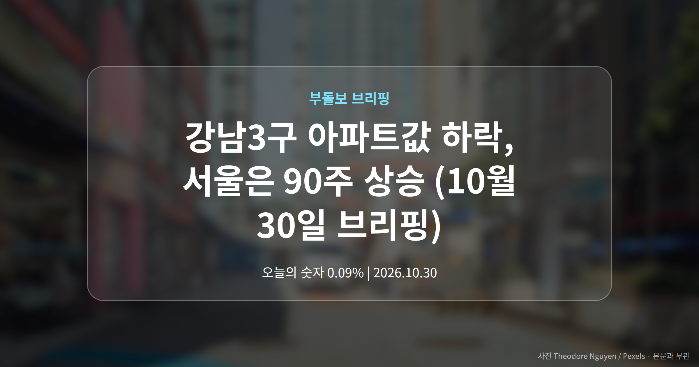
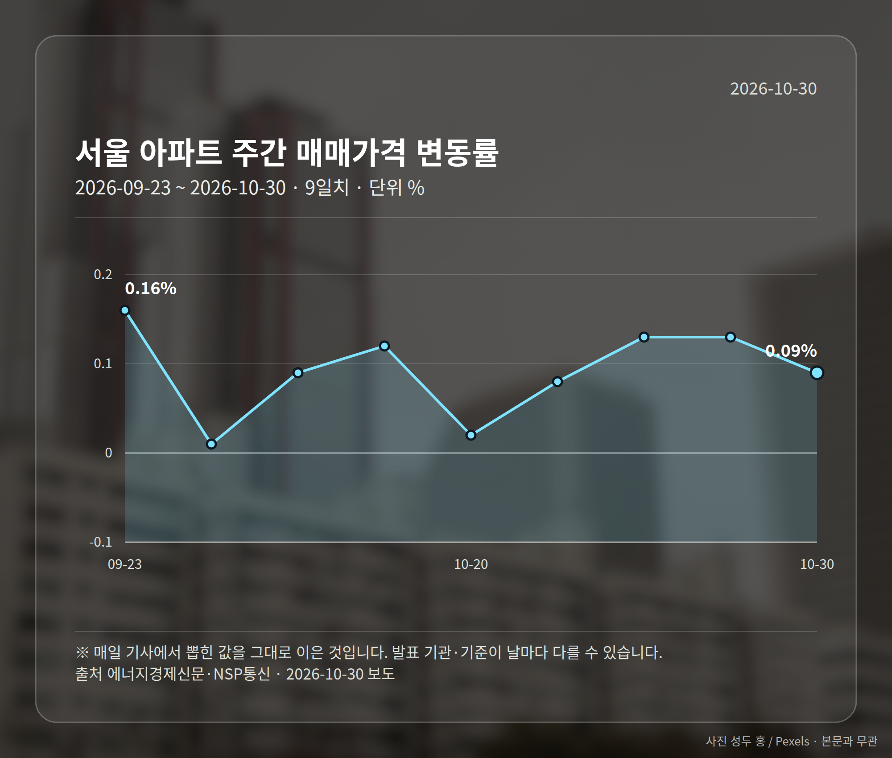
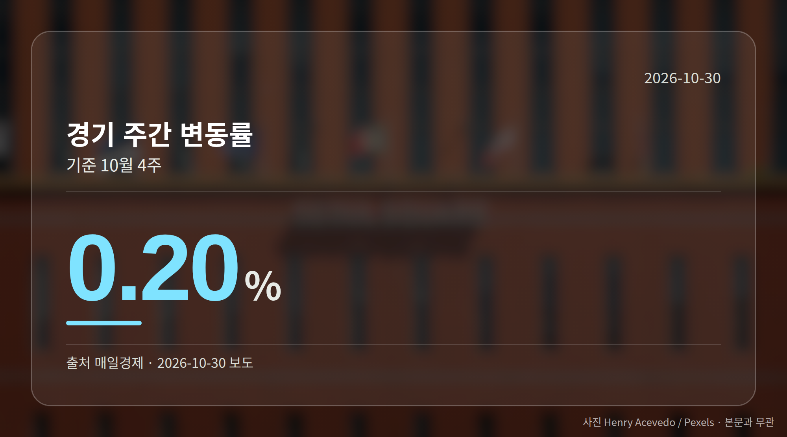
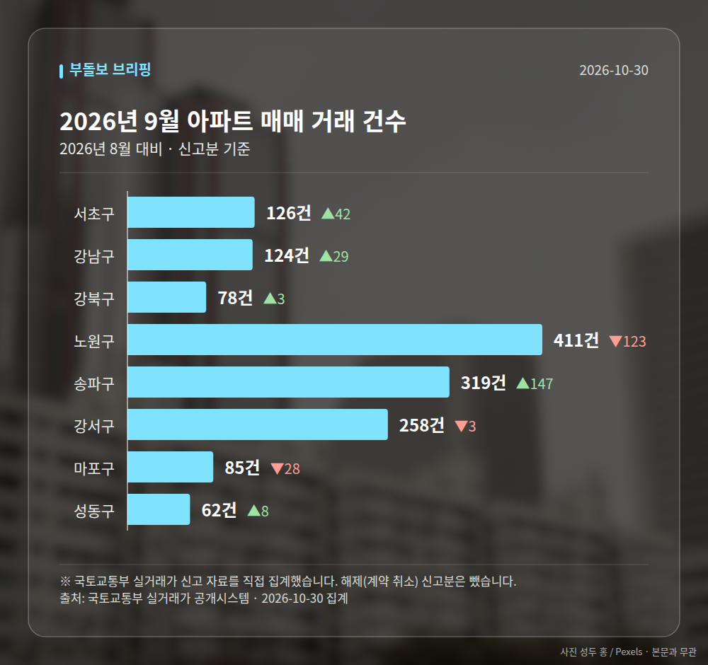

*이 글은 2026년 10월 30일 기준으로 정리한 내용입니다. 실거래 수치는 2026년 9월 신고분입니다.*
**3줄 요약**

- 서울 아파트값은 90주 연속 올랐지만 상승폭은 2주째 축소됐습니다.
- 서울 주간 0.09%, 경기 0.20%로 경기가 5년 만에 서울의 2배입니다.
- 강남·서초는 12주 연속 하락, 지역별로 방향이 갈리고 있습니다.
오늘 브리핑의 핵심은 하나입니다. 서울 전체는 여전히 오르는데, **강남3구 아파트값 하락**은 12주째 이어지고 있다는 점입니다.

서울 아파트값은 90주 연속 상승을 기록했지만, 주간 상승폭은 2주 연속 줄었습니다. 같은 도시 안에서 방향이 갈리고 있다는 뜻입니다.

## 강남3구 아파트값 하락은 몇 주째인가

세계일보 보도에 따르면 강남구와 서초구는 12주 연속 하락세를 보였습니다. 서울 전체가 90주 연속 상승한 것과는 정반대 흐름입니다.

국토매일 집계에서도 강남3구는 하락 전환으로 나타났습니다. 즉 강남3구 아파트값 하락은 한두 기관만의 관찰이 아니라 여러 보도에서 공통으로 확인되는 대목입니다.

해당 보도는 8·13대책 후속조치 맥락에서 다뤄졌습니다. 다만 구체적인 정책 내용은 제목에만 언급돼 본문으로 확인되지 않았다는 점은 짚어 두겠습니다.

## 서울보다 경기가 더 오른 이유는

매일경제에 따르면 10월 4주 서울은 0.09%, 경기는 0.20% 올랐습니다. 경기 상승률이 서울의 2배가 된 것은 5년 만입니다.

| 지역 | 주간 변동률 |
| --- | --- |
| 서울 | 0.09% |
| 경기 | 0.20% |
| 군포·영통 | 0.58% |
| 기흥 | 0.54% |
| 병점(비규제지역) | 0.44% |

특히 병점은 비규제지역(대출·세금·거래 규제가 따로 지정되지 않은 곳)인데도 0.44% 올랐습니다. 수요가 규제 영향권 밖으로 옮겨 가고 있다는 해석이 나오는 배경입니다.

매일경제는 경기 남부에서 '생존 매수'가 격화되고 있다고 전했습니다. 다만 이 표현은 기사 제목에만 등장해 거래량 같은 구체적 근거는 확인되지 않았습니다.

## 매매는 내렸는데 전세는 올랐습니다

2026년 3분기 서울 84㎡ 아파트 평균 매매가는 전년 동기보다 2.5% 내렸습니다. 반면 평균 전세보증금은 3.8% 올랐습니다.

매일경제는 서초구 등 평균을 끌어올리던 자치구의 거래량 감소를 하락 원인으로 지목했습니다. 서초구 84㎡ 평균 매매가는 29억2556만원으로 가장 높았습니다.

매매가는 내리고 전세금은 오르는 흐름은, 수요가 매수 대신 임차로 쏠리고 있다는 신호로 읽힐 여지가 있습니다. 전세 만기가 가까운 분들은 미리 자금 계획을 점검해 두시는 편이 좋겠습니다.

[이미지: 전세 계약서와 계산기가 놓인 책상 사진]

## 그 밖의 오늘 소식

- 세종 아파트값은 서울과 별개로 상승폭이 확대됐습니다.
- 국토매일 집계는 매매 0.07%, 전세 0.10% 상승입니다.
- 서울 주간 수치가 0.09%·0.07%로 기관마다 다릅니다.

수치가 엇갈리는 이유는 조사 대상과 집계 범위 차이일 가능성이 있습니다. 숫자를 볼 때 어느 기관, 어느 범위인지 함께 확인하시길 권합니다.

**그래서 나는?**

- 무주택 실수요자라면, 경기 남부 비규제지역 호가 흐름부터 확인해 보세요.
- 강남3구 보유자라면, 12주 하락이 거래량 감소와 겹치는지 살펴볼 시점입니다.
- 전세 계약을 앞뒀다면, 3분기 전세보증금 3.8% 상승분을 미리 계산해 두세요.

**직접 센 숫자 — 2026년 9월 아파트 실거래**

서울 8개 구 신고 매매 **1463건** (2026년 8월 1388건, +75건)

거래가 많은 곳: 서초구 126건(+42) · 강남구 124건(+29) · 강북구 78건(+3)

서초구 전세가율 가운뎃값 **37.5%** (같은 단지·같은 면적 26곳)

서울 25개 구 가운데 거래가 가장 크게 움직인 곳: 송파구 +85.5%(172→319건, 장지동에 59.2% 몰림) · 서초구 +50.0%(84→126건)

2026년 10월 계약 신고가

- 송파구 현대백조 31.0㎡ — 8.3억 (이전 최고 6.8억, +22.1%, 10월 7일 계약)
- 송파구 송파건원여미지아파트 51.76㎡ — 9.8억 (이전 최고 8.1억, +21.0%, 10월 20일 계약)

*국토교통부 실거래가 신고 자료를 직접 집계했습니다. 해제 신고분은 뺐습니다.*
**여러분이 보고 계신 지역은 지금 오르는 쪽인가요, 아니면 숨을 고르는 쪽인가요?**

---

### 참고한 기사

1. **서울 아파트 상승폭 2주째 축소…강남 3구 낙폭 확대**
   - [코리아리포트](https://news.google.com/rss/articles/CBMicEFVX3lxTE90alZINnRHOTUyS1A0VV9MSzhSVHBwM1VRbmdxTXdIWHBuYWRyMnEzY0FCTkN5WmlQNFZZaUJmcV9qalhZVGhFcVMwOW9LVXdlc1UwZGhFNmZ0TC1oQjN1OUZyeElLSE1odTdldHI3QS0?oc=5)
   - [뉴스엔톡](https://news.google.com/rss/articles/CBMibEFVX3lxTFAzYUpDUy1qUjNYZ0pCbnNIQlV5c3l6UGpYc0FRUGUtNEs4ek15M0JKRW9lMjlxc2pBX2FXWjctWHZzVTFtZTZOaDFqUURJbUpFRHlIZ0E1Y2tPcVlnNVE0M1ZFQXV4T3FJSl9Dcw?oc=5)
2. **서울 집값 90주째 상승…100주까지 가려나**
   - [메트로신문](https://news.google.com/rss/articles/CBMiYEFVX3lxTE5PT0VscThLN29pZVFqMF9td3UyV3pkRHIwTlRncmE0YzJMcDVMMmx2ejZuV1h3bzdoOEVFV2kydnp6RFoxVk5zdDlhZXpWRk0zaUVpWnZOTDVFTDl2a3dqNQ?oc=5)
   - [뉴데일리](https://news.google.com/rss/articles/CBMigAFBVV95cUxPLXFCVWcwTldIRFpYblFIa1Fid1BSbFRCSENIdy1sUnppQTZ5TmpZb0t6Vlk2LWw1bUs3QTJXS1NBS0NQaW5TZ1QxV0lkRGNpY3AzLVQ0bHUzbUoyMFVaUjlHMmJtRjkxV0hqRDZhRS1qNDVOZ3Z3RTk5TGN3cjBjeNIBgAFBVV95cUxPLXFCVWcwTldIRFpYblFIa1Fid1BSbFRCSENIdy1sUnppQTZ5TmpZb0t6Vlk2LWw1bUs3QTJXS1NBS0NQaW5TZ1QxV0lkRGNpY3AzLVQ0bHUzbUoyMFVaUjlHMmJtRjkxV0hqRDZhRS1qNDVOZ3Z3RTk5TGN3cjBjeA?oc=5)
3. **3분기 서울 국평 집값 하락 … 전세금은 3.8% 대폭 올라**
   - [매일경제·부동산](https://www.mk.co.kr/news/realestate/12190120)
4. **서울 아파트값 90주째 상승… 강남·서초 12주째 ↓ [8·13대책 후속조치]**
   - [세계일보](https://news.google.com/rss/articles/CBMiUEFVX3lxTE5vemVYeVV3RkFtTjJ5bFUyRkwza3MxVHFiNXFvYVZFMURmRGlGVzNZcjdMVWJXbW02eHhpcHhYYkZDdlpPeF80d2oySWwxaFhT?oc=5)
   - [BBS불교방송](https://news.google.com/rss/articles/CBMia0FVX3lxTE9TUk9UX3pPSTgzVXRTV29LUllMRV9jNlAwRkNmdnhCTEh6ek1kdnlKMjBOdkxWVkZkVldtV3BoVUhUclp0T3NlaXFfVjZaUlZHTWcweW5obXNrUkNoTXgzZE1mX2hlZVZuR1ZB?oc=5)
5. **주간 아파트 매매 0.07%·전세 0.10% 상승… 강남3구 하락 전환**
   - [국토매일](https://news.google.com/rss/articles/CBMiREFVX3lxTE5EWU03T1RHTTRtVnRzWkV2Y0FZV0xWVzZVNHRndDgyc0pNTG9pNlh4cUZsTldOc1UzcGVneW5WZ3NBVXVG?oc=5)
   - [전문건설신문](https://news.google.com/rss/articles/CBMia0FVX3lxTE55Mk5DYjZuMDJrYmRGLXVyQzlIV2dyUEZtaXhnbFlSdkFURWZJcFZ2dWF1NUMwTS1xRUxvVXRwdGhWcjJfcG93Vzd5NGpfMTRfR0gxYmVYLTh6RnVWVXJ2ZVZTWWVhZFJydHM0?oc=5)

---

*본 글은 공개된 언론 보도를 정리한 것이며, 투자 판단의 책임은 이용자 본인에게 있습니다.*
