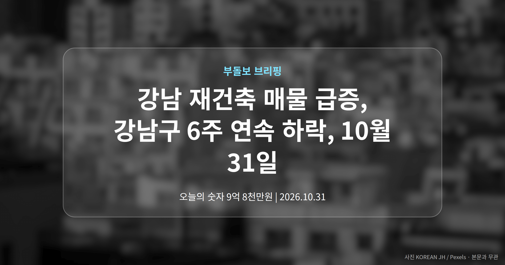
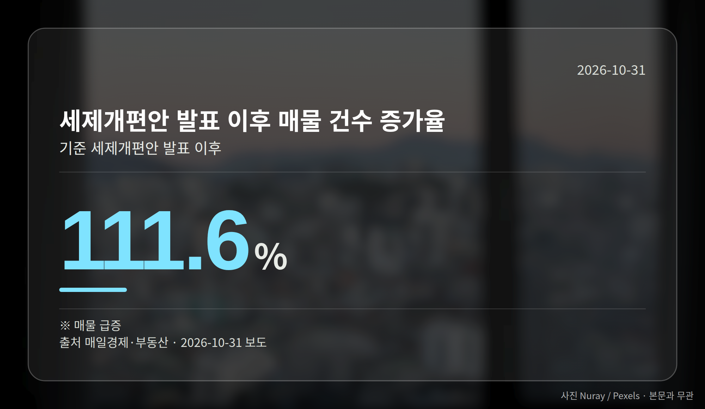
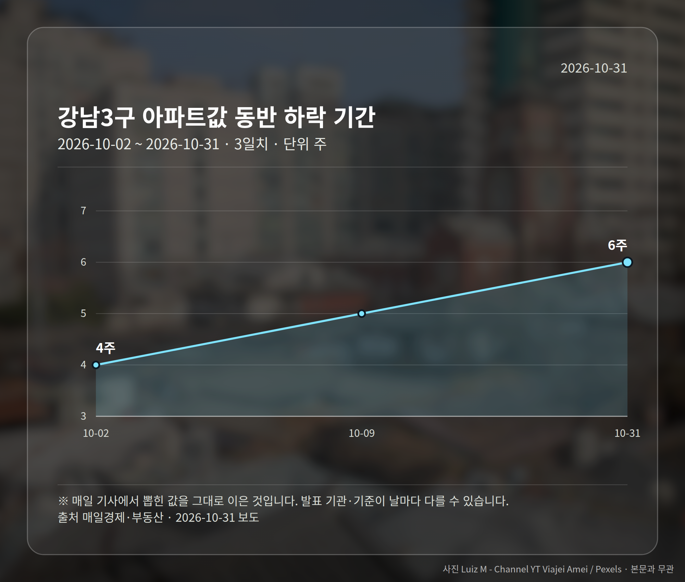
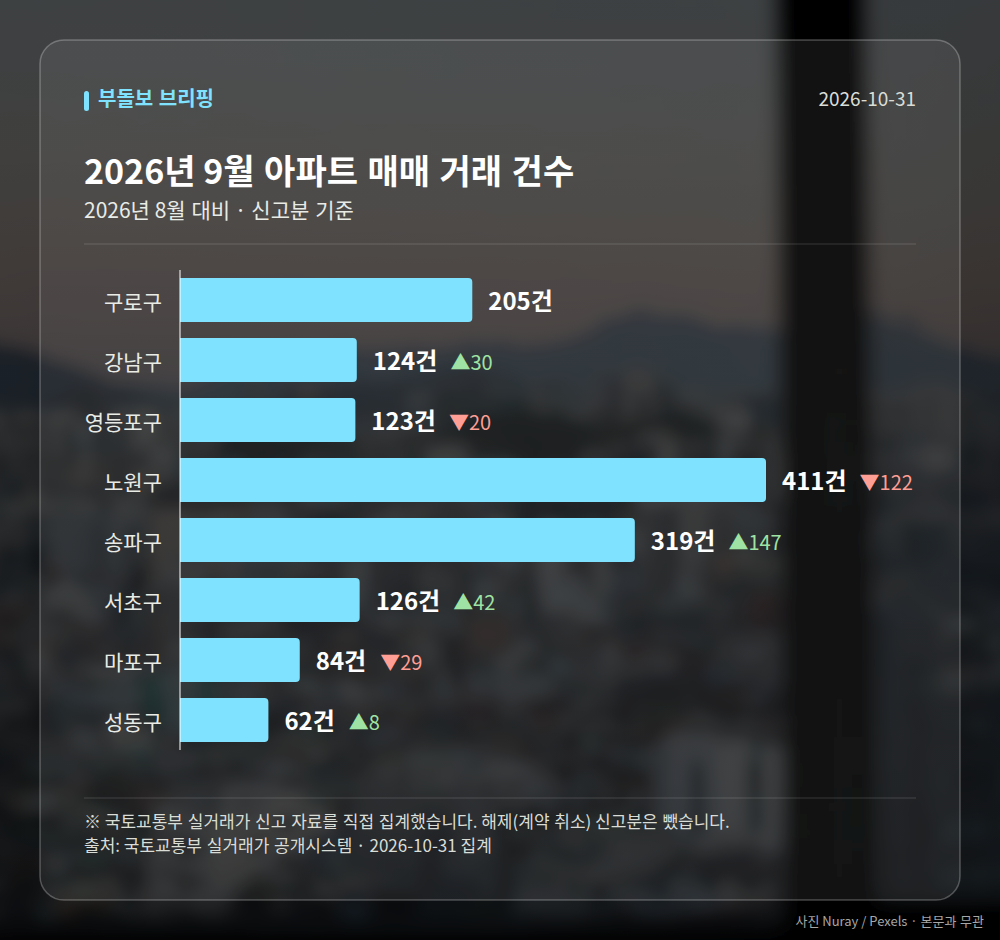

*이 글은 2026년 10월 31일 기준으로 정리한 내용입니다. 실거래 수치는 2026년 9월 신고분입니다.*
**3줄 요약**

- 강남 재건축 매물이 쌓이며 강남권 가격선이 흔들렸습니다.
- 세제개편안 발표 후 매물 111.6% 증가, 강남3구 6주 연속 하락.
- 종부세 과세 기준일 전 급매물 추이를 함께 보면 됩니다.
오늘 서울 부동산은 한 방향으로 움직이지 않았습니다. 강남 재건축 매물이 쌓이며 강남구 아파트값은 6주 연속 내렸고, 같은 날 송파·영등포·구로·강서에서는 최근 3년 신고가 거래가 확인됐습니다.

즉 "서울이 오른다, 내린다"로 묶기 어려운 하루였습니다. 오늘은 그중 변화가 가장 분명한 강남 쪽을 먼저 보겠습니다.

## 강남 재건축 매물이 왜 늘었나

매일경제·부동산 보도에 따르면 세제개편안 발표 이후 강남권 매물 건수가 111.6% 증가했습니다. 두 배가 넘게 늘어난 셈입니다.

배경으로는 세 가지가 함께 꼽혔습니다. 재건축초과이익환수제(재건축으로 늘어난 이익 일부를 정부가 환수하는 제도), 공사비 상승에 따른 추가 분담금, 그리고 세제개편안에 따른 보유세 부담입니다.

호재로 여겨졌던 재건축이 비용과 세금 부담으로 되돌아오면서, 강남 재건축 매물이 먼저 반응한 모습입니다.

## 강남 재건축 매물 증가와 6주 연속 하락

강남구 아파트값은 6주 연속 하락했고, 강남3구 역시 같은 기간 동반 하락세를 기록 중입니다. 숫자로 정리하면 이렇습니다.

| 항목 | 수치 | 기준 |
|---|---|---|
| 강남구 아파트값 하락 | 6주 연속 | 세제개편안 발표 이후 |
| 강남3구 동반 하락 | 6주 연속 | 최근 |
| 매물 건수 증가 | 111.6% | 세제개편안 발표 이후 |

기사는 종합부동산세(공시가격 합이 기준을 넘으면 내는 세금) 과세 기준일을 앞두고 집주인들이 내년 초까지 급매물을 계속 내놓을 것이라는 전문가 전망을 전했습니다. 다만 이는 전망이고, 추가 하락 여부가 정해진 것은 아닙니다.

## 서울 곳곳은 신고가, 어떻게 봐야 할까

같은 날 송파구 송파건원여미지 전용 51.764㎡가 9억 8천만원, 강서구 강서힐스테이트 전용 84.99㎡가 16억 9500만원에 거래되며 최근 3년 신고가를 썼습니다. 영등포구 문래힐스테이트 전용 137.82㎡는 21억원을 기록했습니다.

다만 개별 거래 배경(특수관계 거래 여부 등)은 기사에 설명되지 않았습니다. 특정 단지의 신고가를 서울 전체 상승으로 읽기는 어렵다는 뜻입니다.

[이미지: 서울 아파트 단지가 보이는 도심 전경 사진]

강남 재건축 매물은 늘고 외곽·중소형 단지에서는 신고가가 나오는 양극화 장세, 오늘은 이 한 줄이 핵심입니다.

## 그 밖의 오늘 소식

- 국토부, 서울 연내 정비사업 3.1만호 착공 지원 발표
- 매체별 수치 상이(수도권 7.2만가구 보도도 있어 확인 필요)
- 국민의힘, 재초환·대출 논의할 '3+3 부동산협의체' 제안

**그래서 나는?**

- 1주택자라면, 보유세 부담 변화와 내 단지 매물 수부터 확인해 보세요.
- 매수 대기 중이라면, 지역별 온도차가 커진 만큼 단지 단위로 봐야 합니다.
- 재건축 조합원이라면, 추가 분담금과 재초환 논의 진행 상황이 변수일 수 있습니다.

**직접 센 숫자 — 2026년 9월 아파트 실거래**

서울 8개 구 신고 매매 **1454건** (2026년 8월 1398건, +56건)

거래가 많은 곳: 구로구 205건(+0) · 강남구 124건(+30) · 영등포구 123건(-20)

구로구 전세가율 가운뎃값 **57.2%** (같은 단지·같은 면적 36곳)

서울 25개 구 가운데 거래가 가장 크게 움직인 곳: 송파구 +85.5%(172→319건, 장지동에 59.2% 몰림) · 서초구 +50.0%(84→126건)

2026년 10월 계약 신고가

- 마포구 영화블렌하임 103.86㎡ — 12.7억 (이전 최고 9.5억, +33.7%, 10월 26일 계약)
- 송파구 현대백조 31.0㎡ — 8.3억 (이전 최고 6.8억, +22.1%, 10월 7일 계약)

*국토교통부 실거래가 신고 자료를 직접 집계했습니다. 해제 신고분은 뺐습니다.*
**여러분이 보고 계신 단지는 요즘 매물이 늘어나는 쪽인가요, 줄어드는 쪽인가요?**

---

### 참고한 기사

1. **송파구 마천동 송파건원여미지아파트 51.764㎡ 9억 8천만원 거래… 최근 3년 신고가 [MAI부동산]**
   - [매일경제·부동산](https://www.mk.co.kr/news/realestate/12191199)
2. **홍지선 국토부 장관, “서울 연내 3.1만호 착공 지원… 8·13 대책 속도”**
   - [국토일보](https://news.google.com/rss/articles/CBMiZEFVX3lxTE1RUEVJM3dkNVhRUjRzbVlDOVhULXZYVkRoMTA5T0ZMblhWeGNqbnNBczA3UXVfWF9jODRKNzVCcm1PQ3ZhWFc0V3NYX2xOeTBOcDhGaW51OXJpb1lpRmhEbXFBa20?oc=5)
   - [아시아투데이](https://news.google.com/rss/articles/CBMibkFVX3lxTE51TDdPQ0NYcFYzWFZ2UHBlZ2VTbHYtR2c4c3ZoUWJmQ3NWNEtpWVBzWnNDWXhpWU1zSW52QjNyV001MU9KQ0VTVlBPMGZxWWZYTFF1VHI5cmE4aHJoaTdGQ2t3d09xY2FkcXhOeGln?oc=5)
3. **은마 30억선도 흔들 … 강남 재건축 매물 쌓인다**
   - [매일경제·부동산](https://www.mk.co.kr/news/realestate/12191748)
4. **영등포구 문래힐스테이트 137.82㎡ 21억원… 최근 3년 신고가 [MAI부동산]**
   - [매일경제·부동산](https://www.mk.co.kr/news/realestate/12191196)
5. **“초과이익 환수도 풀어야”…野, 3+3 부동산협의체 제안**
   - [서울경제](https://news.google.com/rss/articles/CBMiU0FVX3lxTE5jWHp4SG5fWldJZnhHeHBHVTNpSVZKOHE5NHFuQ185dWJlLU5zWW9kTUhWUmR5Sk1qa2hUM09KRmYxRHNENWRWR0hUOHBoWTNtNERz0gFTQVVfeXFMTmNYenhIbl9aV0lmeEd4cEdVM2lJVko4cTk0cW5DXzl1YmUtTnNZb2RNSFZSZHlKTWpraFQzT0pGZjFEc0Q1ZFZHSFQ4cGhZM200RHM?oc=5)
   - [대전일보](https://news.google.com/rss/articles/CBMib0FVX3lxTE03LThZMnM2X0ZxMWpaNTF5RkU4UmprNjJVRlVuZEx3eUhta1kzUzBpM1Q3eVY3TEdBMzZMRnBWOTJCZ2FaVk5sNWZ2V1NqUGROTWx6Q2hfRzBnbGpjRURPZXhyUjZzMDBJS3o0Z0g4bw?oc=5)

---

*본 글은 공개된 언론 보도를 정리한 것이며, 투자 판단의 책임은 이용자 본인에게 있습니다.*
