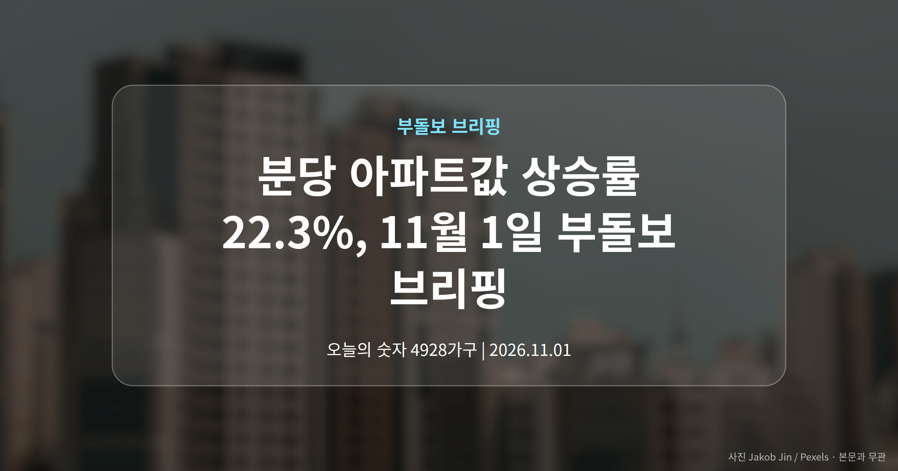
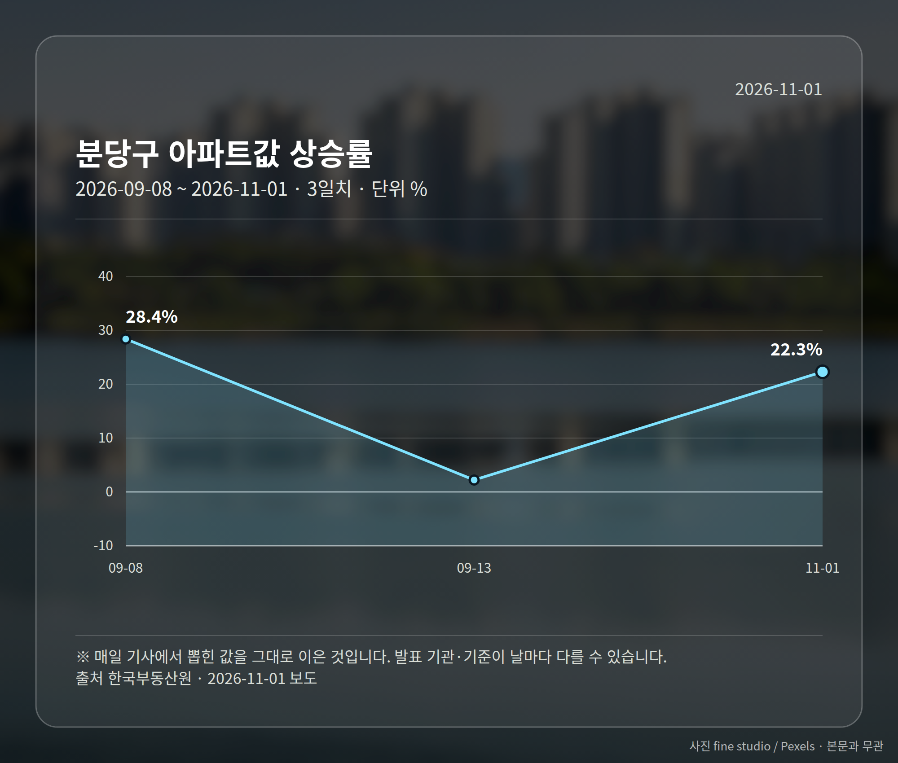
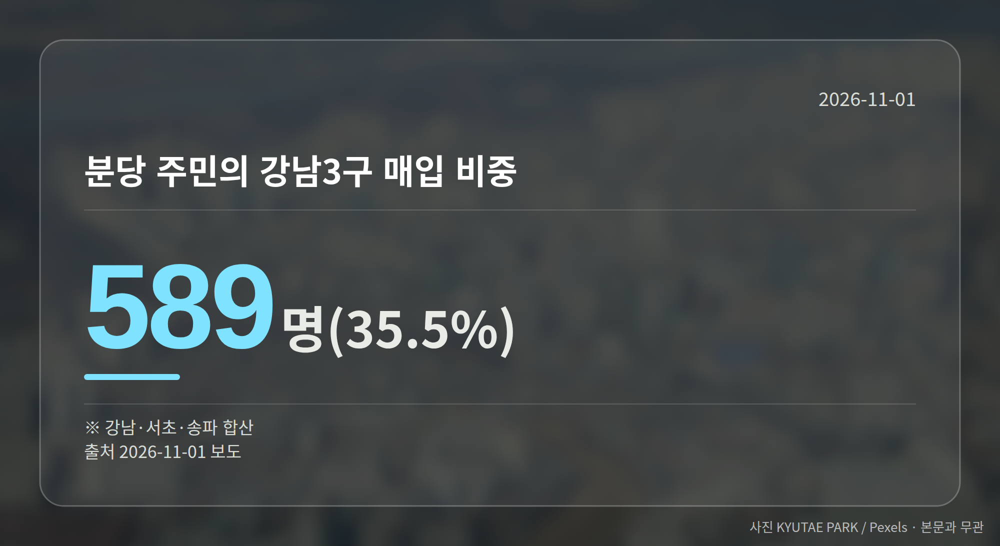
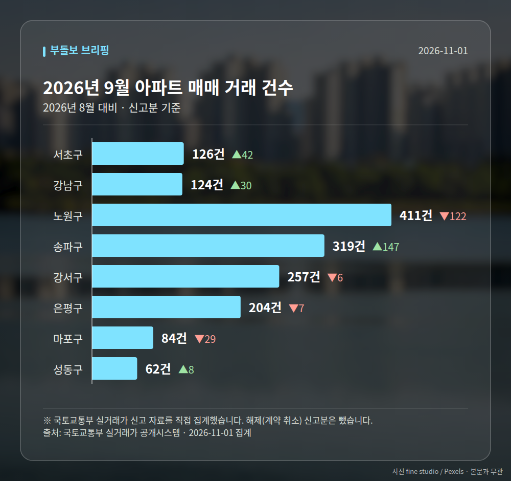

*이 글은 2026년 11월 1일 기준으로 정리한 내용입니다. 실거래 수치는 2026년 9월 신고분입니다.*
**3줄 요약**

- 재건축 기대감에 분당 집값이 1년간 크게 올랐습니다
- 분당 아파트값 상승률 22.3%, 전국 1위(한국부동산원)
- 분당 주민이 산 서울 집 35.5%는 강남3구였습니다
여러분, 2026년 11월 1일 브리핑에서 가장 또렷한 숫자는 분당 아파트값 상승률입니다. 한국부동산원 집계로 지난달 19일 기준 1년 전보다 22.3% 올라 전국에서 가장 높았습니다.

그리고 이 오름세는 분당 주민들이 서울, 특히 강남3구 아파트를 사들이는 흐름과 나란히 나타나고 있습니다.

## 분당 아파트값 상승률 22.3%, 어디서 나온 수치인가

기준은 작년 10월 20일 대비 올해 9월 19일입니다. 자료는 한국부동산원이고, 전국 상승률 1위라는 점이 함께 보도됐습니다.

배경으로는 재건축(낡은 아파트를 허물고 다시 짓는 사업) 기대감이 꼽힙니다. 다만 어느 단지가 어느 단계에 있는지는 오늘 자료에 담기지 않았습니다.

## 분당 주민이 산 서울 집, 35.5%가 강남3구

대법원 등기정보광장을 보면 올해 1~9월 서울 집합건물(아파트·연립처럼 한 건물을 여러 사람이 나눠 소유하는 부동산)을 산 경기·인천 거주자는 2만4993명이었습니다. 이 중 분당구 주민이 1661명(6.6%)으로 가장 많았습니다.

분당 주민이 고른 서울 지역은 아래와 같습니다. 강남·서초·송파를 합친 강남3구가 589명, 비중으로는 35.5%였습니다.

| 매입 지역 | 인원 |
| --- | --- |
| 송파구 | 231명 |
| 강남구 | 227명 |
| 강동구 | 151명 |
| 서초구 | 131명 |
| 용산구 | 111명 |

## 분당 아파트값 상승률이 함께 보여주는 흐름

다른 지역도 비슷했습니다. 고양 덕양구 주민(1407명)은 은평구·강서구, 남양주시(1369명)는 노원구·강동구, 하남시(1098명)는 강동구·송파구, 광명시(984명)는 구로구·영등포구를 주로 골랐습니다.

정리하면 기존 생활권에서 멀지 않은 서울 쪽으로 이동하는 모습입니다. 분당의 경우 그 방향이 강남3구로 모였다는 점이 다릅니다.

보도에서는 이를 재건축 호재를 매개로 상급지(가격과 선호도가 더 높은 지역) 쏠림이 뚜렷해진 신호로 해석했습니다. 다만 개별 거래의 자금 사정이나 매도 이유는 수치만으로 알 수 없습니다.

[이미지: 분당 신도시 아파트 단지 전경]

## 그 밖의 오늘 소식

- 이번 주말부터 전국 5곳 4928가구 청약 접수 시작
- 서울 고덕강일3단지 공공분양이 주요 단지로 거론
- 서울 전세가격 상승률이 매매 상승률을 넘었다는 보도

**그래서 나는?**

- 분당 거주 1주택자라면, 생활권 내 이동 수요가 몰린 구부터 확인해 보세요
- 강남3구 매수 희망자라면, 외부 유입 수요가 늘어난 점을 함께 볼 필요가 있습니다
- 무주택 실수요자라면, 이번 주 고덕강일3단지 공공분양 일정을 먼저 챙겨 보세요

**직접 센 숫자 — 2026년 9월 아파트 실거래**

서울 8개 구 신고 매매 **1587건** (2026년 8월 1524건, +63건)

거래가 많은 곳: 서초구 126건(+42) · 강남구 124건(+30) · 노원구 411건(-122)

서초구 전세가율 가운뎃값 **37.5%** (같은 단지·같은 면적 26곳)

서울 25개 구 가운데 거래가 가장 크게 움직인 곳: 송파구 +85.5%(172→319건, 장지동에 59.2% 몰림) · 서초구 +50.0%(84→126건)

2026년 10월 계약 신고가

- 마포구 영화블렌하임 103.86㎡ — 12.7억 (이전 최고 9.5억, +33.7%, 10월 26일 계약)
- 송파구 송파건원여미지아파트 51.76㎡ — 9.8억 (이전 최고 8.1억, +21.0%, 10월 20일 계약)

*국토교통부 실거래가 신고 자료를 직접 집계했습니다. 해제 신고분은 뺐습니다.*
**여러분은 지금 살고 있는 동네에 머무는 쪽과 생활권을 옮기는 쪽, 어느 쪽을 더 들여다보고 계신가요?**

---

### 참고한 기사

1. **내주 전국 4928가구 청약 접수…고덕강일3단지 등**
   - [중앙신문](https://news.google.com/rss/articles/CBMi_gJBVV95cUxOZ2ZtdUhUUDlUdlRiR29nUk1PTjZjVGVWN1lFUWlBa3RCUGxZZEJSMElQX0xUaGtYa0JtRkZzd0k4WmJfNFVOeTBSZDdlNFE0R3pjOEI4TzdQUGpBajEzOTRLUmhGdks4dFk1T1RkWkFQR0htYjkwZ0NkWV9ZVUlyWTlXSmY2LWRlTjFoV2RCb3JpZzNkbzVzcXhxeWM3eHFkLU85dDAzU0I4Qkxka3FKd0tXNDdTb3Y3LWhsRklzb0lwa3dSN2lENzZDdUlOc1ExS2dtRmtEbmRnTFF1dk9kTlpDTXNXTlRvRk1PWG5Pemh6ekN1OTdtTkx3R05EazZQSlZZVXMySTNLRERQbUk1X3lWdlVsN01qWUR1V21DdnZmaUY5d1k0dUs3cFAtLTJUc0gzbEczckRTWXNlYXRvLWU1My15SjdmTS1hb0JUNVZGTUdvRDJjeGJwRktkeGdwaFYzbkFoeHJ3Z0JvaXhhanRyU0c0RW82cEdRdVJB?oc=5)
   - [워크투데이](https://news.google.com/rss/articles/CBMibEFVX3lxTE5ieVlIRFVOOWdqOU9BNVR4ZVZYSUxaRFVjMHRqQmZ0YWY2b2ZWQk9FQnpSOTFJODFzaHdlaGVBYUttNFNNRF9xbXdCMjRZTjcwSk1JUEhaZWxPQm9kbEs3dmxkeEhGV3FRakg5eA?oc=5)
2. **“재건축 소식에 집값 좀 뛰었거든요”…강남 아파트로 눈돌리는 분당 주민들**
   - [매일경제·부동산](https://www.mk.co.kr/news/realestate/12192394)
3. **아파트값 추월한 서울 전세가격 상승률…서초 빼고 다 올라 |**
   - [연합인포맥스](https://news.google.com/rss/articles/CBMidEFVX3lxTE9WYjVhZm52bnkzY3l5RklyM21xWUZRczlhX0lFazVWV3lralF5TkEwUmFIeVBSazBXeGpTenh1RG9nVTQ0NVRWc3NET2lmTUpKYm1SakFPeFJGWlpVOUVyX2xzazVKci10c3kwRWZBMVJpQmRW?oc=5)
4. **이 대통령 “지금은 견디는 중”…집값 하락 전망 맞을까**
   - [더스쿠프](https://news.google.com/rss/articles/CBMibkFVX3lxTE1EMkFkRnJQRGNHTFJscVZLTUZmM2xNWVBuQWczQnU3MlUwNk9JdzJXOWswcjJDa1BnNmR3bUZGcF9lbDJhWHRjdklveldzQVlfMEhQd1Z0RjJMbmJGN3c4V2F4UnNINlVNZ1BPdUtB?oc=5)
   - [연합인포맥스](https://news.google.com/rss/articles/CBMicEFVX3lxTE1tb2tkcmp1dENZMUtzS0JPWVNPdjQwVDhybzFLWk0xVm13ZGd3MWszMUhtZ2lLbE14dXBWX0lQY0FxQ0wtYzZOR1hPZVktMkJNd2Y4Q3JnSFBRNjBKMlFqUExHVTZLbVIxVXZMUWFDMTk?oc=5)
5. **李 대통령 "자산시장 정상화, 인내의 시간 지나는중"…부동산 정책 불변**
   - [디지털데일리](https://news.google.com/rss/articles/CBMiZEFVX3lxTE1fbkExcGtKamZibG13MUpwdWZSOG9fWlBhVVlCeWcxV2ZiOGVCOWhEUDk4ZTF2a1NBbndtMUROUFlTZ0liT2U3WEp5LTVIdXFWLXNvYUZsYW9BNHNjMlZKUnR0ZlU?oc=5)
   - [한국일보](https://news.google.com/rss/articles/CBMic0FVX3lxTFA4bWRMcVpHVEtCM014M2NhV0NrS19aQTB4eG4zc1VpMWtNOVBHOG5QSWhtRE5YcHdTamlkSEV6WEEwclFrUmtQMTh4TmtQVDRWTmdnUVI3dTBFXzZ4cHBIamRhODhycHVjYmtUZDIzVnpNWmPSAXNBVV95cUxQOG1kTHFaR1RLQjNNeDNjYVdDa0tfWkEweHhuM3NVaTFrTTlQRzhuUElobUROWHB3U2ppZEhFelhBMHJRa1JrUDE4eE5rUFQ0Vk5nZ1FSN3UwRV82eHBwSGpkYTg4cnB1Y2JrVGQyM1Z6TVpj?oc=5)

---

*본 글은 공개된 언론 보도를 정리한 것이며, 투자 판단의 책임은 이용자 본인에게 있습니다.*
