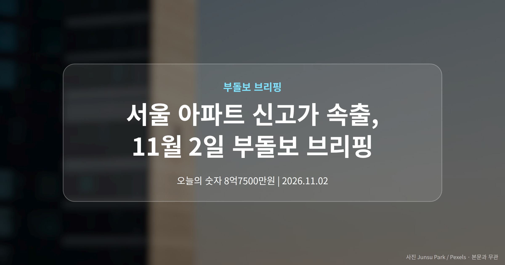
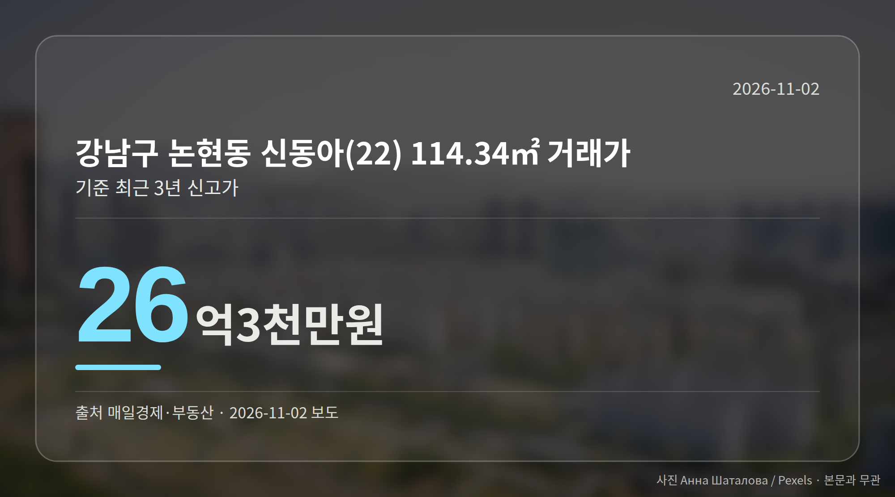
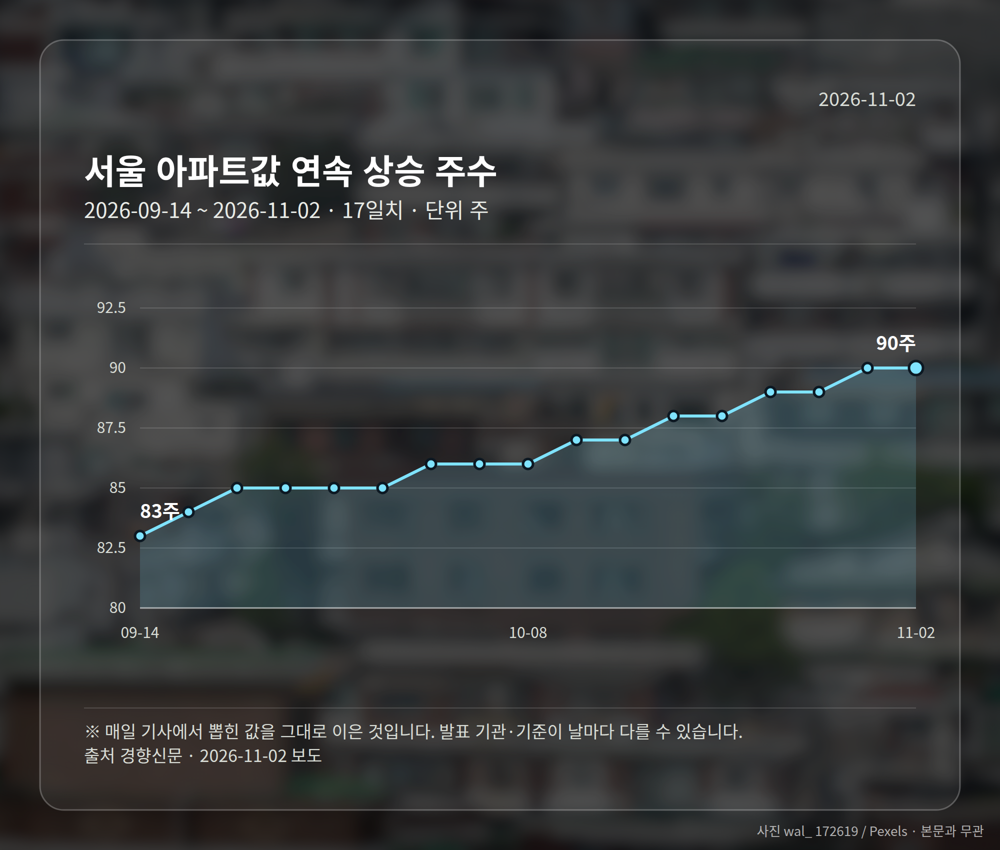
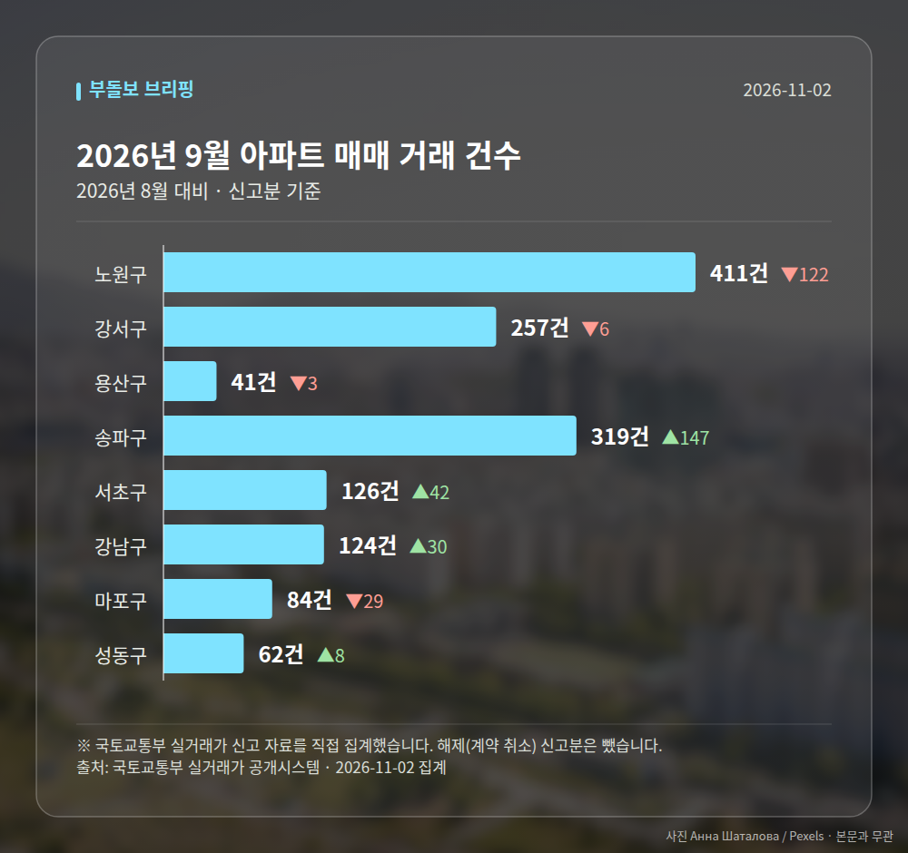

*이 글은 2026년 11월 2일 기준으로 정리한 내용입니다. 실거래 수치는 2026년 9월 신고분입니다.*
**3줄 요약**

- 서울 6개 자치구에서 최근 3년 신고가 거래가 동시에 나왔습니다
- 강남 논현동 신동아 114㎡ 26억3천만원, 관악 두산 60㎡ 13억4500만원
- 서울 아파트값 90주 연속 상승, 전월세도 7~8% 올랐습니다
오늘은 **서울 아파트 신고가** 소식이 가장 눈에 띕니다. 은평·관악·강서·강남·노원·구로, 여섯 개 자치구에서 최근 3년 신고가 거래가 한꺼번에 포착됐습니다.

서울 아파트값이 90주째 오름세를 이어가는 흐름과 맞물린 결과로 읽힙니다. 다만 건별 거래라 구 전체 시세로 보기는 어렵습니다.

## 서울 아파트 신고가, 어느 자치구에서 나왔나

이번에 확인된 거래는 강남권과 강북권, 서남권을 가로지릅니다. 전용면적과 가격을 함께 보시면 체감이 다르실 겁니다.

| 자치구·단지 | 전용면적 | 거래가 |
| --- | --- | --- |
| 강남 논현동 신동아(22) | 114.34㎡ | 26억3000만원 |
| 관악 봉천동 두산 | 59.92㎡ | 13억4500만원 |
| 구로 개봉동현대아이파크 | 84.98㎡ | 12억2800만원 |
| 강서 마곡수명산파크4단지 | 59.84㎡ | 12억1000만원 |
| 은평 신사동 미성 | 83.27㎡ | 8억7500만원 |
| 노원 시영3차(라이프) | 39.6㎡ | 5억2000만원 |

모두 '최근 3년 신고가'입니다. 3년 안에 체결된 거래 중 가장 높은 값이라는 뜻이고, 역대 최고가와는 다른 개념입니다.

## 서울 아파트 신고가가 전역에서 나온 뜻

한 지역에 몰린 게 아니라는 점이 핵심입니다. 매일경제 보도는 이를 서울 전역에서 매수 심리가 살아 있는 신호로 해석했습니다.

다만 각 건은 개별 사례일 수 있습니다. 단지 특성이나 거래 조건에 따라 유독 높게 찍히는 경우가 있어서요.

[이미지: 서울 주택가 아파트 단지 전경 사진]

실제로 이번 보도에는 거래일자, 층수, 직전 거래가가 담기지 않았습니다. 같은 단지라도 층과 향에 따라 수억원이 갈리니, 여러분이 관심 단지를 보실 때는 실거래가 공개시스템에서 직전 거래와 나란히 놓고 비교하시는 편이 안전합니다.

## 매매와 전월세가 같이 오른 상황

경향신문은 서울 아파트값이 90주 연속 올랐고, 전월세도 7~8% 뛰었다고 전했습니다. 사는 쪽과 빌리는 쪽 부담이 함께 커진 셈입니다.

이 가운데 대통령은 '자산시장 정상화, 인내의 시간'이라는 취지로 말했습니다. 단기 하락을 유도하기보다 장기 정상화를 지향한다는 기조로 읽히는 발언입니다. 다만 발언 전문과 일시는 제목 수준으로만 확인됩니다.

## 그 밖의 오늘 소식

- 반포 래미안원베일리 78억원, 대치 선경1차 51억원 거래
- 현대건설, 용산 한강로구역 재개발 시공사 선정(5990억원대)
- 현대건설 올해 도시정비사업 누적 수주 13조원 돌파

**그래서 나는?**

- 무주택 실수요자라면, 관심 단지의 직전 거래가부터 비교해 보세요
- 1주택자라면, 내 지역 신고가가 단지 특성 때문인지 확인해 볼 때입니다
- 전세 계약을 앞뒀다면, 전월세 7~8% 상승분을 미리 계산해 두세요

**직접 센 숫자 — 2026년 9월 아파트 실거래**

서울 8개 구 신고 매매 **1424건** (2026년 8월 1357건, +67건)

거래가 많은 곳: 노원구 411건(-122) · 강서구 257건(-6) · 용산구 41건(-3)

노원구 전세가율 가운뎃값 **52.5%** (같은 단지·같은 면적 90곳)

서울 25개 구 가운데 거래가 가장 크게 움직인 곳: 송파구 +85.5%(172→319건, 장지동에 59.2% 몰림) · 서초구 +50.0%(84→126건)

2026년 10월 계약 신고가

- 마포구 영화블렌하임 103.86㎡ — 12.7억 (이전 최고 9.5억, +33.7%, 10월 26일 계약)
- 송파구 송파건원여미지아파트 51.76㎡ — 9.8억 (이전 최고 8.1억, +21.0%, 10월 20일 계약)

*국토교통부 실거래가 신고 자료를 직접 집계했습니다. 해제 신고분은 뺐습니다.*
**여러분이 보고 계신 단지는 올해 들어 거래가가 어떻게 움직였나요?**

---

### 참고한 기사

1. **은평구 신사동 미성 83.27㎡ 8억 7500만원… 최근 3년 신고가 [MAI부동산]**
   - [매일경제·부동산](https://www.mk.co.kr/news/realestate/12193018)
2. **‘서울자가 김부장’ 송희구의 자가예찬…“전세 살면서 주식? 가장 위험”**
   - [매일경제·부동산](https://www.mk.co.kr/news/realestate/12193046)
3. **현대건설, 용산 한강로 재개발 품었다…5990억 수주**
   - [스페셜경제](https://news.google.com/rss/articles/CBMibEFVX3lxTE5LOGdrWndGQjJHb2ctOUc4NGtTOE4yZVlRdWZ3clQweVZHUjRSZ3lMN19UWlJhem9Hd2NLYnlJdXVVMmlUbHcxTkNFeXloQ3gtejlzWHIwc0JfTWpTeEo0VGJCVlFqQ19IRGZKNA?oc=5)
   - [코리아리포트](https://news.google.com/rss/articles/CBMicEFVX3lxTFBPQ0M3WWZScFhLUV9WUkYxZmV2cGFuZDdLeVA3eGhvVENKTzlSbEtnYlgtMWc2b2VnNUpkZlUtbnBTT2FKTWkyUW52ODRWdWNrRVZGdmdVV0laTDZFQmdITW9VNTFmVXFLcVZzaGJvSUo?oc=5)
4. **반포동 래미안원베일리 78억원·대치동 선경1차 51억원… 서울 아파트 고가 거래 [MAI부동산]**
   - [매일경제·부동산](https://www.mk.co.kr/news/realestate/12193007)
5. **서울 집값 90주째 상승에…대통령은 “시장 정상화, 인내의 시간”**
   - [경향신문](https://news.google.com/rss/articles/CBMiX0FVX3lxTE50SEhJZVFydVRCYWYwd3FnalRzelRteVdULTRfYlVLa3BaSlBhMnZWV01IRlJ0bXI4RG1iSDUwc1dFbHRSbFRUcUtONUtsS05ZSDlJdzdESUMxXzB3eDk40gFfQVVfeXFMTnRISEllUXJ1VEJhZjB3cWdqVHN6VG15V1QtNF9iVUtrcFpKUGEydlZXTUhGUnRtcjhEbWJINTBzV0VsdFJsVFRxS041S2xLTllIOUl3N0RJQzFfMHd4OTg?oc=5)
   - [핀포인트뉴스](https://news.google.com/rss/articles/CBMid0FVX3lxTFAxejJ2OVE2S181QjRsdE95Vnh3ZTVRU0VQTmVsRWxFVTh1OXUxTFFvRGJpa1pmMk5jd0RuQWV0MnZkZEtZa3B3YURXa1RaekFPUkh5NUIxM1BBMTdQbTRfY0VZQjNhZ29YQS1WRVhUM0xnTVdNMVc40gF3QVVfeXFMUDF6MnY5UTZLXzVCNGx0T3lWeHdlNVFTRVBOZWxFbEVVOHU5dTFMUW9EYmlrWmYyTmN3RG5BZXQydmRkS1lrcHdhRFdrVFp6QU9SSHk1QjEzUEExN1BtNF9jRVlCM2Fnb1hBLVZFWFQzTGdNV00xVzg?oc=5)

---

*본 글은 공개된 언론 보도를 정리한 것이며, 투자 판단의 책임은 이용자 본인에게 있습니다.*
