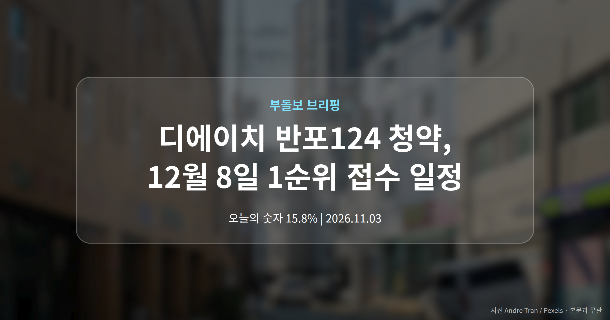
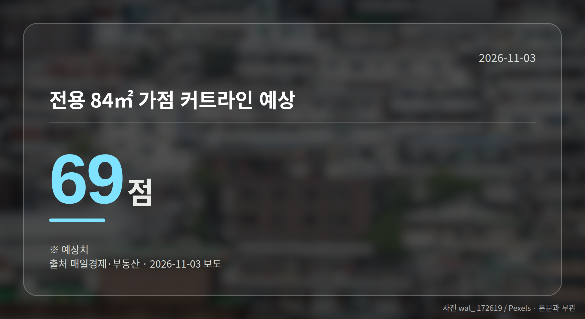
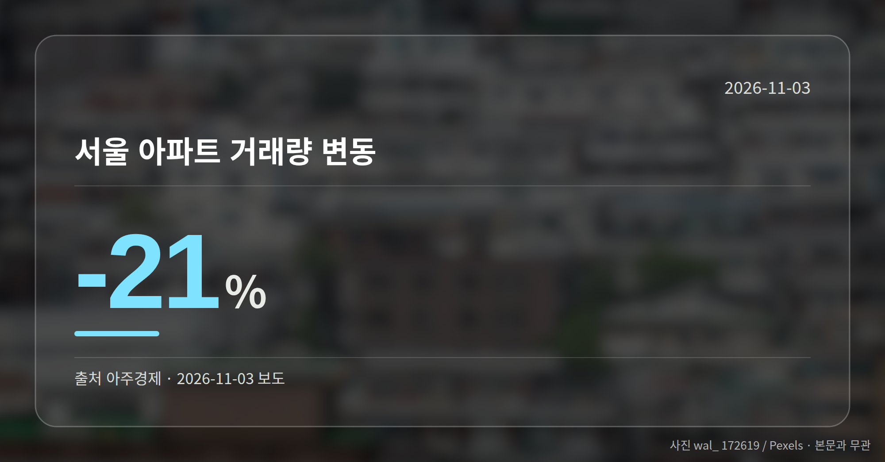
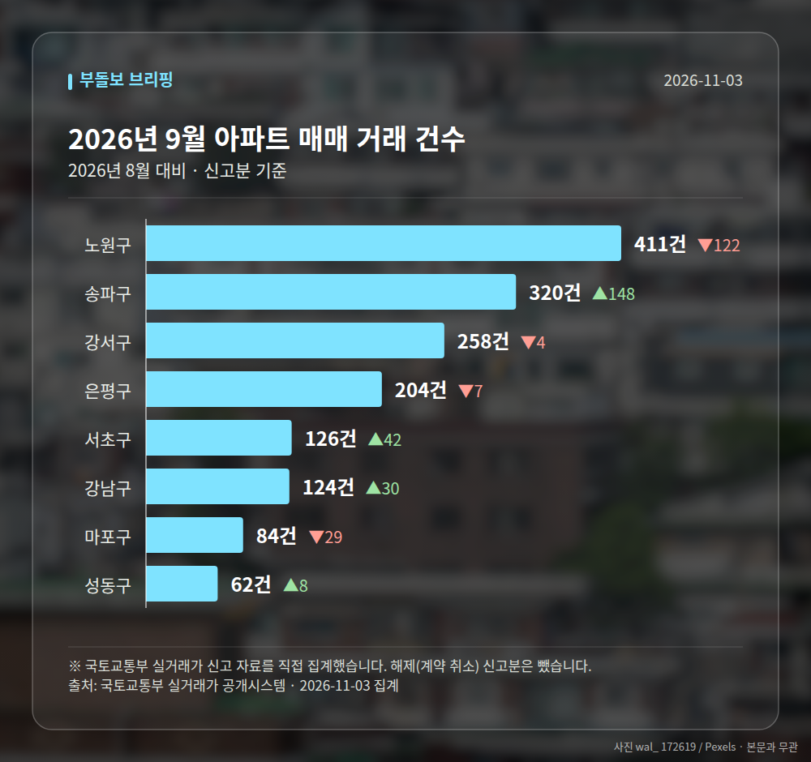

*이 글은 2026년 11월 3일 기준으로 정리한 내용입니다. 실거래 수치는 2026년 9월 신고분입니다.*
**3줄 요약**

- 서울 서초구 디에이치 반포124가 다음 달 1순위 청약에 들어갑니다
- 총 1801가구, 전용 84㎡ 예상 가점 커트라인은 69점입니다
- 가점이 낮다면 59㎡·특별공급·추첨제 조건부터 확인해 보세요
서울 서초구 디에이치 반포124 청약이 다음 달 8일 1순위 접수를 시작합니다. 총 1801가구 규모이고, 매일경제·부동산은 전용 84㎡ 가점 커트라인을 69점으로 예상했습니다.

가점이 높지 않다면 평형과 공급 유형을 나눠서 보는 쪽이 현실적이라는 이야기가 나옵니다. 오늘은 이 단지를 중심으로 짚어보겠습니다.

[이미지: 반포 일대 아파트 단지 전경 사진]

## 디에이치 반포124 청약, 숫자부터 정리하면

1순위(청약통장 가입 기간 등 요건을 채운 1차 신청 자격)는 12월 8일입니다.

| 항목 | 내용 |
|---|---|
| 총 가구수 | 1801가구 |
| 1순위 접수일 | 2026년 12월 8일 |
| 전용 84㎡ 예상 가점 커트라인 | 69점 |
| 예상 시세차익 | 30억원 안팎 |
| 거론되는 현금 보유 | 최소 20억원 |

출처는 모두 매일경제·부동산 보도입니다. 시세차익은 '기대된다'는 전망이고, 커트라인도 확정값이 아니라 예상치라는 점은 먼저 짚어두겠습니다.

## 가점이 낮다면 어디를 봐야 할까

가점(무주택 기간·부양가족 수·청약통장 가입 기간을 점수로 매긴 것)이 앞서 본 예상선에 못 미친다면 전용 84㎡ 경쟁은 쉽지 않습니다.

보도에서는 상대적으로 부담이 적은 59㎡에 경쟁이 몰릴 것으로 봤습니다. 신생아 가구는 특별공급을, 1주택자는 추첨제(가점과 상관없이 무작위로 뽑는 방식)를 살펴볼 만하다는 조언도 함께 나왔습니다.

다만 전제로 거론된 현금 최소 20억원은 당첨 이후 실제로 자금을 치를 수 있는지를 가르는 조건입니다. 평형 전략보다 자금 계획을 먼저 세우는 편이 순서에 맞습니다.

## 디에이치 반포124 청약에서 조심할 부분

이번 내용은 한 매체의 보도여서 다른 곳과 교차 확인이 어렵습니다. 예상 커트라인은 실제 결과와 달라질 수 있다는 점도 함께 기억해 두시면 좋겠습니다.

청약 전에는 모집공고문에 적힌 공급 유형별 물량과 자격 요건을 직접 확인하시는 편이 안전합니다.

## 그 밖의 오늘 소식

- 서울 아파트 거래량 21% 감소, 집값은 90주 연속 상승
- 경기·인천 중대형 아파트 거래량 15.8% 증가
- 당정, 민간 정비사업 용적률(땅 대비 건물 총면적 비율) 1.2배 완화 논의

**그래서 나는?**

- 무주택 실수요자라면, 본인 가점이 69점 예상선과 얼마나 떨어져 있는지부터 확인해 보세요
- 1주택자라면, 추첨제 물량이 있는 평형인지 모집공고문에서 따져볼 수 있습니다
- 자금 계획을 세우는 중이라면, 거론된 현금 20억원 전제가 본인 상황에 맞는지 먼저 보세요

**직접 센 숫자 — 2026년 9월 아파트 실거래**

서울 8개 구 신고 매매 **1589건** (2026년 8월 1523건, +66건)

거래가 많은 곳: 노원구 411건(-122) · 송파구 320건(+148) · 강서구 258건(-4)

노원구 전세가율 가운뎃값 **52.5%** (같은 단지·같은 면적 90곳)

서울 25개 구 가운데 거래가 가장 크게 움직인 곳: 송파구 +86.0%(172→320건, 장지동에 59.1% 몰림) · 서초구 +50.0%(84→126건)

2026년 10월 계약 신고가

- 마포구 영화블렌하임 103.86㎡ — 12.7억 (이전 최고 9.5억, +33.7%, 10월 26일 계약)
- 송파구 송파건원여미지아파트 51.76㎡ — 9.8억 (이전 최고 8.1억, +21.0%, 10월 20일 계약)

*국토교통부 실거래가 신고 자료를 직접 집계했습니다. 해제 신고분은 뺐습니다.*
**여러분은 이번 청약에서 평형과 가점 가운데 어느 쪽을 먼저 보고 계신가요?**

---

### 참고한 기사

1. **서울 집값 부담에 경기·인천 중대형 거래 늘었다**
   - [동아일보](https://news.google.com/rss/articles/CBMickFVX3lxTE9SVG91a0hiZlMxbk9ZeVZmY0FoUGNjc2VuZ3hyaU0wU0ZQVnozVEJsQ3lmbXpxdmpoR1pLaExWeVRqRmFKZnQzdlF0R2p0b2toYUVsbXJZQ2dlZ1RxOEw0Qm4xTTk2OWdtZXNvRUxuUUhhd9IBZkFVX3lxTFBUbHdzTGN6NmlPU2dYbDBRUG1WTUdtaVFmODVOblFPUkJXUXFpakJjV2VfQ0JwVnVNQmJMUnNENHhpVFhCQ1h1c3NvWUliMkZfTFVYUXVISk9NWkJUVi1HaW1OV05ZUQ?oc=5)
   - [아주경제](https://news.google.com/rss/articles/CBMiWkFVX3lxTE1kN2tUNzRRVmpDb0N2cVl6QU5yN2hhRjhINS1UT2FOWHY0X1VLU0dnaXJRNmZ3VVZJVXdraDhxLWJqZnFoTUUzNjVIZ3NqRkstV3Rhd0RqcWdid9IBWEFVX3lxTE5BWmFELTk4aFZtemhLeXZWWmkxUURfbkZNMnR3dE04ZFp4aF9XTGlMVHU1dXhOVXp5U3ZfcGhYeVFxcEprNmVzWHJZSUV6b0xoWGVzRTFQdHA?oc=5)
2. **부평구, ‘재개발·재건축 원스탑 지원센터’ 내년 신설 추진…‘현장에서 답을 찾다’**
   - [일간투데이](https://news.google.com/rss/articles/CBMia0FVX3lxTE9jdnFlcEpuSjJfVGUtSV9mRkFneDBTR285c2lOaDU1M1lZVjN0ZjlCdGNMSjdMTVgxWGpjelN3eThsZnBmdlFNaUtWbER1QW9JZ1Q4N0MtYy12VllTdlJoUGoxQU1ZdGxpUGN3?oc=5)
   - [뉴시스](https://news.google.com/rss/articles/CBMieEFVX3lxTE53THJwOW1FSWU1Ym4tbEIwWmpVTld5ejVoUlB6TnNlTXZiWHJwWGlpNllkaG9JVTRIb2NCZG9rcEJwVGZHbWdaRkljSHFNM0VKc1d5WExxcU51NExBM0ZoelRwTVZJV0RoSzF2QTBUZVNMR0JwbDNTMNIBeEFVX3lxTE53THJwOW1FSWU1Ym4tbEIwWmpVTld5ejVoUlB6TnNlTXZiWHJwWGlpNllkaG9JVTRIb2NCZG9rcEJwVGZHbWdaRkljSHFNM0VKc1d5WExxcU51NExBM0ZoelRwTVZJV0RoSzF2QTBUZVNMR0JwbDNTMA?oc=5)
3. **‘30억 전국민 로또’ 반포124 청약…가점 낮으면 이 평형 노리라는데**
   - [매일경제·부동산](https://www.mk.co.kr/news/realestate/12194101)
4. **대기업·공공기관 가까우니 달랐다…지방 청약 8곳 마감**
   - [매일경제·부동산](https://www.mk.co.kr/news/realestate/12194487)
5. **당정, 민간 용적률 1.2배 상향 추진한다는데…시장선 “임대비율 먼저 현실화 해야”**
   - [매일경제·부동산](https://www.mk.co.kr/news/realestate/12194434)
   - [세계일보](https://news.google.com/rss/articles/CBMiWEFVX3lxTE5XQ1R1NExILWo5RkhVY3A5M1QwRWx0UkJYOC1Kd0lsaUJKS253TjQ4NzFNWWdxV1hZVFJmSlM2ZENlQ0MtVkJCdER6RGlmdzZzN1RCVlNHSVLSAVRBVV95cUxNekw3a0Z5QzBLWmo5cHc2cWtNRFJycUJZZkpGNVhFNzRHWnBNN3dLV0QwTU0wbldnWU13TmZyRWJURUgyZ21jbGs0bnQwVHJLek5PT2I?oc=5)

---

*본 글은 공개된 언론 보도를 정리한 것이며, 투자 판단의 책임은 이용자 본인에게 있습니다.*
