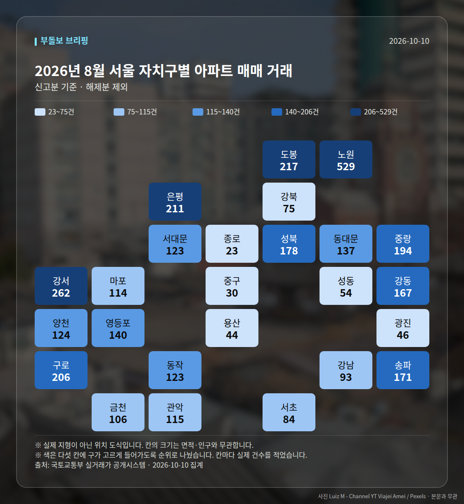
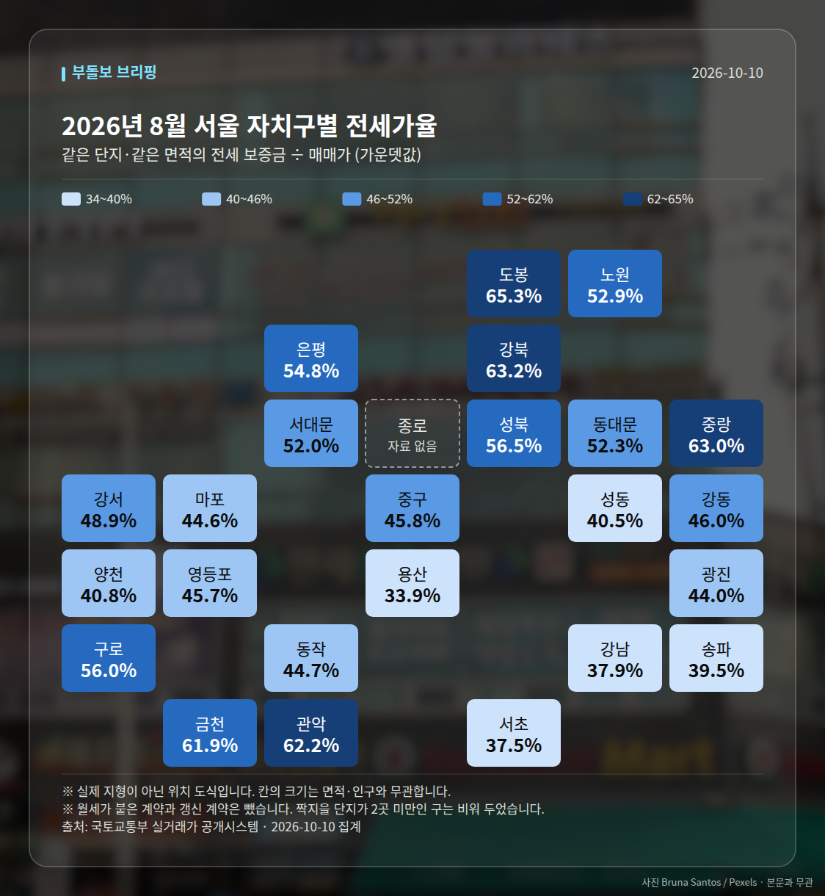

**2026년 10월 다섯 줄**

1. 서울 아파트값 90주 연속 상승 기록 경신
2. 강남·서초는 11주 하락, 강북 14개구 +0.26%
3. 10·15대책 1년, 성북 16.52% vs 강남 1.40%
4. 서울 전세가 6억4천만원 첫 돌파·월세 50% 넘김
5. 9월 확정 실거래 1,454건, 매매지수 +0.51

2026년 10월 서울 시장은 "상승 기록은 늘었지만, 상승 지역이 완전히 갈렸다"로 요약됩니다. 한국부동산원 기준 서울 아파트값은 10월 4주까지 90주 연속 상승했지만, 같은 기간 강남·서초는 11주 연속 하락했습니다.

숫자만 보면 '서울 상승'이지만, 자치구별로 들어가면 방향이 반대인 곳이 공존했습니다. 이달 내용을 주제별로 정리해 드립니다.

## 1. 기록은 90주, 그런데 상승폭은 줄었습니다

월초 브리핑에서는 86주 연속 상승(~2026년 9월 29일, 머니투데이·조선일보 등)이 역대 최장 기록으로 보도됐고, 이후 87주(10월 첫째 주, 주간 변동률 0.12%), 88주, 89주, 90주로 기록이 이어졌습니다. 86주간 누적 상승률은 17.6%로 보도됐습니다(데일리메이커).

다만 상승폭은 월 후반에 꺾였습니다. 한국부동산원 기준 서울 주간 변동률은 9월 넷째 주 0.09% → 0.12% → 0.16%로 확대됐다가, 10월 셋째 주 0.13%, 10월 4주 0.09%로 2주 연속 축소됐습니다. 10월 3주에는 25개 구 중 19곳의 상승률이 전주보다 낮아졌다는 집계도 나왔습니다(조세금융신문).

정부 쪽에서는 매물이 30% 쌓였다며 "집값 과열이 진정됐다"는 진단이 나왔고(파이낸셜뉴스·매일경제), 국토부 장관은 10월 7일 국감에서 연말에는 둔화·안정될 것이라고 전망했습니다. 반면 오세훈 서울시장은 정부와 다른 전망을 내놨고, LH 사장은 집값 급락 가능성을 언급했습니다. 전망 주체마다 방향이 달랐다는 점을 기억해 두시면 좋겠습니다.

## 2. 강남은 내리고, 강북·외곽은 신고가가 이어졌습니다

10월 셋째 주 한국부동산원 자료를 보면 격차가 분명합니다. 서초구 -0.32%(11주 연속 하락), 강남구 -0.31%(11주째), 송파구 -0.13%(7주째)였고, 반대로 성북·서대문 각 0.36%, 중구 0.35%, 도봉 0.33%, 중랑 0.31%였습니다. 강북 14개구 평균 0.26%, 강남 11개구 평균 0.02%로 묶어 보면 더 뚜렷합니다.

강남 재건축에서는 매물이 늘었습니다. 세제개편안 발표 이후 강남구 아파트값은 6주 연속 하락하고 매물 건수는 111.6% 증가했다는 집계가 나왔고(매일경제), 압구정 재건축 단지에서는 같은 평형 안에서 호가 차이가 최대 40억원까지 벌어졌다는 보도도 있었습니다. 동시에 압구정 신현대12차 182.95㎡ 100억원, 155.52㎡ 85억원, 반포 래미안퍼스티지 68억원 같은 초고가 거래도 실거래 시스템에 등록됐습니다.

반대편에서는 신고가가 한 달 내내 올라왔습니다. 상계주공14단지 59.39㎡ 6억 9천만원, 월계주공2단지 58.65㎡ 6억 5천만원, 구로두산 63.33㎡ 8억 6천만원, 성북 현대I-PARK 84.57㎡ 12억 9천만원, 중랑 면목동 현대 84.81㎡ 9억 1,500만원 등 모두 최근 3년 신고가로 기록됐습니다(매일경제·부동산). 강북 14개구 아파트 평균 매매가는 12억194만원으로 역대 최고치, 올해 상승률은 13%로 보도됐습니다.

## 3. 10·15대책 1년 성적표

10월 중순은 10·15 대책 1년 시점이었습니다. 시행 1년간 서울 아파트값 상승률은 10.42%로 집계됐고(뉴스투데이), 매체에 따라 10%, 10.4%로도 보도됐습니다.

자치구별로는 성북구가 16.52%로 1위, 강남구는 1.40%에 머물러 약 12배 차이가 났습니다(문화일보). 시장 평가는 100점 환산 기준으로 명시되지 않은 48.9점으로 보도됐습니다(파이낸셜뉴스).

자금조달 구조도 달라졌습니다. 2026년 1~8월 서울 주택 매입자금 71조1,278억원 가운데 증여·상속과 '그 밖의 차입금'을 합친 사적자금 비중이 11.55%로, 2025년 6.88%보다 4.67%포인트 올랐습니다. 반대로 취득주택 임대보증금 조달 비중은 6.51%로 2025년 14.83%에서 8.32%포인트 줄었습니다. 25개 구 중 광진구를 뺀 24개구에서 사적자금 비중이 임대보증금 비중을 넘어섰는데, 2021~2025년에는 없던 현상입니다(매일경제·부동산).

## 4. 전세는 6억4천만원, 월세 비중은 50%를 넘었습니다

10월 15일 기준 서울 전세가격이 6억4천만원을 처음 돌파했습니다(VOA 한국어). 시행 1년간 서울 전셋값도 10% 가까이 올랐다는 보도가 있었습니다(Queen 이코노미퀸).

같은 달 서울 아파트 월세 비중이 사상 처음 50%를 넘었고, 전세 거래는 27% 줄었습니다(CBC뉴스·동아일보). 국토부 장관의 '전세의 월세화' 발언은 논란이 됐습니다. 아파트 매수가 어려워진 수요가 옮겨간 흐름도 보입니다. 서울 연립·다세대 매수는 19% 늘었고(헤럴드경제), 서울 중형 오피스텔 매매가는 17개월 연속 상승(누적 3.17%), 월세는 전월 대비 0.37%로 2018년 통계 작성 이후 최고치를 기록했습니다.

## 5. 우리가 직접 센 9월 확정 실거래

아래는 국토교통부 실거래가 신고 자료를 저희가 직접 집계한 **2026년 9월** 수치입니다. 신고 기한 때문에 확정 월이 현재보다 두 달쯤 앞섭니다. 집계 기간은 2026년 10월 3일~10월 31일, 27일간이며 총 1,454건으로 직전 대비 7건 늘었습니다.

| 자치구 | 거래 건수 | 평균 거래가 |
| --- | --- | --- |
| 노원구 | 411건 | 7억 1,930만원 |
| 송파구 | 319건 | 11억 8,562만원 |
| 구로구 | 205건 | 7억 5,441만원 |
| 서초구 | 126건 | 26억 5,844만원 |
| 강남구 | 124건 | 28억 8,084만원 |

건수는 노원구가 411건으로 가장 많고, 평균가는 강남구 28억 8,084만원이 가장 높습니다. 건수와 가격의 순서가 반대라는 점이 이달 브리핑의 '강북 거래·강남 조정' 구도와 겹쳐 보입니다.

전세 중위가격(단위: 천만원)은 구로구 57.2(36건), 노원구 52.5(90건), 영등포구 48.3(30건), 성동구 43.9(19건), 송파구 42.5(48건) 순입니다. 지수는 매매 103.14(+0.51), 전세 103.31(+0.70)로 전세 쪽 변동폭이 조금 더 컸습니다.

## 6. 공급·청약은 '속도'가 쟁점이었습니다

공급 쪽은 숫자가 엇갈렸습니다. 서울 도심 공공주택 복합사업 후보지 11곳(1만8,000호)이 선정되고 서울 아파트 인허가는 전년 동기 대비 74% 늘었다는 집계가 있었지만(아시아경제), 국감에서는 LH 착공 실적이 연간 목표의 26%라는 지적이 나왔습니다. 장관은 수도권 착공 목표 80% 이상 달성을 자신한다고 답했습니다.

정부는 LH가 수도권 미분양 1만8,000가구에 대해 분양가의 85~92%로 매입을 확약하고, 조기 착공·500세대 이상 대단지에 최대 3%포인트를 가산하는 방안을 내놨습니다. 또 재개발·재건축 공사비 검증 미실시 사업장 138곳을 확인해 16곳 특별점검에 착수했고, 월말에는 서울 연내 정비사업 착공 3.1만호 지원 방침을 밝혔습니다.

청약은 쏠림이 셌습니다. 청주 가경 아이파크는 1순위 15만건, 경쟁률 630대 1로 지역 역대 최고였고, 올해 수도권 1순위 청약자 중 서울 집중 비율은 매체에 따라 60~64%로 보도됐습니다. 반면 부산 아파트 1순위 경쟁률은 0.6대 1이었습니다. 청년주택드림 청약통장 가입 소득기준은 5,000만원에서 7,000만원으로 상향됐습니다.

## 7. 다음 달 볼 것

- 서울 주간 변동률이 0.09%(10월 4주)에서 더 낮아지는지, 강남·서초 하락이 12주를 넘기는지
- 서울 월세 비중 50%와 전세가 6억4천만원이 유지·확대되는지
- 국토부의 서울 연내 정비사업 착공 3.1만호 지원과 LH 미분양 매입확약(1만8,000가구)의 실제 진행
- 금리 변수: 기준금리 3%, 주담대 4.66% 환경에서 변동형 금리 관련 보도가 어떻게 이어지는지

여기 적은 숫자는 모두 위 출처의 집계·전망치이며, 시장 방향을 단정하는 뜻은 아닙니다. 여러분의 판단에 참고 자료로만 써 주세요.

## 흐름이 바뀐 지점

- 10월 9일부터 강남3구 하락이 5주째로 길어지며 서울 상승과 방향이 갈렸습니다.
- 10월 셋째 주부터 서울 주간 변동률이 0.16%→0.13%→0.09%로 2주 연속 축소됐습니다.
- 10월 15일 서울 전세가 6억4천만원을 처음 돌파하고, 월세 비중이 50%를 처음 넘었습니다.
- 세제개편안 발표 이후 강남구는 6주 연속 하락하며 매물이 111.6% 늘었습니다.

## 2026년 10월에 확정된 실거래 (직접 집계)

신고 기한이 계약 후 30일이라 확정된 달은 지금보다 앞섭니다.
아래는 **2026년 9월** 신고분이고, 2026년 10월 동안 우리가 날마다 센 값의 마지막입니다.

2026년 9월 신고된 아파트 매매는 **1,454건**입니다.
이달에만 +7건이 더 신고됐습니다 — 가격이 아니라 신고가 쌓인 속도입니다.

| 지역 | 거래 건수 | 평균 거래가 |
| --- | ---: | ---: |
| 노원구 | 411건 | 7.2억 |
| 송파구 | 319건 | 11.9억 |
| 구로구 | 205건 | 7.5억 |
| 서초구 | 126건 | 26.6억 |
| 강남구 | 124건 | 28.8억 |

| 지역 | 전세가율 | 견준 단지 수 |
| --- | ---: | ---: |
| 구로구 | 57.2% | 36곳 |
| 노원구 | 52.5% | 90곳 |
| 영등포구 | 48.3% | 30곳 |
| 성동구 | 43.9% | 19곳 |
| 송파구 | 42.5% | 48곳 |

주간 가격지수(2026-10-03 → 2026-10-31)
- 매매 103.14 (+0.51)- 전세 103.31 (+0.70)

## 실거래 지도

<small>2026-10-10 집계본입니다. 실제 지형이 아닌 위치 도식이고, 칸 안의 숫자가 실제 값입니다.</small>

*국토교통부 실거래가 신고 자료를 날마다 직접 집계한 값입니다. 해제 신고분은 뺐습니다.*

## 다음 달 볼 것

- 서울 주간 변동률이 0.09%(10월 4주)보다 더 낮아지는지, 강남·서초 하락이 12주를 넘기는지
- 서울 월세 비중 50%와 전세가 6억4천만원 수준이 유지·확대되는지
- 서울 연내 정비사업 착공 3.1만호 지원과 LH 미분양 매입확약 1만8,000가구의 실제 진행
- 기준금리 3%·주담대 4.66% 환경에서 대출금리 관련 보도 흐름

---

*2026년 10월 브리핑 31일치를 묶은 결산입니다. 본 글은 공개된 언론 보도를 정리한 것이며, 투자 판단의 책임은 이용자 본인에게 있습니다.*
