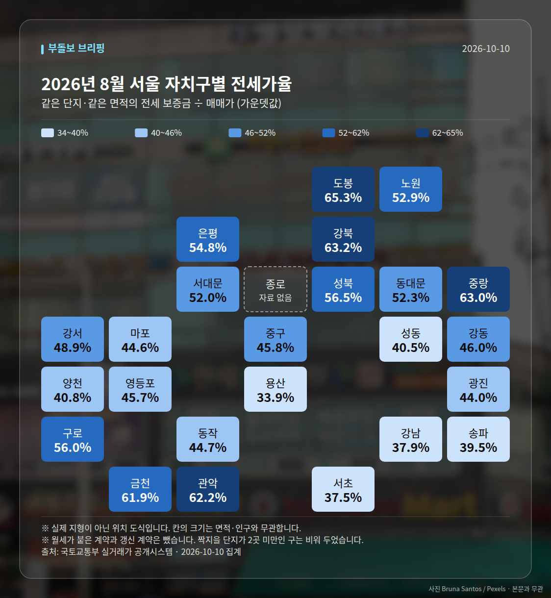

**이번 주 다섯 줄**

1. 서울 아파트값 88주 연속 상승(10/15 기준)
2. 10·15대책 1년, 서울 10.42% 상승·평가 48.9점
3. 강남 1.40% vs 성북 16.52%, 격차 12배
4. 서울 전셋값 첫 6억4천만원 돌파
5. 수도권 착공 목표 26.8만가구, 최대 5만 미달

이번 주 시장은 "서울 중심의 가격 상승은 88주째 이어지는데, 공급 실적과 정책 평가는 뒤처져 있다"는 한 문장으로 정리됩니다.

여러분이 체감하시는 상승세와, 정부가 내놓은 착공 목표·규제 효과 사이의 간격이 이번 주 숫자들에서 그대로 드러났습니다. 아래에서 주제별로 묶어 보겠습니다.

## 10·15대책 1년, 숫자로 본 성적표

이번 주 내내(10/12~10/17) 반복해 다뤄진 주제는 10·15 대책 시행 1년 평가였습니다. 주 초반에는 "서울 아파트값 10.42% 상승, 성북구 상승률 1위"라는 뉴스투데이 보도가 중심이었고, 중반 이후에는 지역 격차와 정책 평가 점수로 논점이 옮겨갔습니다.

| 날짜 | 지표 | 수치 | 출처 |
|---|---|---|---|
| 10/12 | 서울 아파트값 상승률(1년) | 10.42% | 뉴스투데이 |
| 10/14 | 서울 집값 상승률(1년) | 10% / 10.4% | 한국일보 외 / Queen 이코노미퀸 |
| 10/14 | 서울 아파트 전셋값 상승률 | 9.96% | 매일경제·부동산 |
| 10/14 | 강남구 변동률 | 1.40% | 문화일보 |
| 10/14 | 성북구 변동률 | 16.52%(16.5%) | 문화일보(더퍼블릭) |
| 10/14 | 10·15대책 1년 시장 평가 | 48.9점 | 파이낸셜뉴스 |

같은 1년을 두고 매체별로 10%와 10.42%, 성북구 16.5%와 16.52%처럼 수치가 조금씩 다릅니다. 집계 기준이 다를 수 있으니 하나의 숫자를 단정해 받아들이기보다 "10% 안팎 상승" 정도의 범위로 보시는 편이 안전합니다. 파이낸셜뉴스가 전한 평가 점수 48.9점은 만점 기준이 기사에 명시되지 않았다는 점도 함께 기억해 두시면 좋겠습니다.

## 상승은 88주, 그런데 지역은 갈라졌습니다

10월 15일 기준으로 서울 아파트 매매가격은 88주 연속 상승했다고 뉴시스·MBC뉴스·조선비즈 등이 보도했고, 10월 18일에도 시사저널e 등 복수 매체가 같은 88주를 언급했습니다. 다만 같은 보도들이 강남3구는 하락, 강북·외곽·경기 남부는 상승이라고 짚은 점이 이번 주의 핵심입니다.

전세 쪽에서는 서울 전세가격이 6억4천만 원을 역대 처음 돌파했다는 VOA 한국어 보도가 나왔습니다. 아파트 매수가 어려워지자 서울 연립·다세대 매수가 19% 늘었다(헤럴드경제)는 수치도 같은 날 함께 전해졌습니다.

신고가 거래는 주 중반부터 꾸준히 등록됐습니다. 10월 11일 등록분으로 은평구 백련산파크자이 전용 84.901㎡가 11억 4500만 원, 응암푸르지오 전용 84.2㎡가 8억 7800만 원에 최근 3년 신고가를 기록했고(국토교통부 실거래가 시스템), 13일 등록분에서는 강북구 벽산라이브파크 8억 3천만 원, 성북구 현대I-PARK 12억 9천만 원, 중랑구 면목동 현대 9억 1500만 원 등이 이어졌습니다.

| 날짜(등록) | 단지·전용 | 거래가 |
|---|---|---|
| 10/13 | 용산 삼성래미안 114.99㎡ | 21억 8천만 원 |
| 10/15 | 영등포 당산삼성래미안4차 84.94㎡ | 23억 5천만 원 |
| 10/15 | 동작 상도동 동원베네스트 84.958㎡ | 16억 3천만 원 |
| 10/15 | 마포 중동 현대 59.55㎡ | 10억 2500만 원 |
| 10/15 | 노원 상계주공9단지 66.56㎡ | 7억 9800만 원 |

반면 주택유형별로는 온도가 달랐습니다. 한국부동산원 집계로 2026년 3분기 전국 오피스텔 매매가격은 0.33% 하락했고 월세는 0.86% 상승했으며, 대구는 매매 -0.86%, 울산은 -0.35%였습니다. 대구 아파트 전셋값은 13주 연속 상승(대구MBC)인데 경북은 하락폭이 확대돼, 지역·유형별 편차가 컸습니다.

## 공급은 목표에 못 미쳤습니다

10월 17일 보도된 수도권 착공 전망이 이번 주 가장 무거운 숫자였습니다. 정부는 2026년 수도권 착공 목표 26만8000가구 가운데 실제는 21만8000~23만5000가구에 그쳐 최대 5만 가구가 부족할 것으로 전망했습니다(매일경제·부동산).

| 날짜 | 항목 | 실적 | 목표·달성률 |
|---|---|---|---|
| 10/17 | 1~9월 누적 착공 | 9만9000가구 | 연간 목표의 약 37% |
| 10/17 | 민간 정비사업 | 1만7000가구 | 7만2000가구, 23.6% |
| 10/17 | 공공주택 | 1만6200가구 | 6만2000가구, 약 26% |
| 10/17 | 신축매입주택 | 1만3000가구 | 4만2000가구, 31% |
| 10/14 | LH 착공 실적(국감) | — | 목표의 26% |

정비사업 쪽에서는 관리 이슈도 나왔습니다. 10월 14일 기준 공사비 검증을 하지 않은 사업장 138곳이 확인돼 국토부가 16곳에 대해 특별점검에 착수했습니다(한겨레·MBC뉴스·대한경제 등). 서울시는 10월 15일부터 11월 25일까지 25개 자치구를 돌며 정비사업 아카데미 현장 강좌 20회를 운영합니다. 8월 1차에 2000명이 참여한 데 따른 2차 운영입니다(조선비즈).

## 금리와 청약, 방향이 엇갈렸습니다

10월 18일에는 한국은행의 11월 금리 인상 가능성과 변동형 대출금리 6% 돌파 우려가 제기됐습니다(데일리머니). 다만 이 6%는 기사 제목에서만 언급되고 세부 산출 근거가 제시되지 않았으니, 확정된 수치가 아니라 제기된 우려로 구분해 보셔야 합니다.

정책은 문턱을 낮추는 방향도 함께 보였습니다. 국토교통부는 청년주택드림 청약통장 가입 소득기준을 5000만 원에서 7000만 원으로 2000만 원 올리고 디딤돌·버팀목 완화도 예고했습니다(매일경제). 반면 10월 13일 국정감사에서 이성훈 LH 사장은 "집값이 급락할 것"이라고 발언해, 같은 주 안에서도 시장 신호가 엇갈렸습니다.

분양 일정으로는 KCC건설의 화성 향남역 그로브 스위첸이 견본주택을 열었고, '아크메르 동탄'은 10월 16일 견본주택 개관 후 26일 특별공급, 27일 1순위, 28일 2순위 접수를 진행합니다. 전매제한은 3년이며 실거주의무는 적용되지 않습니다(매일경제·부동산). 삼성물산은 반포푸르지오 리모델링에 'N캔버스'를 적용한 전용 84㎡ 특화 평면을 제안했고, 시공사 선정 총회는 10월 24일 예정입니다.

## 다음 주 볼 것

- 10월 24일 반포푸르지오 리모델링 시공사 선정 총회 결과
- 10월 26~28일 '아크메르 동탄' 특별공급·1순위·2순위 청약 접수
- 서울 전역 토지거래허가제 연장 여부 결정
- 한국은행 11월 금리 결정 관련 발언과 주간 서울 아파트값 상승 지속 여부(현재 88주)

여기 담긴 숫자는 모두 해당 주 보도와 기관 발표를 그대로 옮긴 것이며, 매체별 수치 차이가 있는 항목은 함께 표기했습니다. 투자 판단은 여러분의 자금 여건과 원문 확인을 거쳐 내리시길 권합니다.

## 이번 주 실거래 (직접 집계)

2026년 8월 신고된 아파트 매매는 **1,522건**입니다.
이번 주에만 +255건이 더 신고됐습니다.

| 지역 | 거래 건수 | 평균 거래가 |
| --- | ---: | ---: |
| 노원구 | 532건 | 7.1억 |
| 강서구 | 262건 | 9.5억 |
| 은평구 | 211건 | 8.6억 |
| 송파구 | 171건 | 20.6억 |
| 마포구 | 114건 | 14.6억 |

주간 가격지수(2026-10-12 → 2026-10-18)
- 매매 102.91 (+0.17)- 전세 102.97 (+0.19)

## 실거래 지도

<small>2026-10-10 집계본입니다. 실제 지형이 아닌 위치 도식이고, 칸 안의 숫자가 실제 값입니다.</small>

*국토교통부 실거래가 신고 자료를 날마다 직접 집계한 값입니다. 해제 신고분은 뺐습니다.*

---

### 다음 주 볼 것

- 10월 24일 반포푸르지오 리모델링 시공사 선정 총회 결과
- 10월 26~28일 '아크메르 동탄' 특별공급·1순위·2순위 청약 접수
- 서울 전역 토지거래허가제 연장 여부 결정
- 한국은행 11월 금리 결정 관련 발언과 서울 아파트값 88주 상승 지속 여부

---

*본 글은 공개된 언론 보도를 정리한 것이며, 투자 판단의 책임은 이용자 본인에게 있습니다.*
