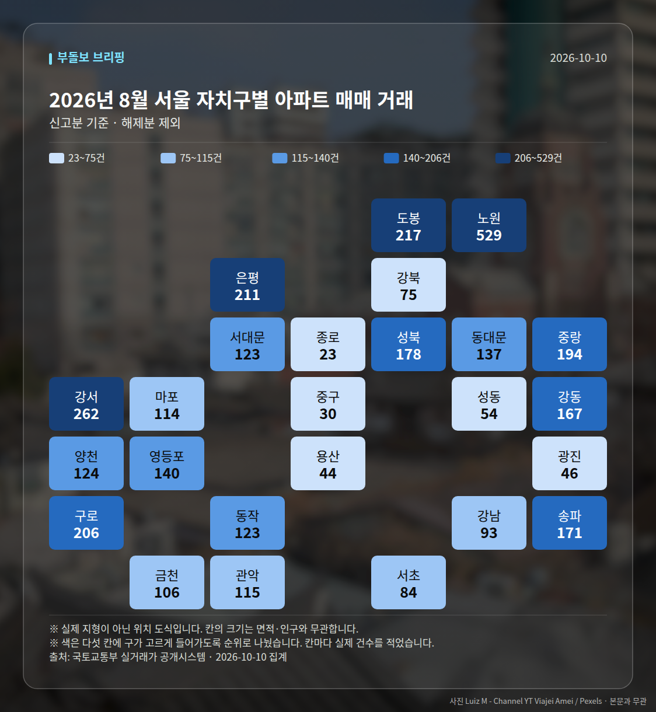

**이번 주 다섯 줄**

1. 서울 아파트값 89주 연속 상승, 주간 0.13%로 둔화
2. 강남구 9월 -1.65%, 강남·서초 10주 연속 하락
3. 서울 아파트 월세 비중 사상 첫 50% 돌파
4. 세종 10월 2주 0.02% 상승 전환, 신고가 잇따라
5. 청주 가경 아이파크 청약 630대 1, 지역 최고

이번 주 시장은 한 문장으로 "서울 전체는 89주째 오르지만 속도가 느려지고, 강남3구는 10주 연속 내리는 엇갈린 국면"으로 정리됩니다. 여기에 월세 비중 50% 돌파와 지방 일부의 청약 열기가 겹쳐, 지역·지표별로 방향이 따로 움직인 한 주였습니다.

아래 숫자는 모두 이번 주 공개된 자료와 보도에 근거한 것이며, 앞으로의 가격 방향을 단정하는 내용은 아닙니다. 판단은 여러분의 상황에 맞춰 보시는 편이 좋겠습니다.

## 1. 서울은 89주 상승, 강남은 10주 하락

한국부동산원 기준 10월 3주 서울 아파트값은 89주 연속 상승을 이어갔습니다. 다만 주간 상승률은 0.13%로 둔화됐고, 25개 구 중 19곳의 상승률이 전주보다 낮아졌다고 조세금융신문은 전했습니다.

반대로 강남권은 방향이 다릅니다. 국토교통부는 9월 월간 기준 강남구 -1.65%, 서초구 -1.25%, 송파구 -0.45%를 제시하며 강남·서초가 10주 연속 하락 중이라고 밝혔습니다. 같은 서울 안에서 중심부는 내리고 외곽은 오르는 역전 구도가 이번 주 가장 또렷한 그림이었습니다.

| 날짜 | 지표 | 수치 | 출처 |
|---|---|---|---|
| 10-23 | 서울 아파트값 연속 상승 | 89주 | 한국부동산원 보도 |
| 10-23 | 서울 주간 상승률(10월 3주) | 0.13% | 뉴스락 |
| 10-23 | 상승률 낮아진 구 | 19개 구 | 조세금융신문 |
| 10-23 | 전국 매매 / 전세(10월 3주) | 0.08% / 0.11% | 한국부동산원 |
| 10-19 | 강남·서초 연속 하락 | 10주 | 국토부 |
| 10-19 | 9월 강남/서초/송파 | -1.65% / -1.25% / -0.45% | 국토부 |

## 2. '하향 안정' 진단과 '우상향' 전망이 맞붙었습니다

국토부는 거래량 감소(5월 8900건→8월 4600건), 매물 증가(연초 5만7000건→약 7만4000건, 약 30%↑), 갭투자 비중 급감(지난해 10월 37.9%→올해 8월 6.1%)을 근거로 하향 안정 국면이라고 진단했습니다. 국토연구원의 서울 주택매매 소비심리지수도 7월 139.9에서 9월 130.8로 두 달 연속 내렸습니다.

반면 오세훈 서울시장은 19일과 20일에 걸쳐 정부 정책을 비판하며 "서울 집값이 내년 초까지 우상향할 가능성"을 언급했습니다. 24일 국정감사에서 국토부 장관은 상승폭 둔화와 연말 금리 상향 시 안정화 가능성을 전망했고, 급등·급락 양쪽 모두에 대응책을 마련하겠다고 밝혔습니다. 같은 주, 같은 시장을 두고 전망 주체마다 결론이 달랐다는 점을 기억해 두시면 좋겠습니다.

## 3. 공급: 인허가는 늘었지만 착공·입주는 아직

국토부는 3~8월 서울 주택 인허가가 3만6000가구로 전년 동기 2만1000가구 대비 74% 늘었다고 밝혔습니다. 다만 착공은 1만7000가구로 45% 증가했을 뿐 10년 평균 3만1000가구에는 미치지 못합니다. 수도권 입주 물량은 2023년 20만4000가구에서 올해 10만5000가구 전망으로, 10년 평균 18만가구보다 약 42% 적습니다.

국토부는 3기 신도시 입주가 올해 1300가구에서 2028년 1만가구 이상으로 늘며 수급이 개선될 것으로 전망했습니다. 21일 이재명 대통령은 인천 계양지구를 찾아 착공 시점을 최대한 앞당기고 2030년까지 공공주택 착공 90%를 달성하라고 주문했습니다. 22일에는 계양신도시 첫 민간분양인 반도건설 '카이브 유보라'(1110가구, 전용 84~93㎡) 견본주택이 개관했습니다.

## 4. 월세 50% 돌파와 신고가의 확산 경로

서울 아파트 월세 비중이 사상 처음 50%를 넘었고, 전세 거래는 27% 줄었습니다(동아일보). 국토부 장관은 23일 '전세의 월세화' 원인을 1인가구·전세사기로 설명해 여야 비판을 받았고, 24일에는 공급 부족이 원인이라고 다시 밝혔습니다.

신고가는 19일 성북·노원·서대문·구로·관악에서 시작해 21일 동대문·노원·도봉, 24일 송파(문정래미안 21억 3천만원)·서초(양재동 우성 22억 1천만원), 25일 은평·강북·금천·중랑·양천(목동파크자이 21억 2천만원)으로 이어졌습니다. 압구정 신현대12차 92억원, 반포 아크로리버파크 62억 8천만원 거래도 확인됐습니다. 모두 '최근 3년 내 신고가'이며, 단지별 개별 거래라는 점은 유의해서 보셔야 합니다.

## 5. 지방: 세종 상승 전환, 청주 청약 630대 1

세종은 한국부동산원 기준 10월 둘째주 매매가격이 0.02%로 상승 전환했습니다. 나성동 나릿재6단지 전용 84㎡가 10억9000만원(직전 대비 7000만원↑), 새뜸13단지가 8억5000만원, 가온9단지 전용 59㎡가 4억6000만원에 신고가를 기록했습니다. 소비심리지수는 7월 101.5에서 9월 125.3으로 두 달 새 23.8포인트 올라 전국 2위였습니다. 공무원 1만명 유입 예고로 전셋값이 먼저 움직인다는 보도도 나왔습니다.

청약에서는 청주 가경 아이파크 7·8단지가 접수 16만건(1순위 15만건), 경쟁률 630대 1로 지역 역대 최고를 기록했습니다. 25일 기준 이번 주에는 수도권·부산 중심으로 9개 단지 5555가구 청약이 예정돼 있습니다. 규제지역 확대 후 비규제지역 상승폭이 커지는 풍선효과 보도도 22일 함께 나왔습니다.

## 다음 주 볼 것

- 10월 4주 한국부동산원 주간 통계: 서울 90주 연속 상승 여부와 0.13%에서의 상승폭 변화
- 강남3구 하락이 11주로 이어지는지, 비강남권 신고가 흐름이 계속되는지
- 연말 금리 방향과 토지거래허가구역 해제·조합원 지위 양도 완화 검토의 진행 상황
- 이번 주 청약 예정 9개 단지 5555가구의 경쟁률과 청주·세종 등 지방 열기의 지속 여부

## 이번 주 실거래 (직접 집계)

2026년 8월 신고된 아파트 매매는 **1,386건**입니다.
이번 주에만 +37건이 더 신고됐습니다.

| 지역 | 거래 건수 | 평균 거래가 |
| --- | ---: | ---: |
| 노원구 | 533건 | 7.1억 |
| 은평구 | 211건 | 8.6억 |
| 송파구 | 171건 | 20.6억 |
| 양천구 | 125건 | 13.0억 |
| 마포구 | 114건 | 14.6억 |

주간 가격지수(2026-10-19 → 2026-10-25)
- 매매 103.04- 전세 103.13

## 실거래 지도

<small>2026-10-10 집계본입니다. 실제 지형이 아닌 위치 도식이고, 칸 안의 숫자가 실제 값입니다.</small>

*국토교통부 실거래가 신고 자료를 날마다 직접 집계한 값입니다. 해제 신고분은 뺐습니다.*

---

### 다음 주 볼 것

- 10월 4주 한국부동산원 주간 통계: 서울 90주 연속 상승 여부와 0.13% 상승폭 변화
- 강남3구 하락이 11주로 이어지는지, 비강남권 신고가 흐름 지속 여부
- 연말 금리 방향과 토지거래허가구역 해제·재건축 조합원 지위 양도 완화 검토 진행
- 이번 주 청약 예정 9개 단지 5555가구 경쟁률, 청주·세종 등 지방 청약 열기 지속 여부

---

*본 글은 공개된 언론 보도를 정리한 것이며, 투자 판단의 책임은 이용자 본인에게 있습니다.*
