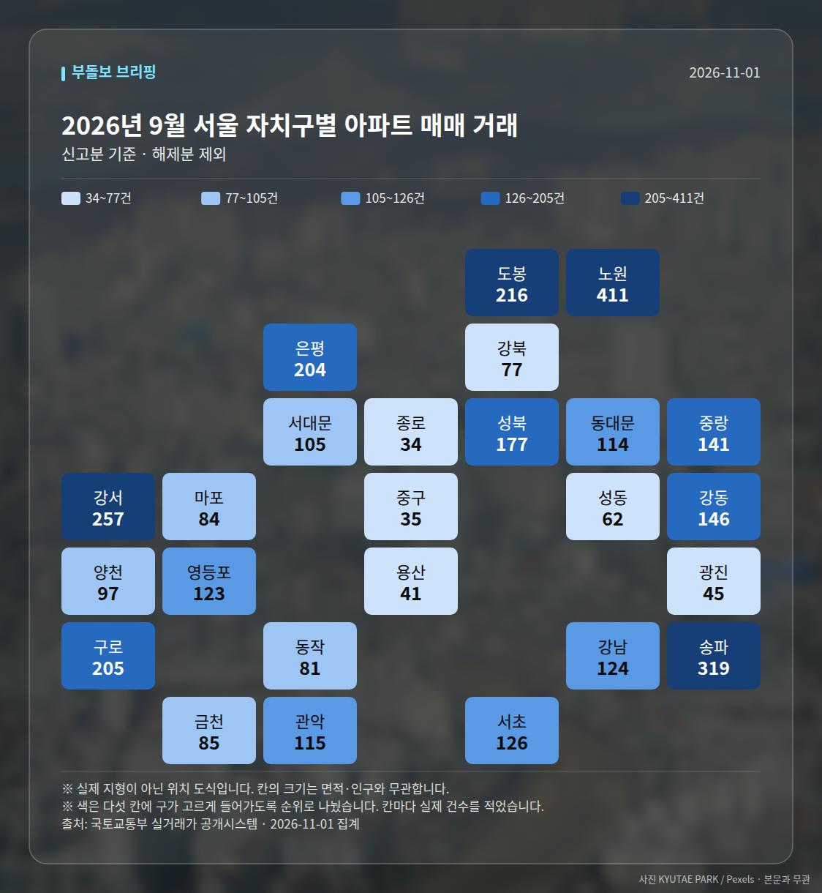
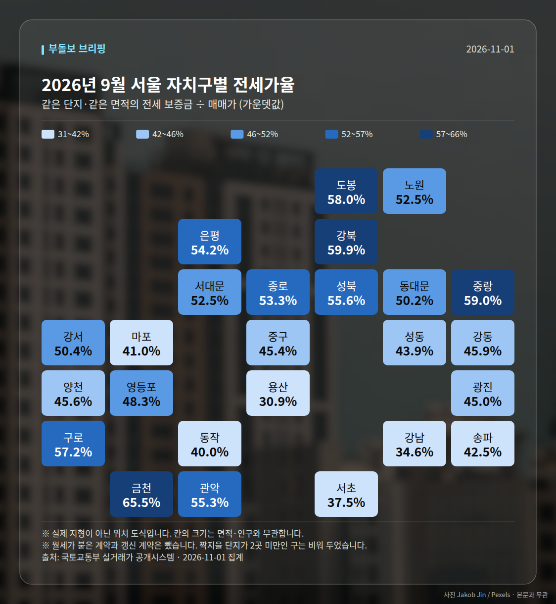

**이번 주 다섯 줄**

1. 서울 아파트값 90주 연속 상승, 10월 4주 0.09%
2. 강남·서초 12주 하락, 매물 111.6% 증가
3. 강북 평균 12억194만원 역대 최고, 올해 13%↑
4. 경기 0.20%, 서울의 2배…분당 1년간 22.3%↑
5. 3분기 서울 84㎡ 매매 -2.5%, 전세 +3.8%

이번 주 시장을 한 문장으로 정리하면, **서울 전체는 90주 연속 상승 기록을 이어갔지만 상승 속도는 둔화됐고, 강남3구와 그 밖의 지역이 서로 반대 방향으로 움직인 한 주**였습니다. 같은 서울 안에서도 숫자의 부호가 갈렸다는 점이 이번 주의 핵심입니다.

## 상승은 이어졌지만 속도는 느려졌습니다

한국부동산원 집계에서 서울 아파트 매매가격은 10월 셋째 주 0.13%로 전주 0.16%보다 오름폭이 줄었고, 10월 4주에는 0.09%(국토매일 기준 0.07%)로 2주 연속 축소됐습니다. 연속 상승 기간은 89주에서 90주로 늘어나 역대 최장 기록이 이어졌습니다.

월간 지표도 같은 방향입니다. KB부동산 기준 10월 서울 아파트값은 0.61% 올라 올해 월간 상승률 중 가장 낮았고, 5개월 만에 1% 아래로 내려왔습니다. '상승 지속'과 '상승 둔화'가 동시에 성립하는 구간이라는 점을 함께 보셔야 합니다.

| 날짜 | 지표 | 값 | 출처 |
|---|---|---|---|
| 10/27~28 | 서울 주간 변동률(10월 3주) | 0.13% (전주 0.16%) | 한국부동산원 |
| 10/30 | 서울 주간 변동률(10월 4주) | 0.09% / 0.07% | 한국부동산원 집계 보도 |
| 10/30 | 연속 상승 기간 | 90주 | 한국부동산원 |
| 10/26~27 | 10월 서울 월간 변동률 | 0.61% | KB부동산 |

## 강남은 식고, 강북·외곽은 신고가

강남3구는 흐름이 다릅니다. 10월 셋째 주 서초구 -0.32%, 강남구 -0.31%, 송파구 -0.13%로 각각 11주·11주·7주 연속 하락했고, 10월 30일 보도에서는 강남·서초의 하락이 12주로 늘었습니다. 31일 보도된 강남3구 6주 연속 동반 하락과 세제개편안 발표 이후 매물 건수 111.6% 증가는 매물이 쌓이는 쪽 변화로 제시된 숫자입니다.

반대편에서는 신고가가 이어졌습니다. 10월 26일 노원·강서·강동·구로, 29일 중랑·동대문, 31일 송파·영등포·구로·강서·광진 등으로 신고가 등록 지역이 주 내내 바뀌며 번졌습니다. 강북 14개구 평균 변동률은 0.26%로 강남 11개구 0.02%와 벌어졌고, 강북 아파트 평균 매매가는 12억194만원으로 처음 12억원을 넘어 역대 최고(올해 13% 상승, 최근 반년 약 1억원 상승)로 집계됐습니다.

| 날짜 | 단지·면적 | 거래가 | 비고 |
|---|---|---|---|
| 10/26 | 하계동 미성 84.94㎡ | 9억 9천만원 | 최근 3년 신고가 |
| 10/26 | 명일지에스 84.9㎡ | 15억 8천만원 | 최근 3년 신고가 |
| 10/29 | 장안현대홈타운 112.78㎡ | 15억 3500만원 | 최근 3년 신고가 |
| 10/29 | 전농동 래미안아름숲 84.92㎡ | 15억원 | 동일 면적 신고가 |
| 10/31 | 강서힐스테이트 84.99㎡ | 16억 9500만원 | 최근 3년 신고가 |
| 10/31 | 문래힐스테이트 137.82㎡ | 21억원 | 최근 3년 신고가 |

## 경기 상승률이 서울의 2배, 분당이 중심

10월 4주 경기 변동률은 0.20%로 서울 0.09%의 두 배였고, 매일경제는 이런 역전이 5년 만이라고 전했습니다. 군포·영통 0.58%, 기흥 0.54%, 비규제지역인 병점 0.44% 등 수도권 남부가 상위권이었습니다.

분당은 작년 10월 20일 대비 올해 9월 19일 기준 22.3% 올라 전국 상승률 1위로 집계됐습니다(한국부동산원). 올해 1~9월 서울 집합건물을 매입한 경기·인천 거주자 2만4993명 중 분당구 거주자가 1661명(6.6%)으로 가장 많았고, 이 중 589명(35.5%)이 강남·서초·송파를 택했습니다.

## 전세·오피스텔로 번진 수요, 그리고 정책

임대차 쪽 신호도 함께 나왔습니다. 서울 전세가격은 10월 셋째 주 0.16%(전주 0.18%), 4주 0.10%로 상승폭이 줄었지만, 3분기 기준으로는 서울 84㎡ 평균 매매가가 전년 대비 -2.5%인 반면 평균 전세보증금은 3.8% 올랐습니다. 11월 1일 보도에서는 서울 전세가격 상승률이 매매가격을 넘어섰고 서초를 제외한 전역이 올랐다고 전했습니다. 서울 중형 오피스텔 매매가는 17개월 연속(누적 3.17%), 대형은 18개월 연속 상승했고 월세는 0.37%로 2018년 통계 작성 이후 최고치였습니다.

정책 쪽에서는 국토부가 3기 신도시 교통사업 직접 인허가 대상을 7곳으로 늘리고(10/26~27), 1~2주 단위 전수점검과 신속추진 TF 가동(10/29)까지 한 주 사이 관리 강도를 높였습니다. 또 8·13 대책 후속으로 서울 연내 정비사업 3.1만호 착공 지원이 발표됐고(브릿지경제는 수도권 7.2만 가구로 보도), 서초구의 재건축초과이익환수 1호 부담금 연내 부과 예고와 국민의힘의 3+3 여야 협의체 제안도 나왔습니다. 이 대통령은 자산시장 정상화 기조를 유지한다고 재확인했습니다.

청약은 10월 26~30일 전국 8곳 5555가구(아크메르 동탄 1808가구, 신분평 에피트 더웨이시티 992가구 전량 일반분양)가 진행됐고, 올해 수도권 1순위 청약자 중 서울 신축에 몰린 비중은 매체별로 60~64%로 집계됐습니다. 서울 공급 비중이 6%라는 점과 함께 보면 쏠림의 배경을 가늠할 수 있습니다.

## 다음 주 볼 것

- 11월 첫째 주 전국 5곳 4928가구 청약(고덕강일3단지 포함) 접수 결과
- 한국부동산원 주간 동향: 서울 상승폭 3주 연속 축소 여부와 강남·서초 하락 주차
- 서초구 재건축초과이익환수 1호 부담금의 연내 부과 진행 상황
- 국토부 3기 신도시 광역교통 전수점검 결과와 서울 연내 3.1만호 착공 지원 후속 조치

여러분, 이 글은 한 주간 공개된 지표와 보도를 정리한 기록입니다. 지역·단지별 사정이 크게 다르므로 개별 판단은 직접 확인하신 자료를 바탕으로 하시길 권합니다.

## 이번 주 실거래 (직접 집계)

2026년 9월 신고된 아파트 매매는 **1,587건**입니다.
이번 주에만 +69건이 더 신고됐습니다.

| 지역 | 거래 건수 | 평균 거래가 |
| --- | ---: | ---: |
| 노원구 | 411건 | 7.2억 |
| 송파구 | 319건 | 11.9억 |
| 강서구 | 257건 | 8.4억 |
| 은평구 | 204건 | 8.0억 |
| 서초구 | 126건 | 26.6억 |

주간 가격지수(2026-10-26 → 2026-11-01)
- 매매 103.14 (+0.09)- 전세 103.31 (+0.17)

## 실거래 지도

<small>2026-11-01 집계본입니다. 실제 지형이 아닌 위치 도식이고, 칸 안의 숫자가 실제 값입니다.</small>

*국토교통부 실거래가 신고 자료를 날마다 직접 집계한 값입니다. 해제 신고분은 뺐습니다.*

---

### 다음 주 볼 것

- 11월 첫째 주 전국 5곳 4928가구 청약(고덕강일3단지 포함) 접수 결과
- 한국부동산원 주간 동향: 서울 상승폭 3주 연속 축소 여부와 강남·서초 하락 주차
- 서초구 재건축초과이익환수 1호 부담금의 연내 부과 진행 상황
- 국토부 3기 신도시 광역교통 전수점검 결과와 서울 연내 3.1만호 착공 지원 후속 조치

---

*본 글은 공개된 언론 보도를 정리한 것이며, 투자 판단의 책임은 이용자 본인에게 있습니다.*
